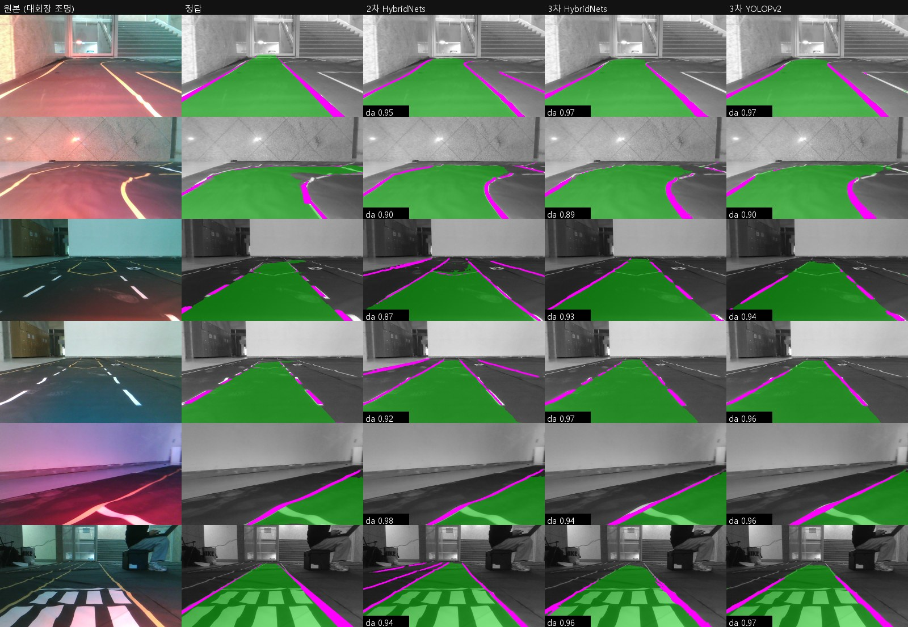
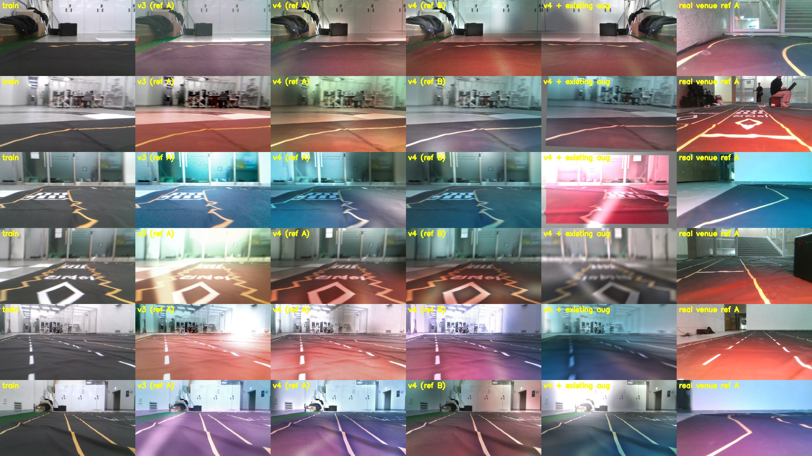
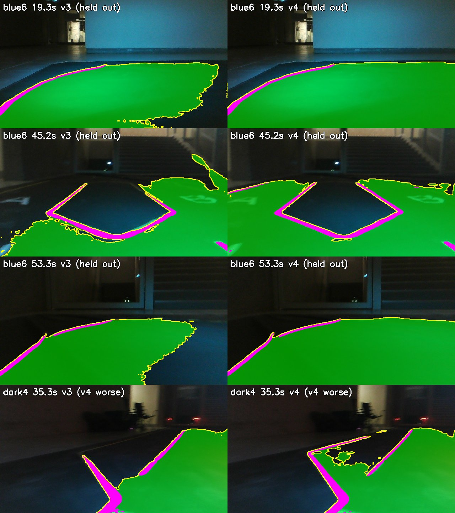

# LimoPro_FOSCAR_Vision

AutoRace 2026 참가팀 FOSCAR의 차선 인식 모델 저장소입니다. BDD100K로 학습된 공개 모델을 LIMO PRO 카메라 영상과 대회 트랙에 맞게 파인튜닝합니다.

모델은 영상에서 두 가지를 찾습니다.

- **da (주행가능영역):** 차가 지금 달리는 차로. 3차선 구간과 A/B 갈림길도 예외 없이 내 차로만 칠합니다.
- **ll (차선):** 차선 위치



*11/06 대회장 조명 사진 중 학습에 쓰지 않은 test 프레임입니다. 초록은 da, 분홍은 ll이고, 칸 아래 숫자는 정답과 비교한 da IoU입니다. 색 조명과 섞이지 않게 흑백 위에 그렸습니다.*

## 현재 상태 (2026-11-08)

- 1·2·3차 파인튜닝을 마쳤고 가중치는 [Releases](https://github.com/mastic-choi/LimoPro_FOSCAR_Vision/releases)에 있습니다. **최신은 HybridNets만 다시 학습한 [`ego-lane-v4`](https://github.com/mastic-choi/LimoPro_FOSCAR_Vision/releases/tag/ego-lane-v4)이고, 모델 4개는 [`ego-lane-v3`](https://github.com/mastic-choi/LimoPro_FOSCAR_Vision/releases/tag/ego-lane-v3)에 있습니다.**
- 4차(HybridNets만)는 11/07 실차 주행에서 3차 HybridNets가 코너 안쪽 da를 깎던 프레임과 트랙 밖 프레임을 라벨링해 더했습니다. 실차 코너 test da가 0.878 → 0.982로 올랐고, 기존 test와 대회장 test는 0.004~0.005 떨어졌습니다. 아래 [4차 결과](#4차-hybridnets만-2026-11-08)를 보세요.
- 3차는 2차 가중치에서 이어서, 11/06 대회장 조명 사진과 대회장 조명 증강을 더해 학습했습니다. 대회장 test da가 2차보다 0.02~0.19 올랐고, 기존 test 점수도 떨어지지 않았습니다.
- 차에는 YOLOPv2 또는 HybridNets 3차를 추천합니다. 정확도가 가장 높고, Jetson TensorRT FP16에서 오버레이를 끄면 약 20 FPS가 나옵니다(2차 가중치로 잰 값).

## 왜 파인튜닝하나

BDD100K는 실제 도로 데이터입니다. 공개 모델을 그대로 쓰면 트랙 위에서 다음 문제가 생깁니다.

- 지금 달리는 차로가 아니라 매트 전체를 도로로 칠합니다.
- 흰 횡단보도 선을 잘 잡지 못합니다.
- 커브와 주름진 트랙에서 차선과 da가 끊기거나 샙니다.
- 대회장의 빨강·파랑 조명에서는 da가 얼룩지거나 옆 차로로 번집니다.

대회 트랙은 도면으로 고정돼 있습니다(10m×6m, 차선 폭 550mm). 그래서 이 트랙과 이 카메라에 잘 맞는 모델을 목표로 합니다. 공개 모델을 비교한 기록은 [`docs/EARLY_EXPLORATION.md`](docs/EARLY_EXPLORATION.md)에 있습니다.

## 파인튜닝 과정

| 단계 | 내용 |
|---|---|
| 1. 데이터 수집 | LIMO PRO로 트랙을 16분 주행(10/27). 1280×720, 약 8.6Hz. 멈춰 있던 프레임을 빼고 8,232장 |
| 2. 첫 라벨 | 공개 모델 앙상블 + HSV + 차선 추적 + SAM2로 내 차로 라벨 생성. 사람이 OK 프레임 검수 |
| 3. 1차 학습 | 검수 라벨 950장으로 모델 4개 파인튜닝 |
| 4. 라벨 확장 | 1차 앙상블로 커브 등 어려운 프레임에 pseudo-label 생성. 사람이 신뢰, SAM 보정, 버림으로 판정 |
| 5. 2차 학습 | 학습 데이터 3,709장으로 모델 4개 재학습 (동아리 RTX 3070 Ti) |
| 6. 라벨 정리 | 정답의 구멍과 조각을 정리하고 흰 선을 da에 포함 |
| 7. 대회장 라벨 | 11/06 대회장 조명 734장을 트랙 도면으로 위치를 찾아 라벨링. 2차 앙상블과 비교해 어긋난 257장은 사람이 골라 607장 사용 |
| 8. 3차 학습 | 2차 가중치에서 이어서, 대회장 사진 + 대회장 조명 증강으로 학습 (H100) |

### 데이터 (3차, `ego_v3`)

연속 프레임은 서로 거의 같아서 시간 구간 단위로 나눴고, test 구간 앞뒤 프레임은 학습에서 뺐습니다.

| split | 장수 | 구성 |
|---|---:|---|
| train | 3,988 | 10/27 일반 조명 3,524 + 11/06 대회장 조명 464 |
| val | 324 | 10/27 |
| test | 542 | 10/27. 쉬운 test 268 + 어려운 장면을 넣은 추가 test 274 |
| test_venue | 143 | 11/06 대회장 조명. 코스 구간 5곳(맨 위, 오른쪽 지그재그, 아래 3차선·갈림길, 왼쪽 아래, 두 번째 도로)에서 30장씩 |

- 2차 학습 라벨 중 da가 화면의 40% 이상인 188장(대부분 3차선 전체를 칠한 것)은 "내 차로만" 기준과 달라 뺐습니다.
- 대회장 라벨은 도면 라벨 474장, 2차 앙상블 라벨 133장(떨어진 얼룩 제거)입니다. 차선 굵기는 기존 라벨에 맞췄습니다.
- 원본 이미지와 라벨은 용량 때문에 저장소에 넣지 않았습니다.

### 학습 설정

모델마다 출력 형식이 달라, 공통 학습 코드에 어댑터를 끼워 같은 손실과 평가를 씁니다.

- **입력:** 640×360에 위아래 12px을 패딩한 640×384
- **손실:** BCE + soft Dice, ll 가중치 2.0 (YOLOP은 채널별 BCE)
- **학습:** AdamW, poly LR, 최대 40 epoch, 8 epoch 동안 개선이 없으면 조기 종료
- **기본 증강:** 좌우 반전, 회전·확대·이동, HSV, 노출 과다, 조명 번짐, 바닥 반사, 모션·줌·가우시안 블러
- **2차부터:** 차선 일부를 지우는 `lane_gap`, 매트 주름을 흉내 내는 `track_wrinkle`. 이미지만 바꾸고 라벨은 그대로 둡니다.
- **3차부터, 대회장 조명 증강 (`scripts/venue_aug.py`):** 학습 사진의 70%에 적용합니다. 실제 대회장 사진을 크게 흐려 조명만 뽑고, 학습 사진의 조명과 바꿔 끼웁니다(v4, 80%). "가까운 쪽 빨강, 먼 쪽 파랑" 같은 조명 배치가 그대로 따라오고, 차선과 매트 무늬는 원본 그대로입니다. 나머지 20%는 사진 색 통계를 옮기는 v3입니다.



*한 줄이 학습 사진 한 장입니다. 원본 | v3 | v4(견본 A) | v4(견본 B) | v4 + 기존 증강 | 실제 대회장 견본 A. 모델 특징으로 잰 대회장 사진과의 거리는 기존 증강 12.9, v3 + 기존 증강 2.5, v4 + 기존 증강 1.1입니다(대회장 사진끼리 0.7).*

| 모델 | 파라미터 | LR | 3차 epoch (best) | 3차 학습 시간 (H100) |
|---|---:|---:|---|---:|
| HybridNets | 12.8M | 0.0001 | 33 (25) | 약 43분 |
| TwinLiteNet+ Large | 1.94M | 0.00005 | 11 (3) | 약 9분 |
| YOLOP | 7.9M | 0.0001 | 23 (15) | 약 16분 |
| YOLOPv2 | 38.9M | 0.00001 | 23 (15) | 약 15분 |

TwinLiteNet+ Large는 3 epoch에서 최고점을 찍고 멈춰 2차에서 거의 바뀌지 않았습니다. 학습률이 낮아 이어서 학습할 때 변화가 작았던 것으로 보입니다.

### 학습 곡선 (2차)


## 결과

점수는 그룹 전체 픽셀로 낸 IoU입니다. da는 정리한 라벨 기준입니다.

### 대회장 test 143장 (da)

| 모델 | 1차 | 2차 | **3차** |
|---|---:|---:|---:|
| HybridNets | 0.814 | 0.910 | **0.935** |
| TwinLiteNet+ Large | 0.826 | 0.886 | **0.919** |
| YOLOP | 0.808 | 0.736 | **0.926** |
| YOLOPv2 | 0.834 | 0.899 | **0.939** |

구간별로는 아래 3차선·갈림길이 가장 많이 올랐고(HybridNets 0.885 → 0.931, YOLOPv2 0.858 → 0.929), 오른쪽 지그재그 구간이 3차에서도 가장 낮습니다(0.90).

- 같은 날 같은 주행에서 나온 사진이라, 대회 날 조명이 다르면 이보다 낮을 수 있습니다.
- 대회장 라벨을 고를 때 2차 앙상블과의 일치도를 썼기 때문에, 이 test는 2차에 조금 유리합니다.
- 대회장 ll 점수(3차 0.39~0.51)는 도면으로 그린 차선 위치와 모델 차선이 조금씩 어긋나 낮게 나오므로 참고만 합니다.

### 기존 test 542장 (da / ll)

| 모델 | 1차 | 2차 | **3차** |
|---|---|---|---|
| HybridNets | 0.920 / 0.820 | 0.948 / 0.824 | **0.956 / 0.823** |
| TwinLiteNet+ Large | 0.931 / 0.801 | 0.943 / 0.810 | **0.948 / 0.804** |
| YOLOP | 0.890 / 0.766 | 0.935 / 0.789 | **0.945 / 0.782** |
| YOLOPv2 | 0.911 / 0.823 | 0.948 / 0.828 | **0.955 / 0.830** |

대회장 사진을 더해도 일반 조명 성능은 떨어지지 않았습니다. 1차 점수는 라벨 출처가 1차 앙상블이라 1차에 유리한 프레임과 불리한 프레임이 섞여 있어 참고용입니다. 1차와 2차의 상세 비교와 라벨 정리 과정은 [`docs/ENSEMBLE_FINETUNE.md`](docs/ENSEMBLE_FINETUNE.md)에 있습니다.


### 4차 (HybridNets만, 2026-11-08)

11/07 실차 주행(3차 HybridNets, 조명 7가지) rosbag을 분석해 보니, 3차 HybridNets가 특정 코너에서 0.2~0.6초씩 코너 안쪽 da를 깎았습니다. 같은 3차의 다른 모델 3개는 그 프레임을 끝까지 칠했습니다. 주행 노드는 깎인 da의 무게중심을 차로 중심으로 써서 경로가 바깥으로 밀렸습니다.

- **데이터 (`ego_v4` = `ego_v3` + 사람이 고른 후보, `scripts/build_train_dataset_v4.py`):**
  - 코너 안쪽 깎임 프레임: 다른 3개 모델의 합의 라벨
  - 트랙 이탈 앞뒤 프레임: 합의 라벨, 또는 내 차로가 안 보이면 da 비움
  - 3차 때 뺀 3차선 라벨 중 126장: 내 차로만 남겨 되살림(`scripts/wide_to_ego.py`)
  - bag 프레임은 2번씩 넣어 train 4,652장
  - 주행 하나(blue6)는 통째로 빼서 `test_bag` 42장으로 씀
- **학습:** 3차 HybridNets에서 이어서 이 PC(RX 9070 XT, GPU 90% 제한)로 학습했습니다. 증강은 3차와 같고, 실제 어둠·색 조명 주행의 색을 옮기는 v5를 대회장 조명 증강의 25%에 추가했습니다. epoch 4가 best였고 epoch 12에 조기 종료했습니다(epoch당 약 5분).

| HybridNets da / ll | 3차 | **4차** |
|---|---|---|
| 기존 test 542장 | 0.956 / 0.823 | 0.951 / 0.819 |
| 대회장 test 143장 | 0.935 / 0.500 | 0.931 / 0.495 |
| 실차 코너 test_bag 42장 (blue6, 학습에서 뺀 주행) | 0.878 / 0.662 | **0.982 / 0.816** |

| 실차 bag 전체 프레임 | 3차 | 4차 |
|---|---:|---:|
| HybridNets만 코너 안쪽을 깎은 프레임 (blue6, 학습에서 뺌) | 14 | **0** |
| 같은 수 (나머지 6개 주행, 학습에 일부 들어감) | 38 | 12 |

- 코너 안쪽 깎임은 거의 사라졌습니다. 다만 test_bag 라벨이 다른 모델 3개의 합의라, 그 모델들과 비슷하게 칠할수록 점수가 오르는 셋입니다.
- 기존 test와 대회장 test의 하락(0.004~0.005)은 시드 1개 기준이라 우연일 수 있지만, 커브 test가 0.932 → 0.922로 가장 많이 떨어졌습니다.
- 어두운 갈림길 등 일부 프레임에서는 4차가 3차보다 엉뚱한 곳을 칠합니다(아래 그림 맨 아래 줄). 실차에서 확인이 필요합니다.



## 한계

- 일반 조명 데이터는 주행 1회, 대회장 조명 데이터는 2.5분 주행 1회에서 나왔고 시드도 1개입니다. ±0.01 안팎의 차이는 우연일 수 있습니다.
- 정차 LIMO, 라바콘, 신호등, 표지판이 차선을 가리는 장면은 학습하지 않았습니다.
- 대회장 라벨은 도면 위치 추정과 2차 앙상블에서 나와, 둘 다 틀린 프레임이 일부 남아 있을 수 있습니다.

## 다음 할 일

1. 4차 HybridNets로 TensorRT 엔진을 다시 만들고, 3차와 같은 코스·조명에서 실차로 비교합니다. 배포 전 확인 사항은 [`docs/LIMO_DEPLOY_NOTES.md`](docs/LIMO_DEPLOY_NOTES.md)에 있습니다.
2. 주행 노드가 시야에 잘린 da 띠의 무게중심을 그대로 쓰는 문제는 주행 쪽에서 고칩니다([autorace2026 이슈 #1](https://github.com/smoony0226/autorace2026/issues/1)).
3. 오른쪽 지그재그 구간처럼 점수가 낮은 곳의 데이터를 보강합니다.

## 가중치 받기

| 릴리즈 | 내용 |
|---|---|
| [`ego-lane-v4`](https://github.com/mastic-choi/LimoPro_FOSCAR_Vision/releases/tag/ego-lane-v4) | **4차 HybridNets (최신)**, 실차 코너 test 채점 |
| [`ego-lane-v3`](https://github.com/mastic-choi/LimoPro_FOSCAR_Vision/releases/tag/ego-lane-v3) | 3차 모델 4개, 대회장 test 채점 |
| [`ego-lane-v2`](https://github.com/mastic-choi/LimoPro_FOSCAR_Vision/releases/tag/ego-lane-v2) | 2차 모델 4개, 보고서, 이 학습에 쓴 코드 |
| [`ego-lane-v1`](https://github.com/mastic-choi/LimoPro_FOSCAR_Vision/releases/tag/ego-lane-v1) | 1차 모델 4개 |

```bash
gh release download ego-lane-v4 -p "hybridnets_v4_best_da.pt"
```

- `best_da`, `best_ll`은 각각 val da, val ll이 가장 높을 때의 가중치입니다.
- YOLOPv2는 TorchScript이므로 `scripts/train_seg.py`의 `load_yolopv2_trainable`로 읽습니다. 나머지는 state_dict입니다.
- 모델 코드와 사전학습 가중치는 [`models/README.md`](models/README.md)를 보고 받습니다.
- 전처리: 1280×720 → 640×360 리사이즈 → 위아래 12px 패딩(값 114). YOLOP은 BGR + ImageNet 정규화, HybridNets는 RGB + ImageNet 정규화, YOLOPv2와 TwinLiteNet+는 RGB /255.

## 실행

```bash
# 학습. 끊겨도 같은 명령으로 이어서 함. GPU 사용률은 GPU_DUTY(기본 90%)로 제한
.venv/Scripts/python scripts/train_all.py --data dataset/ego_v3 -- --venue-ref-dir dataset/venue_ref_20261106 --init <이전 best_da.pt>

# 3차 데이터셋 만들기 (ego_v2_clean + 대회장 라벨)
.venv/Scripts/python -I scripts/build_train_dataset_v3.py dataset/ego_v3

# 서버용 학습 번들 (코드 + 데이터 + 1·2차 가중치, 설명서 tools/rtx/README_H100.md)
.venv/Scripts/python -I scripts/make_rtx_bundle.py --target h100 --data dataset/ego_v3 --extra-data dataset/venue_ref_20261106 --weights v1 v2 --out outputs/share
```

대회장 사진의 위치 추적과 도면 라벨 코드는 팀 비공개 도면을 쓰므로 [`track-map-labels`](https://github.com/mastic-choi/LimoPro_FOSCAR_Vision/tree/track-map-labels) 브랜치에 따로 있습니다.

## 저장소 구성

| 경로 | 내용 |
|---|---|
| `scripts/train_seg.py`, `train_all.py`, `train_watchdog.py` | 모델별 학습(대회장 조명 증강, 이전 가중치에서 시작, 대회장 test 채점 포함), 순차 실행과 자동 재개, 감시 |
| `scripts/venue_aug.py` | 대회장 조명 증강 v1~v4 |
| `scripts/make_ego_lane_labels.py`, `split_ego_labels.py`, `review_ok_labels.py` | 첫 라벨 생성과 OK 프레임 검수 |
| `scripts/make_finetuned_pseudo_labels.py` | 파인튜닝 앙상블로 pseudo-label 생성 |
| `tools/ego_label_review_{mac,radeon,nvidia}.ipynb` | 사람 검수와 SAM 보정 앱 |
| `scripts/build_train_dataset.py`, `_v2.py`, `_v3.py` | 학습 데이터셋 생성 |
| `scripts/clean_labels.py`, `eval_clean_compare.py`, `eval_da_leak.py` | 라벨 정리, 재채점, da 침범률 측정 |
| `scripts/benchmark_models.py` | 추론 속도 측정 |
| `tools/rtx/`, `scripts/make_rtx_bundle.py` | 다른 NVIDIA PC, 서버용 학습 번들 |
| `outputs/train_v2_foscar/`, `outputs/train_v3_h100/`, `outputs/train_v4/` | 2차, 3차, 4차 학습 로그와 결과 |
| `scripts/review_bag_events.py`, `round4_candidates.py`, `review_round4.py`, `wide_to_ego.py`, `build_train_dataset_v4.py` | 실차 rosbag 문제 순간 분류, 4차 후보 뽑기와 사람 검토, 4차 데이터셋 |
| `scripts/eval_splits.py` | 가중치 하나를 여러 test split에서 채점 |
| `outputs/eval_clean/` | 1차와 2차 재채점 결과 |

## 문서

- [`docs/ENSEMBLE_FINETUNE.md`](docs/ENSEMBLE_FINETUNE.md): 파인튜닝 방법과 결과 상세
- [`docs/EGO_LANE_PSEUDO_LABEL.md`](docs/EGO_LANE_PSEUDO_LABEL.md): 첫 라벨 생성 방법
- [`docs/LANE_MODEL_WORKFLOW.md`](docs/LANE_MODEL_WORKFLOW.md): 참고 프로젝트의 작업 흐름
- [`docs/EARLY_EXPLORATION.md`](docs/EARLY_EXPLORATION.md): 공개 모델 비교 기록
- [`docs/LIMO_DEPLOY_NOTES.md`](docs/LIMO_DEPLOY_NOTES.md): LIMO PRO 사양과 배포 전 확인 사항
- [`tools/rtx/README_H100.md`](tools/rtx/README_H100.md): 서버에서 3차 학습을 돌리는 방법
- [`outputs/train_v2_foscar/학습결과_보고서.md`](outputs/train_v2_foscar/학습결과_보고서.md): 2차 원본 보고서. `001660` 해석 등 일부는 재채점 전 내용입니다.

## 사용한 모델

[HybridNets](https://github.com/datvuthanh/HybridNets), [TwinLiteNetPlus](https://github.com/chequanghuy/TwinLiteNetPlus), [YOLOP](https://github.com/hustvl/YOLOP), [YOLOPv2](https://github.com/CAIC-AD/YOLOPv2) (모두 MIT License)
