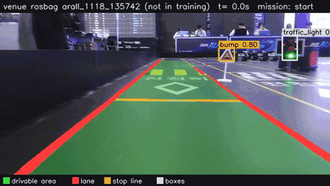
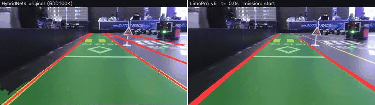
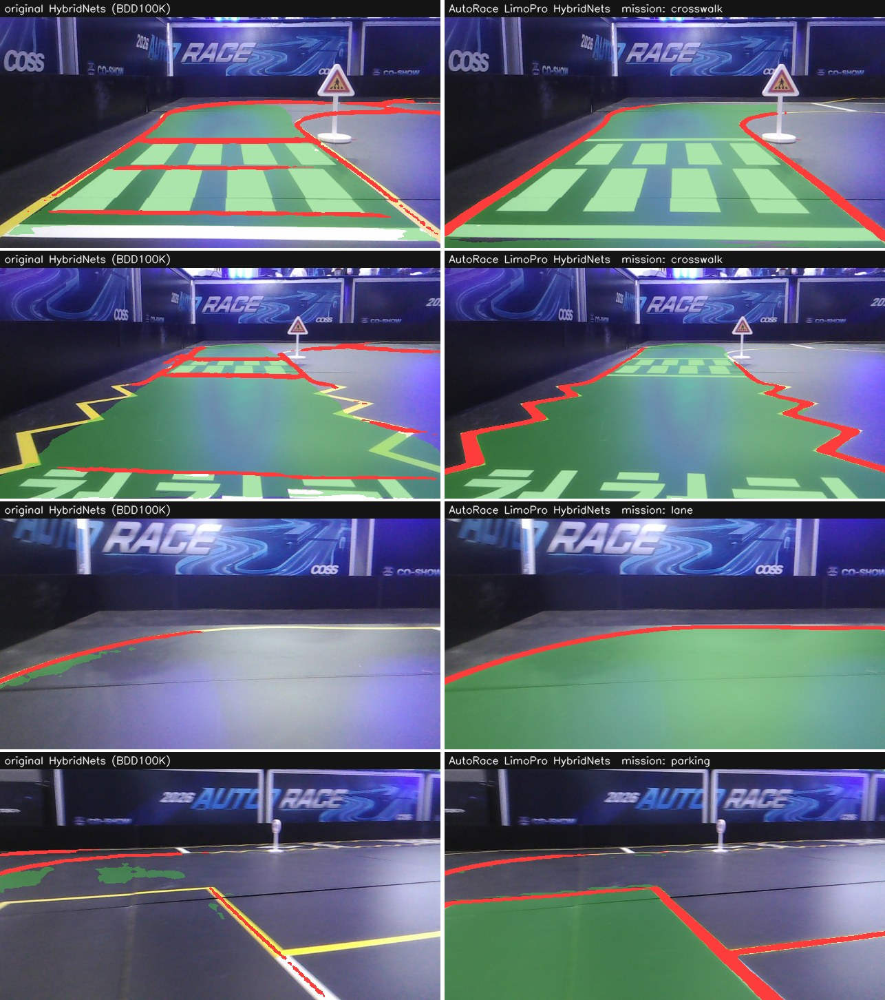
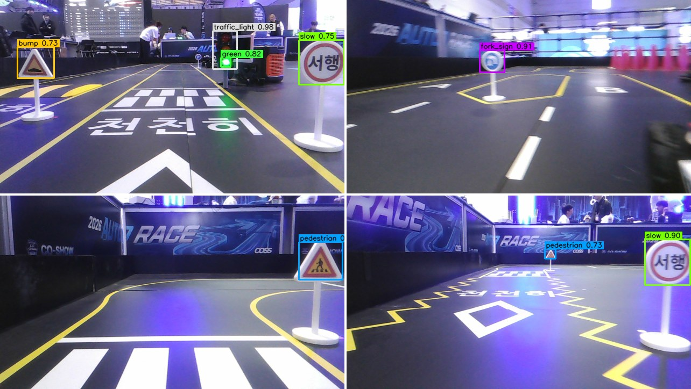
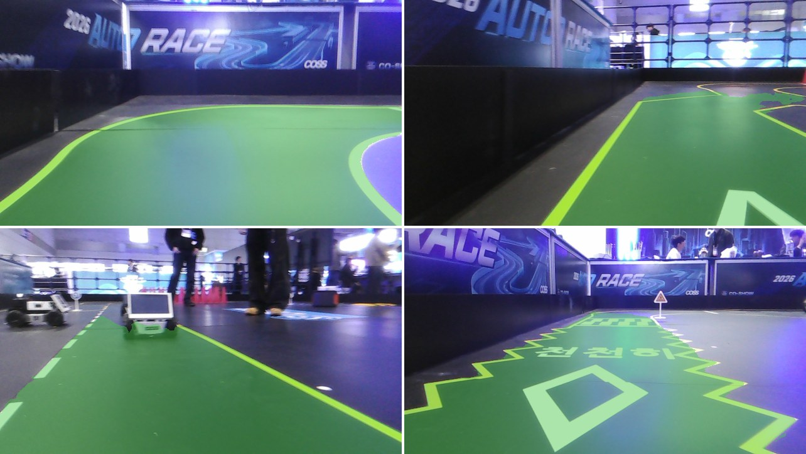
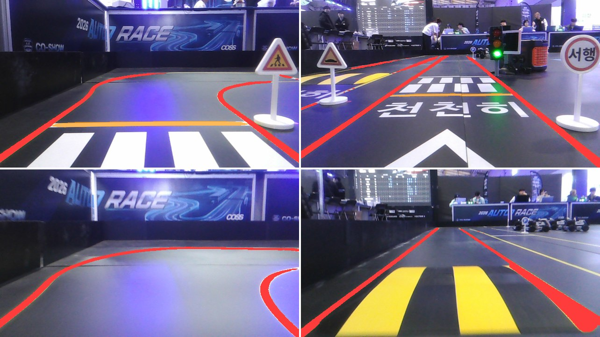
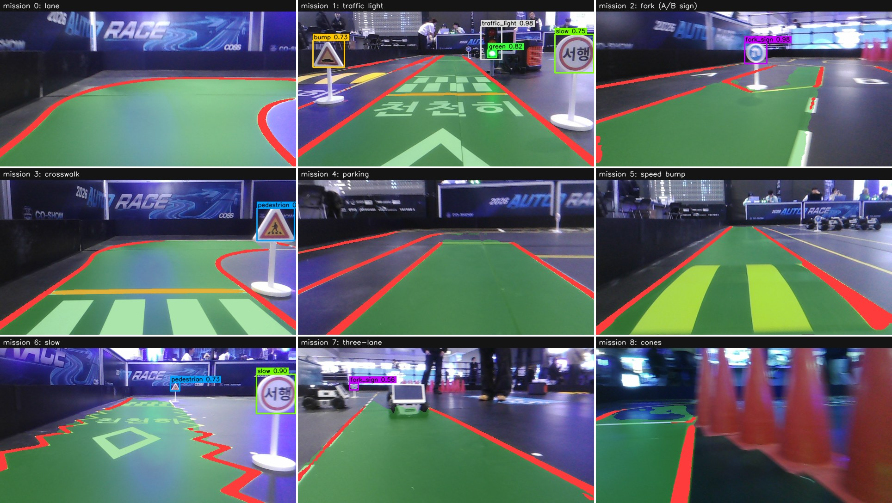

<div align="center">

# LimoPro FOSCAR Vision

**카메라 한 대로 차선 · 주행가능영역 · 정지선 · 표지판 · 신호등을 한 번에 보는 다중 작업 모델**

AutoRace 2026 (CO-SHOW) 최우수상 수상팀 **FOSCAR** · LIMO PRO

[**최신 릴리즈 `multitask-v6`**](https://github.com/mastic-choi/LimoPro_FOSCAR_Vision/releases/tag/multitask-v6) · [갈림길 분류기 `fork-sign-v0.3`](https://github.com/mastic-choi/LimoPro_FOSCAR_Vision/releases/tag/fork-sign-v0.3) · [팀 주행 코드](https://github.com/smoony0226/autorace2026)

</div>

## Introduction
[HybridNets](https://github.com/datvuthanh/HybridNets)를 바탕으로 AutoRace 2026 트랙과 LIMO PRO 카메라에 맞게 파인튜닝한 다중 작업 모델입니다.
네트워크 하나가 **주행가능영역(내 차로)**, **차선**, **흰 가로선(정지선·횡단보도)**, **검출 12종**을 한 번에 냅니다.
갈림길 A/B 글자만 작은 분류기([`fork-sign`](docs/FORK_SIGN_CLASSIFIER.md))가 따로 정합니다.

- **One model**: 미션 9개(차선, 신호등, 갈림길, 횡단보도, 주차, 과속방지턱, 천천히, 3차선, 라바콘)에 필요한 인식을 한 번의 추론으로 처리합니다.
- **Venue-tuned**: 대회장의 보라·파랑 LED 조명, 바닥 반사, 신호등 뒤 방해 모니터를 증강과 실제 대회장 bag으로 학습했습니다.
- **Gate-verified**: 시험셋 점수만으로는 릴리즈하지 않습니다. **대회장 rosbag 전체를 돌려** DA가 한 프레임이라도 통째로 꺼지면 탈락시킵니다.

## Results
아래 그림은 **모두 실제 대회장(11-18 CO-SHOW) rosbag 프레임**에 `multitask-v6`를 돌린 결과입니다. 쓴 bag 두 개(`arall_1118_135742`, `ar4_1118_135516`)는 **학습에 쓰지 않았습니다.**
학습은 H100 PCIe 1장에서 했습니다.

### Visualization
<table>
<tr><td></td></tr>
<tr><td align="center"><sub>대회장 rosbag 전 코스(출발 → 라바콘)와 주차. 초록 = 주행가능영역, 빨강 = 차선, 주황 = 정지선, 박스 = 검출. 위 줄은 bag 시간과 차량의 미션 상태입니다.</sub></td></tr>
</table>

### original HybridNets vs AutoRace LimoPro HybridNets
<table>
<tr><td></td></tr>
<tr><td align="center"><sub>같은 대회장 bag(학습 안 씀), 전 코스. 왼쪽 = original HybridNets(BDD100K 공개 가중치), 오른쪽 = AutoRace LimoPro HybridNets(v6). 초록 = 주행가능영역, 빨강 = 차선.</sub></td></tr>
</table>

<a href="./"></a>

<sub>위부터 횡단보도, 지그재그, 벽 옆 커브, 주차 구역. 원본은 실제 도로용이라 <b>횡단보도 줄무늬·정지선을 차선으로</b> 잡고, 벽 옆 커브나 주차 구역에서는 바닥을 거의 칠하지 못합니다. 원본은 도로 전체를 DA로 칠하도록, LimoPro는 내 차로만 칠하도록 학습했습니다.</sub>

### Model parameter and inference speed
| Model | Input | Params | 출력 | LIMO PRO (Orin Nano, TensorRT FP16) |
|---|---|---:|---|---|
| HybridNets (원본, BDD100K) | 640×384 | 12.8M | DA, 차선, 검출 1종 | - |
| **LimoPro multitask (v4~v6)** | 640×384 | **13.4M** | DA, 차선, 정지선, 검출 12종 | 차선 전용 HybridNets 기준 추론 32 ms, 전체 19.9 fps ([측정](https://github.com/mastic-choi/LimoPro_FOSCAR_Vision/blob/limo-trt-fp16/limo_deploy/LANE_PERCEPTION_USAGE.md)) |

<sub>다중 작업 엔진의 차량 속도는 따로 재지 않았습니다. 백본과 입력 크기가 같아 차선 전용과 비슷할 것으로 봅니다.</sub>

### Traffic Object Detection Result
<table>
<tr><th>Result</th><th>Visualization</th></tr>
<tr><td>

| test 세트 | v4 | **v6** |
|---|---:|---:|
| 합성 test | 0.978 | **0.981** |
| 대회장 test | 0.987 | **0.987** |
| 실차 test_bag | 0.980 | **0.981** |
| 실물 신호등 | **0.989** | 0.985 |
| 실물 A·B 표지판 주행 | 0.944 | **0.955** |

<sub>mAP@0.5. 검출 칸: pedestrian, fork_sign, bump, slow, parking, traffic_light, light_red / yellow / green</sub>
</td><td width="55%"></td></tr>
</table>

### Drivable Area Segmentation
<table>
<tr><th>Result</th><th>Visualization</th></tr>
<tr><td>

| test 세트 | v4 | **v6** |
|---|---:|---:|
| 합성 test | 0.954 | **0.955** |
| 대회장 test | 0.939 | **0.940** |
| 실차 test_bag | **0.981** | 0.980 |
| 실차 bag 11/16 | **0.973** | 0.969 |

<sub>DA IoU. DA는 **지금 달리는 내 차로만** 칠합니다. 그림: 직선, 갈림길 A 갈래, 3차선, 지그재그.</sub>
</td><td width="55%"></td></tr>
</table>

### Lane Line and Stop Line Detection
<table>
<tr><th>Result</th><th>Visualization</th></tr>
<tr><td>

| test 세트 | 차선 IoU v4 / **v6** | 정지선 IoU v4 / **v6** |
|---|---:|---:|
| 합성 test | 0.806 / **0.811** | 0.882 / **0.891** |
| 대회장 test | 0.493 / **0.500** | 0.699 / **0.714** |
| 실차 test_bag | 0.832 / **0.837** | - |
| 실차 bag 11/16 | 0.864 / **0.874** | 0.883 / **0.885** |

<sub>정지선 = 분할 4번째 채널(흰 가로선: 정지선·횡단보도 앞 선).</sub>
</td><td width="55%"></td></tr>
</table>

### Mission-by-mission results (venue rosbag)
<a href="./"></a>

<sub>미션마다 한 장. 차량이 기록한 미션 상태(`mission_id`)로 구간을 나눴습니다. 3차선 칸의 장애물 차 옆 `fork_sign` 박스처럼 오탐도 그대로 두었습니다.</sub>

### DA gate: whole-bag check before release
시험셋 점수만으로는 릴리즈하지 않습니다. 후보 모델을 **대회장 bag 전체 프레임**에 돌려 지금 차량 모델과 비교하고([`bag_da_gate.py`](tools/mt_v4_data/bag_da_gate.py)), 모두 통과해야 릴리즈합니다.

| 항목 | 통과 조건 | **v6 (11-18 bag 11개)** |
|---|---|---|
| DA·차선 통째로 꺼짐 | 0 프레임 | **모두 0** |
| 가장 긴 연속 꺼짐 | 0.3 s 미만 | **0 s** |
| 차 앞이 비어 보임 (화면 맨 아래 띠 DA < 20%) | 기준 + 5 프레임 이하 | 통과 |
| 흔들림 (이웃 프레임 DA IoU 5% 분위) | 기준 − 0.05 이상 | 통과 (대부분 기준 모델보다 안정) |

## Models
| 릴리즈 | 내용 |
|---|---|
| **[`multitask-v6`](https://github.com/mastic-choi/LimoPro_FOSCAR_Vision/releases/tag/multitask-v6)** | **최신·권장.** v4에서 시작, 빈 DA 정답 제거, 11-18 대회장 자동 라벨 996장. DA 주행 검사 통과 |
| [`multitask-v4`](https://github.com/mastic-choi/LimoPro_FOSCAR_Vision/releases/tag/multitask-v4) | 원본 HybridNets에서 새로 학습, `fork_sign` 합침. v6 이전 차량 기준 모델 |
| [`fork-sign-v0.3`](https://github.com/mastic-choi/LimoPro_FOSCAR_Vision/releases/tag/fork-sign-v0.3) | 갈림길 A/B 분류기 (ONNX, OpenCV 4.5.4 dnn 호환). v4·v6의 `fork_sign` 박스 크롭에 씀 |
| [`multitask-v3real`](https://github.com/mastic-choi/LimoPro_FOSCAR_Vision/releases/tag/multitask-v3real) · [`v3`](https://github.com/mastic-choi/LimoPro_FOSCAR_Vision/releases/tag/multitask-v3) · [`v2`](https://github.com/mastic-choi/LimoPro_FOSCAR_Vision/releases/tag/multitask-v2) · [`v1`](https://github.com/mastic-choi/LimoPro_FOSCAR_Vision/releases/tag/multitask-v1) | 이전 다중 작업 모델 (검출 칸 1·2 = sign_A·sign_B) |
| [`ego-lane-v4`](https://github.com/mastic-choi/LimoPro_FOSCAR_Vision/releases/tag/ego-lane-v4) ~ [`v1`](https://github.com/mastic-choi/LimoPro_FOSCAR_Vision/releases/tag/ego-lane-v1) | 차선 전용 모델 (HybridNets · TwinLiteNet+ · YOLOP · YOLOPv2) |

```bash
gh release download multitask-v6 -R mastic-choi/LimoPro_FOSCAR_Vision -p 'hybridnets_mt_v6_*'
```

- `hybridnets_mt_v6_best.pt`: state_dict (epoch 41). 분할 4채널(배경 / DA / 차선 / 흰 가로선), 검출 12칸.
  - 검출 칸: 0 pedestrian, 1 fork_sign, 2 비움, 3 bump, 4 slow, 5 parking, 6 traffic_light, 7~9 light_red / yellow / green, 10·11 쓰지 않음
- `hybridnets_mt_v6_calib.json`: 클래스별 점수 보정. `p' = sigmoid(logit(p) / T[클래스])`
- **전처리**: 1280×720 → 640×360 리사이즈 → 위아래 12px 패딩(값 114), RGB + ImageNet 정규화
- v4와 구조가 같아서 차량에서는 가중치만 바꿔 TensorRT 엔진을 다시 만들면 됩니다([릴리즈 노트](https://github.com/mastic-choi/LimoPro_FOSCAR_Vision/releases/tag/multitask-v6)). **바꾸면 팀에 알리고 기록해 주세요.**

## Demo Test
학습·추론 코드는 HybridNets를 함께 두어야 돕니다([`models/README.md`](models/README.md)). 아래 명령은 학습 번들(`LimoPro_mt_v4`)의 venv 기준입니다.

```bash
# 대회장 bag 프레임 뽑기 (-> <out>/<bag>/frames/*.jpg + frames.csv)
python -I tools/mt_v4_data/bag_fork_frames.py <out> <bag 폴더>... --msgdir <autorace2026>/src/ar_msgs/msg --all

# README 그림 다시 만들기 (이 페이지의 GIF·몽타주)
python -I tools/mt_v4_data/readme_media.py --bundle <LimoPro_mt_v4> --weights hybridnets_mt_v6_best.pt \
    --orig-weights hybridnets.pth --frames-root <out> --out docs/images/readme

# 릴리즈 전 DA 주행 검사 (후보 vs 지금 차량 모델)
python -I tools/mt_v4_data/bag_da_gate.py --cand <후보 best.pt> --base <v4 best.pt> --bundle <LimoPro_mt_v4> --stride 2 <out>/<bag>...

# 학습에 안 쓴 bag 확인 영상(mp4) + 몽타주
python -I tools/mt_v4_data/heldout_video.py --bundle <LimoPro_mt_v4> --weights <best.pt> --frames-root <out> --out <폴더> arall_1118_135742
```

| 도구 | 하는 일 |
|---|---|
| [`tools/mt_v4_data/bag_da_gate.py`](tools/mt_v4_data/bag_da_gate.py) | 릴리즈 전 DA 주행 검사 |
| [`tools/mt_v4_data/gate_timeline_plot.py`](tools/mt_v4_data/gate_timeline_plot.py) | bag별 DA 비율 타임라인 그림 |
| [`tools/mt_v4_data/which_model_in_bag.py`](tools/mt_v4_data/which_model_in_bag.py) | bag에 기록된 차량 출력(`/ar/lane/sl_mask`)으로 차에 올라간 모델 버전 찾기 |
| [`tools/mt_v4_data/auto_label_v4.py`](tools/mt_v4_data/auto_label_v4.py) | 대회장 bag 자동 라벨 (v6 학습 데이터) |
| [`scripts/eval_mt_stopline_montage.py`](scripts/eval_mt_stopline_montage.py) | 정지선 정답·예측을 겹친 몽타주와 사진별 IoU |
| [`tools/h100_mt_v4/run_v6.sh`](tools/h100_mt_v4/run_v6.sh) | v6 학습 명령 (H100, epoch당 약 170초, 53 epoch 약 2.6시간) |

### Documents
- [`docs/VENUE_1118_STATUS.md`](docs/VENUE_1118_STATUS.md): 11-18 대회장 정리 (DA 주행 검사, 자동 라벨, v6 학습)
- [`docs/MULTITASK_V4_TRAINING.md`](docs/MULTITASK_V4_TRAINING.md): v4 데이터·학습 설계
- [`docs/FORK_SIGN_CLASSIFIER.md`](docs/FORK_SIGN_CLASSIFIER.md): 갈림길 A/B 분류기
- [`docs/HISTORY.md`](docs/HISTORY.md): 전체 실험 기록 (차선 1~4차, 다중 작업 1~3차)
- [`docs/LIMO_DEPLOY_NOTES.md`](docs/LIMO_DEPLOY_NOTES.md): LIMO PRO 사양과 배포 전 확인 사항

## License
- 기반 모델: [HybridNets](https://github.com/datvuthanh/HybridNets), [TwinLiteNetPlus](https://github.com/chequanghuy/TwinLiteNetPlus), [YOLOP](https://github.com/hustvl/YOLOP), [YOLOPv2](https://github.com/CAIC-AD/YOLOPv2). 모두 MIT License입니다.
- 라바콘 공개 데이터: TraCon, FSOCO
- AutoRace 2026 참가팀 **FOSCAR**: [smoony0226/autorace2026](https://github.com/smoony0226/autorace2026)
