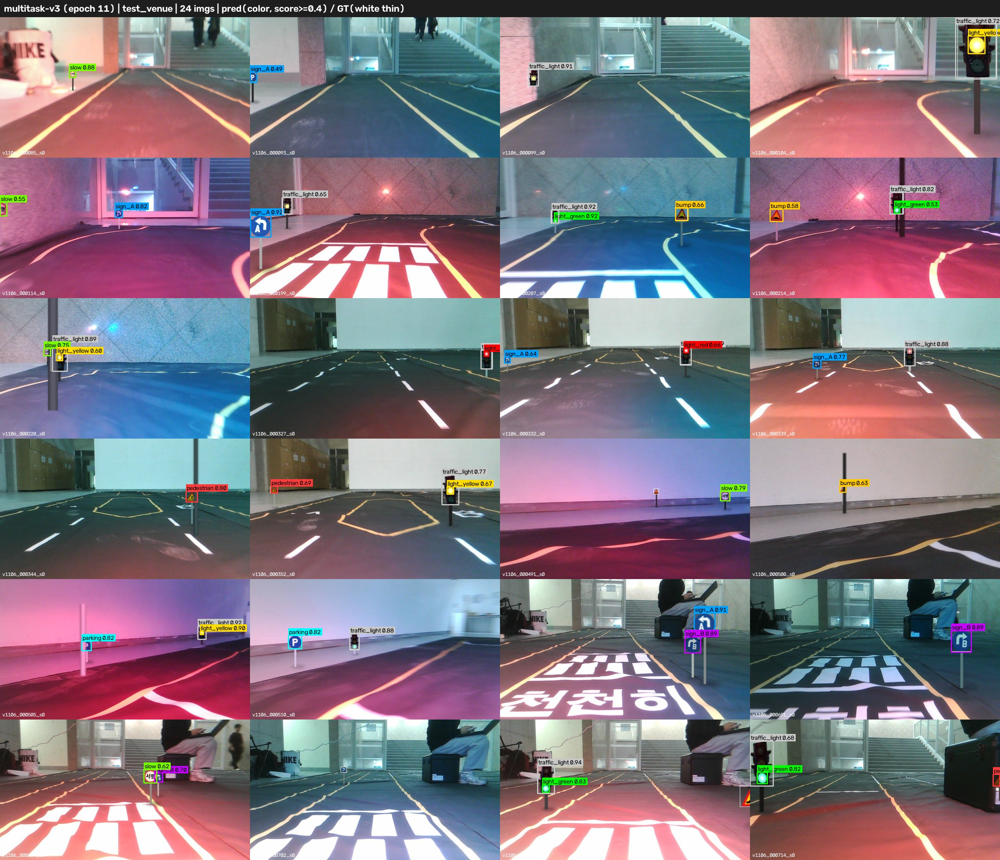
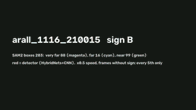

# LimoPro FOSCAR Vision

> LIMO PRO 카메라 한 장으로 **차선·주행영역·표지판·신호등·라바콘**을 한 번에 보는 다중 작업(multi-task) 모델. AutoRace 2026 트랙에 맞춰 파인튜닝했습니다.



*대회장 조명 test 프레임입니다. 색 박스가 모델 예측(검출), 흰 얇은 박스가 정답입니다. 분할(차선·주행영역)은 같은 모델이 함께 냅니다.*

최신 릴리즈는 **[`multitask-v3real`](https://github.com/mastic-choi/LimoPro_FOSCAR_Vision/releases/tag/multitask-v3real)** (HybridNets 기반, v3 + 실물 신호등)입니다.
상세 실험 기록(1~4차 차선 모델, 데이터·학습 설정, 한계 등)은 [`docs/HISTORY.md`](docs/HISTORY.md)에 있습니다.

### 진행 중 (2026-11-16): 실물 갈림길 A/B 표지판과 v4



*실물 크기(Ø80 mm 인쇄) A·B 표지판으로 돈 M7 주행 5개. 표지판 박스를 SAM 2.1 영상 추적으로 모든 프레임에 만들었습니다 —
자홍 = 아주 먼 구간(3차선 구간에서 차로 끝), 하늘색 = 먼 구간(장애물 사이), 초록 = 가까운 구간, 빨강 = HybridNets 검출 + 갈림길 분류기 확인.*

- **갈림길 A/B 분류기 [`fork-sign-v0.2`](https://github.com/mastic-choi/LimoPro_FOSCAR_Vision/releases/tag/fork-sign-v0.2)** (사전 릴리즈): 위 주행의 크롭을 더해 학습.
  학습에 안 쓴 실물 주행으로 A↔B 혼동 0, 재현율 98~100%. 자세히: [`outputs/fork_cls_v2/README.md`](outputs/fork_cls_v2/README.md), [`docs/FORK_SIGN_CLASSIFIER.md`](docs/FORK_SIGN_CLASSIFIER.md)
- **`hybridnets_mt_v4` 학습 준비**: 원본 HybridNets 에서 새로 학습, sign_A·sign_B 를 `fork_sign` 하나로 합침(A/B 는 분류기),
  정지선 사람 검수 2,587장 추가, 실차 bag 834장·실물 A·B 주행 641장 추가, H100 속도 대응. 자세히: [`docs/MULTITASK_V4_TRAINING.md`](docs/MULTITASK_V4_TRAINING.md)

## 1. 주요 기능

- **한 모델, 네 가지 출력** — HybridNets 하나로 아래를 동시에 냅니다.
  - **da (주행가능영역):** 지금 달리는 내 차로만. 3차선·갈림길도 내 차로만 칠합니다.
  - **ll (차선):** 차선 위치
  - **흰 가로선:** 정지선·횡단보도 같은 흰 가로선 (분할 4번째 채널)
  - **검출 12종:** pedestrian, sign_A, sign_B, bump, slow, parking, traffic_light, light_red/yellow/green, limo, cone
- **트랙·카메라 맞춤** — BDD100K 공개 모델을 LIMO PRO 영상과 대회 트랙(10m×6m, 차선 폭 550mm)에 맞게 파인튜닝.
- **대회장 조명 증강** — 빨강·파랑 색 조명을 학습 사진에 입혀, 색 조명에서도 주행영역이 번지지 않게 함.
- **신호등 뒤 방해 모니터 대응** — 학습 중 신호등 뒤에 단색·땡땡이 화면을 그려 넣어, 화면 속 원을 불빛으로 잡는 오탐을 줄임(v3).
- **실물 신호등** — 로봇 카메라로 찍은 실물 신호등 961장을 섞어, 합성으로만 배운 v3가 못 잡던 실물 노란불·초록불을 잡게 함(v3real).
- **1차 추론 코드 그대로** — v1·v2·v3·v3real은 구조·입력·출력이 같아 추론 코드에 가중치만 바꿔 끼우면 됩니다.

## 2. 모델 다운로드

| 릴리즈 | 내용 |
|---|---|
| **[`multitask-v3real`](https://github.com/mastic-choi/LimoPro_FOSCAR_Vision/releases/tag/multitask-v3real)** | **3차 + 실물 신호등 (권장·최신).** 실물 노랑·초록 재현율(점수 0.5) 71 / 22% → 100 / 100%, 차선 ll 0.802 → 0.822, 모니터 가짜 불빛 4 → 0개. **콘은 학습 안 함(콘 출력 쓰지 말 것)**. 실물 신호등 데이터셋 포함 |
| [`multitask-v3`](https://github.com/mastic-choi/LimoPro_FOSCAR_Vision/releases/tag/multitask-v3) | 다중 작업 3차 HybridNets. 콘 뺀 검출 mAP50 0.97~0.99, 모니터 가짜 불빛 61 → 4개. 콘 검출이 필요하면 이것 |
| [`multitask-v2`](https://github.com/mastic-choi/LimoPro_FOSCAR_Vision/releases/tag/multitask-v2) | 다중 작업 2차 HybridNets. 검출 mAP50 0.90~0.95, A/B 구분 84~92%. 차선이 가장 중요하면 이것 |
| [`multitask-v2-skip`](https://github.com/mastic-choi/LimoPro_FOSCAR_Vision/releases/tag/multitask-v2-skip) | 참고용: v2 + 백본 지름길(실험 B). 성능은 v2와 비슷, 추론에 `forward_mt` 필요 |
| [`multitask-v1`](https://github.com/mastic-choi/LimoPro_FOSCAR_Vision/releases/tag/multitask-v1) | 다중 작업 1차 + 학습 데이터셋 + 학습 코드 |
| [`ego-lane-v4`](https://github.com/mastic-choi/LimoPro_FOSCAR_Vision/releases/tag/ego-lane-v4) | 차선 전용 4차 HybridNets (실차 코너·이탈 프레임 보강) |
| [`ego-lane-v3`](https://github.com/mastic-choi/LimoPro_FOSCAR_Vision/releases/tag/ego-lane-v3) | 차선 전용 3차 모델 4개 (HybridNets · TwinLiteNet+ · YOLOP · YOLOPv2) |
| [`ego-lane-v2`](https://github.com/mastic-choi/LimoPro_FOSCAR_Vision/releases/tag/ego-lane-v2) · [`ego-lane-v1`](https://github.com/mastic-choi/LimoPro_FOSCAR_Vision/releases/tag/ego-lane-v1) | 차선 전용 2차 · 1차 |

```bash
# 최신 다중 작업 가중치 받기
gh release download multitask-v3real -p "hybridnets_mt_v3real_best.pt" -p "hybridnets_mt_v3real_calib.json"
```

- `hybridnets_mt_v3real_best.pt`는 state_dict(epoch 29)입니다. 분할 4채널(배경/도로/차선/흰 가로선), 검출 12클래스(cone 출력은 학습하지 않아 쓰지 않음).
- `hybridnets_mt_v3real_calib.json`은 클래스별 점수 보정값입니다. `p' = sigmoid(logit(p) / T[클래스])`. v3와 점수 분포가 달라, 주행 코드의 점수 기준은 바꿔 넣은 뒤 다시 확인하세요.
- **전처리:** 1280×720 → 640×360 리사이즈 → 위아래 12px 패딩(값 114), RGB + ImageNet 정규화.
- 차선 전용 모델의 모델별 전처리와 사전학습 가중치는 [`models/README.md`](models/README.md)를 보세요.

## 3. 성능 (multitask-v3real)

점수는 시드 1개 기준입니다. 합성 test의 표지판·신호등은 실제 프레임에 합성한 것입니다. 실물 신호등 test는 학습과 같은 수집 영상에서 시간 구간만 떼어 둔 것이라, 실제보다 좋게 나왔을 수 있습니다.

| 지표 | 2차 (v2) | 3차 (v3) | **3차 + 실물 (v3real)** |
|---|---:|---:|---:|
| 실물 신호등 test 171장, 빨강 / 노랑 / 초록 재현율 (점수 0.5) | 측정 안 함 | 82 / 71 / 22% | **96 / 100 / 100%** |
| 실물 신호등 1.2m 12장, 노랑 / 초록 재현율 (점수 0.3) | 측정 안 함 | 0 / 0% | **100 / 75%** |
| 검출 mAP50, 콘 제외 (기존 / 대회장 / bag) | 0.931 / 0.937 / 0.952 | 0.969 / 0.979 / 0.987 | **0.978 / 0.980 / 1.000** |
| A/B 구분, A·B 점수만 비교 (기존 / 대회장 / bag) | 84 / 84 / 92% | **97 / 95 / 100%** | 측정 안 함 |
| 땡땡이 모니터 앞 가짜 불빛 (193장, 점수 0.3) | 61개 (36장) | 4개 (3장) | **0개** |
| 콘 AP50 (14px 이상) / 콘 오탐 (1,363장, 점수 0.4) | 0.887 / 2,365개 | **0.970 / 189개** | 학습 안 함 |
| 차선 da / ll, 기존 test | 0.955 / 0.816 | 0.952 / 0.802 | **0.956 / 0.822** |
| 차선 da / ll, 대회장 test | 0.935 / 0.486 | 0.932 / 0.483 | **0.937 / 0.490** |
| 차선 da / ll, 실차 test_bag | 0.981 / 0.826 | 0.979 / 0.810 | **0.982 / 0.845** |
| 흰 가로선 IoU, 대회장 test | 0.604 | **0.645** | 0.618 |

v3real 검출 AP50 (대회장 test): pedestrian 1.00 · bump 0.95 · sign_A 0.96 · sign_B 1.00 · parking 1.00 · slow 1.00 · traffic_light 0.99 · light red/yellow/green 0.95 / 1.00 / 0.96.

- **실물 신호등은 실차에서 꼭 확인하세요.** 따로 찍은 사진은 1.2m 12장뿐입니다. **1.2m 초록불은 점수 0.30~0.31로 겨우 잡히거나 놓칩니다.** 초록불은 가까워질 때까지 몇 프레임 지켜보고 판단하세요. 비교 그림은 [`outputs/train_mt_v3real/compare/`](outputs/train_mt_v3real/compare/)에 있습니다.
- **콘 출력은 쓰지 마세요.** v3real은 콘 없이 학습했습니다. 콘 검출이 필요하면 v3를 쓰세요.
- **흰 가로선 IoU가 v3보다 0.027 낮습니다.** 주로 실제 가로선을 덜 칠해서 생긴 하락입니다(잘못 칠한 픽셀은 줄었음). 정지선 판단에 쓴다면 실차에서 v3와 비교해 보세요.
- 전체 표는 [`outputs/train_mt_v3real/README.md`](outputs/train_mt_v3real/README.md), 3차는 [`outputs/train_mt_v3/README.md`](outputs/train_mt_v3/README.md), 2차는 [`outputs/train_mt_v2/README.md`](outputs/train_mt_v2/README.md)에 있습니다.

## 4. Quick start

학습·추론 코드는 HybridNets를 함께 두어야 돕니다(`models/README.md`). 경로는 Windows + `.venv` 기준입니다.

**추론 / 시각화** — test 사진에 검출 박스를 그려 몽타주를 만듭니다.

```bash
.venv/Scripts/python scripts/eval_mt_montage.py . hybridnets_mt_v3real_best.pt outputs/preview "multitask-v3real"
```

**이어서 학습 (v1 → v2 재현)** — 1차 best.pt에서 검출 머리·BiFPN lr 10배, 검출 손실 2배로 15 epoch.

```bash
.venv/Scripts/python scripts/train_multitask.py \
  --seg-data dataset/synth_signs_v2 --det-data dataset/cones_v1 \
  --venue-ref-dir dataset/venue_ref_20261106 \
  --init outputs/train/hybridnets_mt_v1_seed0/best.pt \
  --head-lr-mult 10 --det-weight 2 --warmup-steps 500 --epochs 15 \
  --amp --batch 32 --workers 16 --out outputs/train/hybridnets_mt_v2
# 실험 A(=v2)·B를 한 번에 돌리고 비교표까지: bash scripts/run_mt_exp_ab.sh
```

**H100 서버 학습 (v2 → v3 재현)** — 묶음 zip을 만들어 서버에 올리고 실행합니다(이미지는 서버에 둔 v2 데이터 재사용).

```bash
# 이 PC: 코드 + 시작 가중치(v2 best)만 담은 번들 생성
.venv/Scripts/python -I scripts/make_h100_mt_v3_bundle.py --out outputs/share

# 서버: v2 폴더 위에 덮어 풀고 실행
unzip -o LimoPro_mt_v3_h100.zip && cd LimoPro_mt
bash run_v3.sh check    # 데이터·가중치·SHA256 확인
bash run_v3.sh          # 학습 → 모니터 시험 → results_v3_<서버이름>.zip
```

v3 릴리즈는 학습이 남긴 후보 중 `best_score.pt`(epoch 11)입니다. 다른 후보를 쓸 때는 점수 보정과 test 채점을 다시 합니다.

```bash
.venv/Scripts/python scripts/eval_mt_finalize.py outputs/train/hybridnets_mt_v3_seed0/best_score.pt outputs/train_mt_v3/hybridnets_mt_v3
```

자세한 서버 실행법은 [`tools/h100_mt_v3/README_V3.md`](tools/h100_mt_v3/README_V3.md), v3 설계는 [`docs/MULTITASK_V3_TRAINING.md`](docs/MULTITASK_V3_TRAINING.md)를 보세요.

**RTX PC 학습 (v3 → v3real 재현)** — v3 릴리즈 가중치에서 이어서 실물 신호등을 섞어 30 epoch 학습합니다(RTX 3070 Ti에서 epoch당 약 6분, 약 3시간).

```bash
# 번들 폴더(LimoPro_mt_rtx)에 tools/rtx_mt_v3real/의 파일과 scripts/, models/HybridNets, weights/hybridnets_mt_v3_best.pt,
# dataset/real_tl_v1(릴리즈의 LimoPro_dataset_real_tl_v1.zip)을 두고, 상위 폴더에 LimoPro_dataset_mt_v1.zip을 둡니다.
bash run.sh check   # venv 만들기, 합성 데이터 풀기, 데이터·가중치·GPU 확인
bash run.sh         # 학습 -> 실물 신호등 비교 -> 모니터 시험 -> results_v3real_<PC이름>.zip
```

설정과 결과 보는 법은 [`tools/rtx_mt_v3real/README.md`](tools/rtx_mt_v3real/README.md)에 있습니다.

## 5. 다음 할 일

- **실차에서 실물 신호등 확인 (v3real)** — 대회장 신호등과 거리(1~2m), 조명에서 노랑·초록을 잡는지, 불빛 점수 기준(0.3 / 0.5)별로 확인합니다. 따로 찍은 실물 사진을 더 모아 test를 늘립니다.
- **실차에서 차선·정지선 비교** — 같은 코스에서 v2 / v3 / v3real의 차선 추종과 흰 가로선(정지선)을 비교합니다. v3real은 ll이 가장 높고 흰 가로선은 v3보다 낮습니다.
- **실제 모니터 사진 확인** — 모니터 시험은 합성 화면이라, 대회장에서 신호등 뒤 실제 모니터를 찍어 확인합니다.

## 6. 문서

- [`docs/HISTORY.md`](docs/HISTORY.md) — 전체 실험 기록(차선 1~4차, 데이터·학습 설정, 결과·한계, 저장소 구성)
- [`outputs/train_mt_v3real/README.md`](outputs/train_mt_v3real/README.md) — 3차 + 실물 신호등 결과 전체(실물 신호등, 합성 test, 모니터 시험, 학습 곡선)
- [`tools/rtx_mt_v3real/README.md`](tools/rtx_mt_v3real/README.md) — v3real 학습 설정과 RTX PC 실행법
- [`outputs/train_mt_v3/README.md`](outputs/train_mt_v3/README.md) — 다중 작업 3차 결과 전체(후보 비교, 크기별 정답률, 모니터 시험, 점수 보정)
- [`outputs/train_mt_v2/README.md`](outputs/train_mt_v2/README.md) — 다중 작업 2차 결과 전체
- [`docs/MULTITASK_DETECTION_ANALYSIS.md`](docs/MULTITASK_DETECTION_ANALYSIS.md) — 표지판 구분 실패 원인 분석(A/B 언더피팅)
- [`docs/MULTITASK_V3_TRAINING.md`](docs/MULTITASK_V3_TRAINING.md) · [`tools/h100_mt_v3/README_V3.md`](tools/h100_mt_v3/README_V3.md) — v3 설계와 서버 실행법
- [`docs/ENSEMBLE_FINETUNE.md`](docs/ENSEMBLE_FINETUNE.md) — 차선 파인튜닝 방법과 결과
- [`docs/LIMO_DEPLOY_NOTES.md`](docs/LIMO_DEPLOY_NOTES.md) — LIMO PRO 사양과 배포 전 확인 사항

## 7. 사용한 모델 · 라이선스 · 크레딧

- 기반 모델: [HybridNets](https://github.com/datvuthanh/HybridNets), [TwinLiteNetPlus](https://github.com/chequanghuy/TwinLiteNetPlus), [YOLOP](https://github.com/hustvl/YOLOP), [YOLOPv2](https://github.com/CAIC-AD/YOLOPv2) — 모두 MIT License.
- 라바콘 공개 데이터: TraCon, FSOCO.
- AutoRace 2026 참가팀 **FOSCAR** — [smoony0226/autorace2026](https://github.com/smoony0226/autorace2026).
