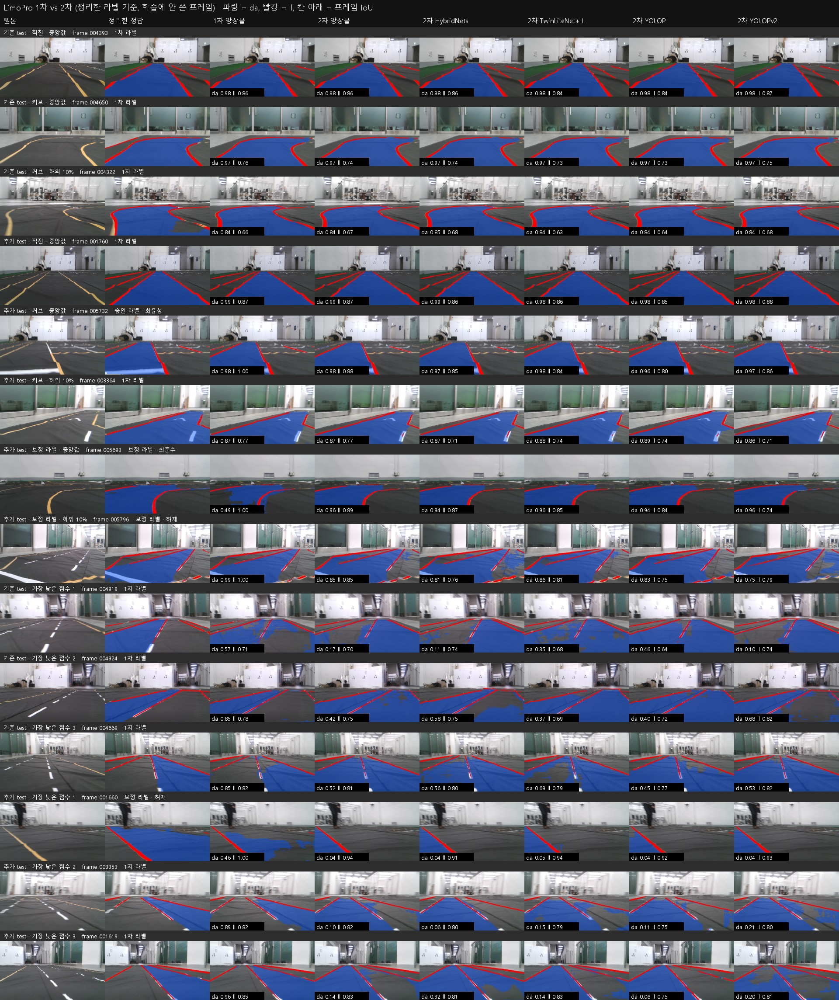
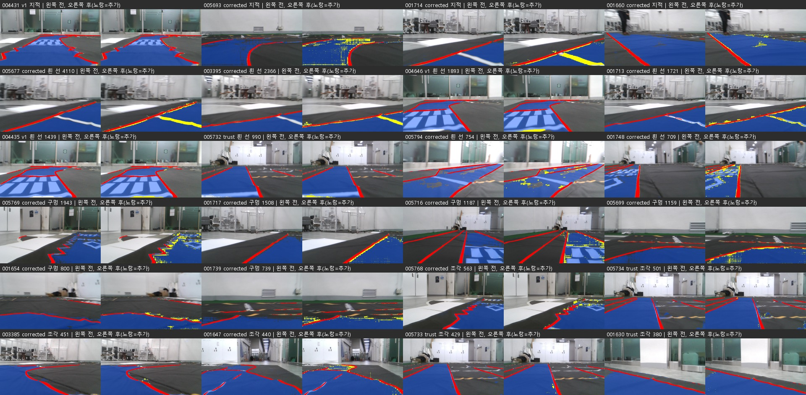

# LimoPro_FOSCAR_Vision

AutoRace 2026 참가팀 FOSCAR의 차선 인식 모델 저장소입니다. BDD100K로 학습된 공개 모델을 LIMO PRO 카메라 영상과 대회 트랙에 맞게 파인튜닝합니다.

모델은 영상에서 두 가지를 찾습니다.

- **da (주행가능영역):** 차가 지금 달리는 차로
- **ll (차선):** 차선 위치



*학습에 쓰지 않은 test 프레임입니다. 파랑은 da, 빨강은 ll이고, 칸 아래 숫자는 정답과 비교한 IoU입니다.*

## 현재 상태 (2026-10-31)

- 1차, 2차 파인튜닝을 마쳤고 가중치는 [Releases](https://github.com/mastic-choi/LimoPro_FOSCAR_Vision/releases)에 있습니다.
- 어려운 장면에서는 2차가 나아 보이지만, 쉬운 test와 3차선 구간 일부에서는 1차가 더 좋습니다. **어느 쪽이 항상 낫다고 정하지 않았습니다.**
- LIMO PRO 보드에서는 아직 돌려 보지 않았습니다. 차에 올릴 모델은 Jetson 속도를 잰 뒤 정합니다.

## 왜 파인튜닝하나

BDD100K는 실제 도로 데이터입니다. 공개 모델을 그대로 쓰면 트랙 위에서 다음 문제가 생깁니다.

- 지금 달리는 차로가 아니라 매트 전체를 도로로 칠합니다.
- 흰 횡단보도 선을 잘 잡지 못합니다.
- 커브와 주름진 트랙에서 차선과 da가 끊기거나 샙니다.

대회 트랙은 도면으로 고정돼 있습니다(10m×6m, 차선 폭 550mm). 그래서 이 트랙과 이 카메라에 잘 맞는 모델을 목표로 합니다. 공개 모델을 비교한 기록은 [`docs/EARLY_EXPLORATION.md`](docs/EARLY_EXPLORATION.md)에 있습니다.

## 파인튜닝 과정

| 단계 | 내용 |
|---|---|
| 1. 데이터 수집 | LIMO PRO로 트랙을 16분 주행. 1280×720, 약 8.6Hz. 멈춰 있던 프레임을 빼고 8,232장 |
| 2. 첫 라벨 | 공개 모델 앙상블 + HSV + 차선 추적 + SAM2로 내 차로 라벨 생성. 사람이 OK 프레임 검수 |
| 3. 1차 학습 | 검수 라벨 950장으로 모델 4개 파인튜닝 |
| 4. 라벨 확장 | 1차 앙상블로 커브 등 어려운 프레임에 pseudo-label 생성. 사람이 신뢰, SAM 보정, 버림으로 판정 |
| 5. 2차 학습 | 학습 데이터 3,709장으로 모델 4개 재학습 |
| 6. 라벨 정리, 재채점 | 정답의 구멍과 조각을 정리하고 흰 선을 da에 포함. 1차와 2차를 다시 비교 |

### 데이터

2차 데이터는 시간 구간 단위로 나눴습니다. 연속 프레임은 서로 거의 같아서 무작위로 나누면 점수가 부풀려집니다. 구간 앞뒤 프레임은 학습에서 뺐습니다.

| split | 장수 | 구성 |
|---|---:|---|
| train | 3,709 | 1차 라벨 782, 사람이 승인 2,086, 사람이 보정 841 |
| val | 327 | 기존 97 + 추가 230 |
| test | 542 | 기존 268 + 추가 274 (어려운 장면 포함) |

원본 이미지와 라벨은 용량 때문에 저장소에 넣지 않았습니다.

### 학습 설정

모델마다 출력 형식이 달라, 공통 학습 코드에 어댑터를 끼워 같은 손실과 평가를 씁니다.

- **입력:** 640×360에 위아래 12px을 패딩한 640×384
- **손실:** BCE + soft Dice, ll 가중치 2.0 (YOLOP은 채널별 BCE)
- **학습:** AdamW, poly LR, 최대 40 epoch, 8 epoch 동안 개선이 없으면 조기 종료
- **증강:** 좌우 반전, 회전·확대·이동, HSV, 노출 과다, 조명 번짐, 바닥 반사, 모션·줌·가우시안 블러
- **2차에 추가한 증강:** 차선 일부를 지우는 `lane_gap`, 매트 주름을 흉내 내는 `track_wrinkle`. 이미지만 바꾸고 라벨은 그대로 둬서, 차선이 끊겨 보여도 경계는 이어진다고 학습합니다. 효과는 아직 따로 재지 않았습니다.

| 모델 | 파라미터 | LR | 2차 batch | 2차 epoch (best) | 2차 학습 시간 |
|---|---:|---:|---:|---|---:|
| HybridNets | 12.8M | 0.0001 | 4 | 39 (31) | 101분 |
| TwinLiteNet+ Large | 1.94M | 0.00005 | 8 | 30 (22) | 57분 |
| YOLOP | 7.9M | 0.0001 | 8 | 40 (37) | 48분 |
| YOLOPv2 | 38.9M | 0.00001 | 8 | 38 (30) | 70분 |

2차는 RTX 3070 Ti 8GB에서 총 4시간 37분 걸렸고, HybridNets만 메모리 때문에 batch 4로 학습했습니다.

### 학습 곡선


- 네 모델 모두 20 epoch 전후로 대부분 수렴합니다.
- da는 HybridNets가 가장 높고, ll은 YOLOPv2가 가장 높습니다.
- YOLOP은 40 epoch까지 조금씩 올라 아직 포화되지 않았을 수 있습니다.
- val에 어려운 장면이 들어가 있어서 1차 val 점수와 직접 비교할 수 없습니다.

## 결과

점수는 test 전체 픽셀로 낸 IoU입니다. da는 정리한 라벨 기준이고, ll 라벨은 정리하지 않았습니다. 앙상블은 da 확률 평균 0.5 이상, ll 과반 투표로 합칩니다.

### 쉬운 test 268장 (1차 → 2차)

기존 파이프라인을 통과한 프레임으로 만든 test입니다. 두 모델 모두 학습에 쓰지 않아 가장 공정한 비교입니다.

| 모델 | da | ll | 커브 da | 커브 ll |
|---|---:|---:|---:|---:|
| HybridNets | 0.967 → 0.959 | 0.809 → 0.802 | 0.938 → 0.917 | 0.760 → 0.750 |
| TwinLiteNet+ Large | 0.954 → 0.956 | 0.784 → 0.783 | 0.919 → 0.923 | 0.731 → 0.724 |
| YOLOP | 0.940 → 0.947 | 0.749 → 0.769 | 0.907 → 0.908 | 0.692 → 0.715 |
| YOLOPv2 | 0.963 → 0.960 | 0.809 → 0.806 | 0.940 → 0.929 | 0.761 → 0.752 |
| **4개 앙상블** | **0.971 → 0.962** | **0.809 → 0.801** | **0.948 → 0.925** | **0.754 → 0.743** |

### 어려운 장면을 포함한 추가 test 274장 (1차 → 2차)

| 모델 | da | ll | 커브 da | 커브 ll |
|---|---:|---:|---:|---:|
| HybridNets | 0.873 → 0.936 | 0.832 → 0.850 | 0.864 → 0.918 | 0.823 → 0.844 |
| TwinLiteNet+ Large | 0.908 → 0.929 | 0.821 → 0.842 | 0.894 → 0.909 | 0.807 → 0.837 |
| YOLOP | 0.841 → 0.923 | 0.786 → 0.812 | 0.816 → 0.901 | 0.773 → 0.802 |
| YOLOPv2 | 0.859 → 0.936 | 0.839 → 0.854 | 0.834 → 0.918 | 0.824 → 0.847 |
| 2차 앙상블 | 0.939 | 0.868 | 0.921 | 0.864 |

이 표는 참고용입니다.

- **1차에 유리한 점:** 라벨 대부분이 1차 앙상블에서 나왔고, 71장은 1차 학습에도 쓰였습니다. 그래서 1차 앙상블 점수는 표에서 뺐습니다.
- **1차에 불리한 점:** 사람이 보정한 53장은 1차가 틀려서 고친 프레임입니다.

### 눈에 띄는 장면

- **좋아진 곳:** `005693`처럼 1차의 da가 끊기던 커브에서 2차가 매끄럽습니다(da 0.49 → 0.96).
- **나빠진 곳:** 3차선 구간인 `004919`(0.57 → 0.17), `004924`(0.85 → 0.42), `004669`(0.85 → 0.52)에서 2차가 옆 차로까지 얼룩지게 칠합니다. 2차 학습 라벨에 옆 차로까지 칠한 프레임이 섞인 영향일 수 있지만, 아직 확인하지 못했습니다.
- **라벨 오류:** `001660`은 모델이 아니라 정답이 틀린 프레임입니다.

### 라벨 정리의 효과

사람이 SAM으로 보정한 라벨에는 구멍과 작은 조각이 많았습니다. `scripts/clean_labels.py`로 정리하되, 모델 출력은 쓰지 않아 점수가 부풀려지지 않게 했습니다.



정리 후 재채점해도 전체 da는 0.003 이하로만 올랐고, 보정 라벨 53장의 앙상블 da만 0.872 → 0.898로 뚜렷이 올랐습니다. 따라서 쉬운 test에서 2차 점수가 떨어진 원인은 채점 라벨의 잡음이 아닙니다. 정리한 라벨로 다시 학습한 결과는 아직 없습니다.

## 한계

- 데이터 전체가 같은 트랙, 같은 조명의 주행 1회에서 나왔고 시드도 1개입니다. ±0.01 안팎의 차이는 우연일 수 있습니다.
- 주름 없는 트랙(2026-10-23 촬영)에는 라벨이 없습니다. 차가 비스듬할 때 da가 얼룩지는 모습이 보입니다.
- 정차 LIMO, 라바콘, 신호등, 표지판이 차선을 가리는 장면은 학습하지 않았습니다.
- 라벨 정리로 고칠 수 없는 오류가 남아 있습니다. 차로를 잘못 칠한 라벨은 사람이 고쳐야 합니다.

## 다음 할 일

1. 2차 점수가 크게 떨어진 프레임의 라벨을 사람이 확인합니다.
2. 3차선 구간의 라벨 기준을 정하고, 정리한 라벨로 다시 학습합니다.
3. Jetson에서 후보 모델의 속도를 재고 차에 올릴 모델을 고릅니다. 배포 전 확인 사항은 [`docs/LIMO_DEPLOY_NOTES.md`](docs/LIMO_DEPLOY_NOTES.md)에 있습니다.
4. 주행 코드와 연결해 실제 트랙에서 차로 이탈이 나는 구간을 찾습니다.

## 가중치 받기

| 릴리즈 | 내용 |
|---|---|
| [`ego-lane-v1`](https://github.com/mastic-choi/LimoPro_FOSCAR_Vision/releases/tag/ego-lane-v1) | 1차 모델 4개 |
| [`ego-lane-v2`](https://github.com/mastic-choi/LimoPro_FOSCAR_Vision/releases/tag/ego-lane-v2) | 2차 모델 4개, 보고서, 이 학습에 쓴 코드 |

```bash
gh release download ego-lane-v2 -p "hybridnets_v2_best_da.pt"
```

- `best_da`, `best_ll`은 각각 val da, val ll이 가장 높을 때의 가중치입니다.
- YOLOPv2는 TorchScript이므로 `scripts/train_seg.py`의 `load_yolopv2_trainable`로 읽습니다. 나머지는 state_dict입니다.
- 모델 코드와 사전학습 가중치는 [`models/README.md`](models/README.md)를 보고 받습니다.

## 실행

```bash
# 1차 데이터로 학습. 끊겨도 같은 명령으로 이어서 함. GPU 사용률은 GPU_DUTY(기본 90%)로 제한
.venv/Scripts/python scripts/train_all.py --data dataset/ego_v1

# 다른 NVIDIA PC로 옮길 코드, 모델, 데이터 묶기
.venv/Scripts/python -I scripts/make_rtx_bundle.py --data dataset/ego_v2 --out <USB 폴더>

# 1차와 2차를 정리한 라벨로 채점하고 몽타주 생성
.venv/Scripts/python scripts/eval_clean_compare.py --data dataset/ego_v2_clean --out outputs/eval_clean
```

2차 학습 데이터(`ego_v2_ys_split`)를 만든 `merge_review.py`, `resplit_dataset.py`와 동아리 PC용 수정 코드는 [`outputs/train_v2_foscar/코드_수정본.zip`](outputs/train_v2_foscar/코드_수정본.zip)에 있고, `scripts/`에는 아직 합치지 않았습니다.

## 저장소 구성

| 경로 | 내용 |
|---|---|
| `scripts/train_seg.py`, `train_all.py`, `train_watchdog.py` | 모델별 학습, 순차 실행과 자동 재개, 감시 |
| `scripts/make_ego_lane_labels.py`, `split_ego_labels.py`, `review_ok_labels.py` | 첫 라벨 생성과 OK 프레임 검수 |
| `scripts/make_finetuned_pseudo_labels.py` | 파인튜닝 앙상블로 pseudo-label 생성 |
| `tools/ego_label_review_{mac,radeon,nvidia}.ipynb` | 사람 검수와 SAM 보정 앱 |
| `scripts/build_train_dataset.py`, `build_train_dataset_v2.py` | 학습 데이터셋 생성 |
| `scripts/clean_labels.py`, `eval_clean_compare.py`, `eval_da_leak.py` | 라벨 정리, 재채점, da 침범률 측정 |
| `scripts/benchmark_models.py` | 추론 속도 측정 |
| `tools/rtx/`, `scripts/make_rtx_bundle.py` | NVIDIA PC 학습 번들 |
| `outputs/train_v2_foscar/` | 2차 학습 원본 보고서, 로그, 그림 |
| `outputs/eval_clean/` | 재채점 결과 |

## 문서

- [`docs/ENSEMBLE_FINETUNE.md`](docs/ENSEMBLE_FINETUNE.md): 파인튜닝 방법과 결과 상세
- [`docs/EGO_LANE_PSEUDO_LABEL.md`](docs/EGO_LANE_PSEUDO_LABEL.md): 첫 라벨 생성 방법
- [`docs/LANE_MODEL_WORKFLOW.md`](docs/LANE_MODEL_WORKFLOW.md): 참고 프로젝트의 작업 흐름
- [`docs/EARLY_EXPLORATION.md`](docs/EARLY_EXPLORATION.md): 공개 모델 비교 기록
- [`docs/LIMO_DEPLOY_NOTES.md`](docs/LIMO_DEPLOY_NOTES.md): LIMO PRO 사양과 배포 전 확인 사항
- [`outputs/train_v2_foscar/학습결과_보고서.md`](outputs/train_v2_foscar/학습결과_보고서.md): 2차 원본 보고서. `001660` 해석 등 일부는 재채점 전 내용입니다.

## 사용한 모델

[HybridNets](https://github.com/datvuthanh/HybridNets), [TwinLiteNetPlus](https://github.com/chequanghuy/TwinLiteNetPlus), [YOLOP](https://github.com/hustvl/YOLOP), [YOLOPv2](https://github.com/CAIC-AD/YOLOPv2) (모두 MIT License)
