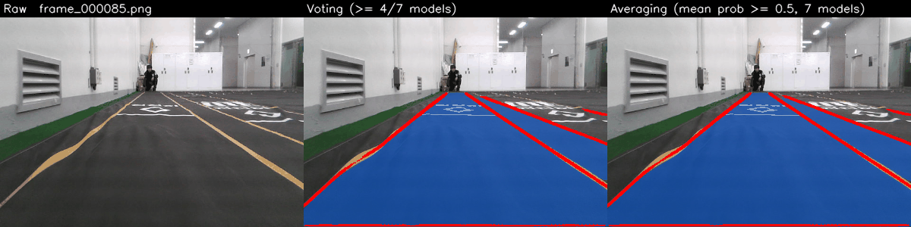
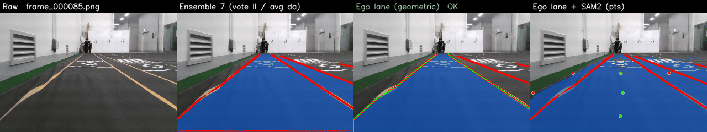
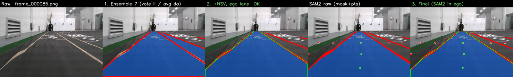

# LimoPro_FOSCAR_Vision
AutoRace2026 참가팀 FOSCAR 비전 모델관련 코드

## 구성

| 경로 | 내용 |
|---|---|
| `docs/LANE_MODEL_WORKFLOW.md` | 참고 프로젝트 [TwinLiteNet-KMU-finetune](https://github.com/mastic-choi/TwinLiteNet-KMU-finetune)의 차선 모델 제작 워크플로우 정리 |
| `models/` | 공개 da/ll 모델 7종(YOLOPv2, TwinLiteNet+ N/S/M/L, YOLOP, HybridNets) + SAM2. 가중치는 gitignore, 받는 법은 `models/README.md` |
| `scripts/make_model_compare_gif.py` | 모델 7개 결과를 4×2 오버레이 GIF로 비교 |
| `scripts/benchmark_models.py` | 모델별 추론 속도(forward / end-to-end) 측정 |
| `scripts/make_ensemble_gif.py` | 7개 앙상블 Voting vs Averaging 비교 GIF |
| `scripts/make_ego_lane_labels.py` | 앙상블 → HSV 보완 → ego 추적 → SAM2(범위 클리핑)로 '지금 달리는 차선' da pseudo-label 생성, OK/FAIL 판정 (아래 방법론) |
| `tools/da_trust_review.ipynb` | 사람 검수 노트북 (아래) |

## 결과 GIF

입력: LimoPro 실차 카메라 `LimoPro_frames_20261023`(640×480, 10Hz) 중 frame 85~433(0~84는 정지 화면),
2프레임 간격 175장 → 5fps 재생. 공통 색: **파랑 = 주행가능영역(da)**, **빨강 = 차선(ll)**.
모델은 전부 BDD100K 사전학습 그대로(파인튜닝 없음), RX 9070 XT + ZLUDA에서 실행.

### 1. 공개 모델 7종 비교 — `outputs/montages/model_compare.gif`

| 원본 | YOLOPv2 | TwinLiteNet+ Large | TwinLiteNet+ Medium |
|---|---|---|---|
| **YOLOP** | **TwinLiteNet+ Small** | **HybridNets** | **TwinLiteNet+ Nano** |

노란 실선은 대부분 잡지만 흰 횡단보도 선은 거의 모든 모델이 못 잡고, da는 지금 차선이 아니라
매트 전체를 칠한다(BDD100K의 "도로 전체" 개념). TwinLiteNet+ 일부는 화면 맨 아래에 가짜 차선 줄이 생긴다.
속도는 `outputs/benchmarks/` 참고(이 PC 기준 Nano 135fps ~ YOLOPv2 15fps).

### 2. 앙상블 Voting vs Averaging — `outputs/montages/ensemble_vote_vs_avg.gif`

원본 | **Voting**(픽셀별로 7개 중 4개 이상이 확률 ≥ 0.5) | **Averaging**(7개 확률 평균 ≥ 0.5)

두 방식 결과는 거의 같다. 개별 모델보다 차선이 안정적이고, **끊긴 흰 점선을 연속된 선으로 이어 준다**
(HSV로는 조각만 나옴) → 이 앙상블 차선을 ego lane 추출의 기준으로 씀. 모든 모델이 같이 틀리는
부분(흰 횡단보도, 매트 전체 da)은 앙상블로도 안 고쳐진다.

### 3. Ego lane 초기 비교(SAM2 단독) — `outputs/montages/ego_lane_compare.gif`

원본 | 앙상블 | ego lane(기하) | ego lane + SAM2(점 프롬프트 결과 그대로)

**SAM2를 단독으로 쓰면 제외 점을 찍어도 노란 선을 넘어 매트 전체로 번진다**(선 양쪽이 같은 검은 매트라
SAM이 한 물체로 봄 — TwinLiteNet-KMU에서 겪은 실패와 같은 원인). 그래서 최종 방법에서는 SAM을 기하 범위
안으로 잘라서만 쓴다.

### 4. Ego lane 최종 — `outputs/montages/ego_lane_final.gif`

원본 | 1. 앙상블 | 2. +HSV 보완 ego lane(초록 선 = 선택된 좌/우 경계, 상단 OK/FAIL) | 3. 최종(SAM2 ∩ ego 범위)

175장 중 **OK 90장(51%)** — 그대로 라벨 후보. FAIL 85장(좌/우 차선 한쪽 누락 43, 추적 끊김 27,
양쪽 동시 검출 행 부족 15)은 사람이 검수/보정. 라벨은 `--save-labels`로 `images/ da_masks/ ll_masks/ status.csv` 저장.

## Ego lane pseudo-label 방법론 (`scripts/make_ego_lane_labels.py`)

목표: "지금 달리는 차선"만 da로 칠한 라벨을 자동으로 만들고, 실패한 프레임만 사람이 고친다.
환경 준비·실행 명령·파라미터·ZLUDA 트러블슈팅까지 포함한 **재현 가이드는 [`docs/EGO_LANE_PSEUDO_LABEL.md`](docs/EGO_LANE_PSEUDO_LABEL.md)**.

| 단계 | 방법 | 이유 / 결정 근거 |
|---|---|---|
| 1. 앙상블 | 공개 모델 7종 확률 → **ll = Voting(과반 4/7)**, **도로 = da Averaging(평균 ≥ 0.5)** | 흰 점선을 연속 선으로 이어 주고 모델별 잡음이 줄어듦. Voting/Averaging 차이는 거의 없음 |
| 2. HSV 보완 | 노란색(H 15–40, S ≥ 70, V ≥ 90)만 검출해 앙상블 ll에 합침(도로 근처만) | 앙상블이 놓친 노란 선(지그재그 등) 보완. **흰색은 안 씀** — 횡단보도/마름모/노면 글자/화살표까지 잡혀 오히려 OK가 줄었음 |
| 3. 차선 정리 | 작은 조각, 화면 맨 아래 가로줄(모델 공통 가짜 차선), 납작한 가로선(정지선/횡단보도) 제거 | 맨 아래 가로줄이 바닥까지 내려온 차선과 붙어 추적이 잘못 시작되던 문제 → 아래 15행의 긴 가로 구간은 행 단위로 직접 지움 |
| 4. ego 경계 추적 | 화면 아래 → 위로 행마다, 중심선 기준 **좌/우 가장 가까운 차선**을 경계로 선택. 다음 행은 이전 위치 ±14px 안에서만 찾고, 끊기면 최대 40행 선형 외삽. 화면 아래로 빠진 구간도 외삽 | 커브/점선에서도 같은 차선을 따라가게. 경계 간격이 8px 미만(소실점)이거나 도로 밖이면 정상 종료 |
| 5. 기하 ego da | 행마다 좌/우 경계 사이를 채움(앙상블 도로 범위로 클리핑) | 두 차선 사이 = 지금 차선. 이것만으로도 OK 프레임은 깔끔함 |
| 6. SAM2 보정 | ego 중심선에 포함 점 3개, 좌/우 차선 바깥에 제외 점 최대 12개(가까운/먼 바깥 2개씩) → 마스크 구멍 메움 → **ego 범위(±9px)로 클리핑**. SAM이 ego의 절반도 못 덮으면 기하 결과로 폴백 | SAM 단독은 매트 전체로 번져서 못 씀(3번 GIF). 범위 안으로 자르면 차선 위 사람/장애물을 잘라내는 효과만 남음 |
| 7. 품질 판정 | 양쪽 차선을 실제로 찾은 행 < 60, 한쪽 차선 없음, 추적 끊김 → **FAIL** | FAIL 프레임만 사람이 `tools/da_trust_review.ipynb`로 검수/SAM 클릭 보정 |

출력 라벨: da = 최종 ego ∪ ll, ll = 정리된 차선. `status.csv`에 프레임별 OK/FAIL 사유와 최종 결과 출처
(SAM2 / 기하) 기록. GPU 사용률은 기본 90%로 제한(`GPU_DUTY` 환경변수).

## 사람 검수: `tools/da_trust_review.ipynb`

TwinLiteNet-KMU-finetune의 `da_trust_review.ipynb`를 **그대로 복사**해 온 Gradio 노트북.
자동 생성된 da 라벨을 사람이 한 장씩 보며 빠르게 판정한다.

- 키보드 **1 = 신뢰**(그대로 채택) / **2 = 비신뢰** → SAM 클릭 보정 모드(포함/제외 점 찍기 → 마스크 생성 → 수락)
- 판정 즉시 마스크 PNG + `trust_results.csv` 저장 → 재실행하면 이어서 진행
- `share=True` 공개 링크로 여러 명 동시 작업 가능(프레임 찜/10분 타임아웃으로 중복 배정 방지)
- 브라우저 탭에서 열어 쓸 것(Jupyter 출력창 inline에서는 단축키가 안 먹음)

> ⚠️ 아직 KMU 원본 설정 그대로다. 노트북 안의 `INPUT_DIR` / `OUTPUT_DIR` / `ENSEMBLE_DIR` / `DEPLOYED_ONNX` /
> `SAM_CKPT`가 KMU 레포 구조(KMU 딥앙상블 가중치, KMU 배포 onnx)를 가리킨다. 이 레포에서 쓰려면
> 초안 da를 `scripts/make_ego_lane_labels.py --save-labels` 결과(`da_masks/`)에서 읽도록,
> SAM 가중치는 `models/sam2/sam2.1_b.pt`를 쓰도록 바꿔야 한다.
> ZLUDA(AMD) 환경이면 cuDNN / flash·mem-efficient SDPA를 꺼야 SAM2가 돈다(`scripts/make_model_compare_gif.py` 상단 참고).

pseudo-label 흐름: `make_ego_lane_labels.py`로 초안 생성(FAIL 프레임 자동 표시) → 이 노트북으로 사람이
신뢰/보정 → 검수된 라벨로 작은 모델(TwinLiteNet+ 등) 파인튜닝.
