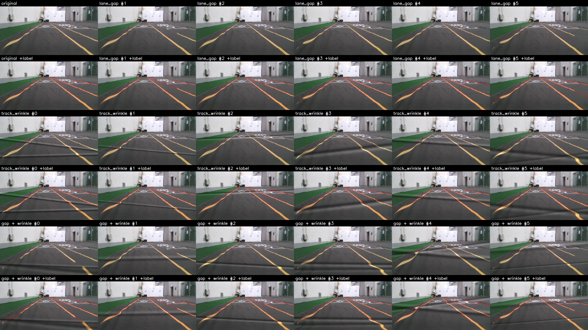
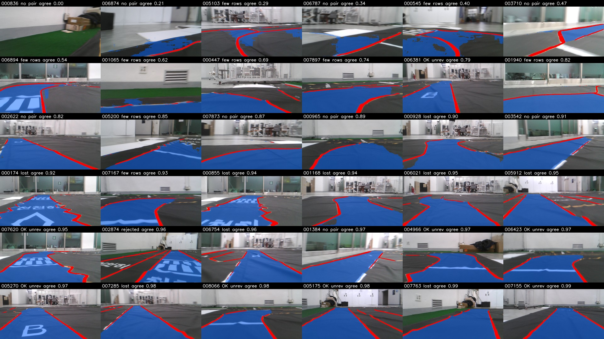

# 앙상블 멤버 ego lane 파인튜닝 (2026-10-28)

공개 모델(BDD100K 사전학습)은 da를 "도로 전체"로 칠한다. 우리가 필요한 건 **지금 달리는 차선(ego lane)**뿐이라,
ego lane pseudo-label([`EGO_LANE_PSEUDO_LABEL.md`](EGO_LANE_PSEUDO_LABEL.md))을 사람이 검수한 데이터로
앙상블 멤버 4개를 각각 파인튜닝했다.

## 0. 한눈에 보기

```
LimoPro_frames_20261027 (1280x720, 8465장)
  │  Drive 중복본·정지 중복 제거                         -> 8232장           (dataset/README.md)
  ▼
ego lane pseudo-label (4모델 앙상블 + HSV + 기하 추적 + SAM2) -> OK 3286 / FAIL 4946
  │  사람 검수: 0~4929번 OK 1994장 중 257장 반려          -> 검증된 OK 1737장
  ▼
build_train_dataset.py: 시간 구간 분할 + 비슷한 프레임 제거 + 커브/직진 1:1
  │                                                     -> train 950 / val 97 / test 268
  ▼
train_seg.py x 4 모델 (train_all.py 순차 실행, train_watchdog.py 감시)
```

## 1. 데이터

### 1.1 원본과 pseudo-label
- 원본: `dataset/LimoPro_frames_20261027/session_183234` — Orbbec Dabai DC1, 1280×720 jpg, 약 8.6Hz, 16분 주행.
  정지 상태 중복 프레임은 제거(바로 앞 프레임과 평균 차이 < 2.5). 자세한 건 `dataset/README.md`.
- pseudo-label: `scripts/make_ego_lane_labels.py --no-gif --save-labels` (프로세스 2개 병렬, GPU 99%로 약 55분).
  입력이 가로 640보다 크면 비율 유지로 640×360으로 줄여서 처리·저장한다.

| 판정 | 장수 | 비율 |
|---|---|---|
| OK | 3286 | 40% |
| FAIL: 좌/우 차선 한쪽 누락 | 1829 | 22% |
| FAIL: 추적 끊김 | 1735 | 21% |
| FAIL: 추적 행 부족 | 1382 | 17% |

- 앙상블 멤버는 4개: YOLOPv2, TwinLiteNet+ Large, YOLOP, HybridNets.
  TwinLiteNet+ N/S/M/L은 같은 구조의 크기 차이라 Large만 남겼다(4개를 다 넣으면 이 계열 혼자 7표 중 과반).

### 1.2 사람 검수
- `scripts/split_ego_labels.py`로 ok/ fail/ 분리 → `scripts/review_ok_labels.py make`로 [원본 | 오버레이] 이미지 생성
  → 사진 앱에서 넘기며 틀린 OK를 삭제 → `review_ok_labels.py apply`로 ok → fail 이동(`rejected.csv`).
- 1차 검수: frame 0~4929의 OK 1994장 중 **257장(13%) 반려**, 검증된 OK **1737장**. 4930번 이후 OK 1292장은 미검수.

### 1.3 학습 데이터셋 (`dataset/ego_v1`, `scripts/build_train_dataset.py`)
- **시간 구간 단위 분할**: 연속 프레임은 서로 거의 같아서 무작위로 나누면 test 점수가 부풀려진다.
  - test = frame 4300~4929 전체(자연 비율 그대로), val = 2000~2299, 두 구간 앞뒤 30프레임은 버퍼로 제외.
- train만 줄인다: 마지막으로 남긴 프레임과 dHash 해밍거리 < 6이면 버림 → 커브/직진 1:1.
  - 커브 판정: ego da 중심선을 아래→위로 2차 피팅, |휨| ≥ 1.0 또는 |기울기| ≥ 0.4. 실제 커브와 차가 비스듬히 선 장면이 같이 잡힌다.

| split | 장수 | 커브 |
|---|---|---|
| train | 950 | 475 (+ 직진 475) |
| val | 97 | 23 |
| test | 268 | 84 |

> 주의: test의 커브는 자동 라벨이 **성공한** 완만한 커브뿐이다. 차선이 한쪽만 보이는 급커브(FAIL)는 아직 평가에 없다.

## 2. 학습 방식 (`scripts/train_seg.py`)

공통 코드 하나에 모델별 어댑터를 끼운다. 어댑터는 각 모델 출력을 **da/ll 전경 확률**로 바꾼다
(앙상블 추론 `make_model_compare_gif.py`의 `probs()`와 같은 정의).

| 모델 | 파라미터 | 입력 | 출력 → 확률 | LR |
|---|---|---|---|---|
| TwinLiteNet+ Large | 1.94M | RGB /255 | 2ch logit → softmax[1] | 5e-5 |
| YOLOP | 7.9M | BGR ImageNet 정규화 | 채널별 sigmoid 2ch → c1/(c0+c1) | 1e-4 |
| HybridNets | 12.8M | RGB ImageNet 정규화 | 3ch logit → da = road+lane, ll = lane | 1e-4 |
| YOLOPv2 | 38.9M | RGB /255 | da 2ch → c1/(c0+c1), ll 1ch 그대로 | 1e-5 |

- **입력**: 640×360 이미지를 위아래 12px 패딩해 640×384. 라벨은 640×360 그대로, 손실/평가 때 출력 높이 12:-12만 사용
  (TwinLiteNetPlus 공식 BDD100K 학습과 같은 배치).
- **손실**: BCE + soft Dice, `da + 2.0 × ll` (KMU에서 ll 가중치 2.0이 효과 있었음). AdamW, poly LR(power 1.5), batch 8, 최대 40 epoch.
- **증강**(학습 중 매번 무작위, 파일 수는 그대로 950):
  - 기하: 좌우 반전 50%, 회전 ±5°·확대 0.9~1.1·이동 ±5% 50%
  - 색: HSV 지터 50%
  - 빛: 과노출(밝기 ×1.6~2.6) 15%, 위쪽 조명 번짐 25%, 바닥 반사 띠 20%
  - 블러(셋 중 하나): 방향 모션 블러 9~25px 15%, 전진 줌 블러 4~10% 15%, 가우시안 10%
  - 샘플: `outputs/augmentation_samples.jpg`
  - 차선 끊김(2차 학습부터, 아래 2.0절): lane_gap 30%, track_wrinkle 25%
- **조기 종료**: val (da + ll) IoU가 8 epoch 동안 0.001 이상 안 오르면 멈추고 test로.
- **저장/재개**: 매 epoch `last.pt`(임시 파일에 쓴 뒤 교체 → 전원이 꺼져도 안 깨짐). 다시 실행하면 자동으로 이어서.
  `best_da.pt` / `best_ll.pt`는 val 기준 최고점. 끝나면 `test.json`(best_da 가중치, 전체/커브/직진 IoU).

### 2.0 차선 끊김 증강 (lane_gap / track_wrinkle)

**문제**: 트랙 매트가 구겨진 곳에서 차선(ll)이 끊기거나 어긋나 보이면, 그 자리에서 da가 차선 밖으로 새는 경우가 많다.
학습/test 데이터(`LimoPro_frames_20261027`)는 현수막을 당기지 않아 주름이 많은 촬영이라 진짜 주름 장면은 이미 들어 있다.
다만 기존 파이프라인을 통과한 OK 프레임만 썼기 때문에 차선이 심하게 끊긴 장면은 FAIL로 빠졌을 수 있다(가설, 측정 전).
반대로 주름 없는 촬영(`LimoPro_frames_20261023`, 640×480, 434장)은 학습에 쓰지 않았고 라벨도 없어서, 팽팽한 트랙에서의 성능은 수치로 검증되지 않았다.

**방법**: 이미지에서만 차선을 지우거나 꺾고 **라벨(da, ll)은 그대로** 둔다 → "차선이 안 보이거나 어긋나도 경계는 이어진다"를 배우게 함.
기하/색 증강 다음, 빛/블러 증강 전에 적용(`scripts/train_seg.py`의 `lane_gap`, `track_wrinkle`).

| 증강 | 확률 | 내용 |
|---|---|---|
| `lane_gap` | 30% | ll이 있는 높이에서 1~2구간(세로 20~80px)을 골라, 그 구간의 차선 조각 **하나만** 마스크를 7px 넓혀 `cv2.inpaint`(TELEA)로 주변 바닥 질감으로 메움. 메운 곳에 노이즈(σ=3)를 넣고 경계를 블러로 섞음 |
| `track_wrinkle` | 25% | 살짝 기운(±0.15) 가로 띠 1~2개(폭 4~15px)에서 이미지를 옆으로 4~15px, 위아래로 ±4px 밀어 차선이 꺾여 보이게 하고, 주름 한쪽은 그늘/반대쪽은 반사(밝기 ±25~50%) |

설계 메모:
- **한 구간에 한 조각만 지움**: 먼 곳에서 좌우 차선이 한 덩어리로 붙어 있어도 구간 안에서 덩어리를 다시 나눠 하나만 고름.
  같은 높이에서 양쪽 차선이 다 사라지면 정답 자체가 애매해지기 때문.
- **단색으로 칠하지 않음**: 매끈한 패치가 생기면 "평평한 패치 = 차선 자리"라는 꼼수를 배울 수 있어서 inpaint + 노이즈 + 경계 블러.
- 바닥으로 메우는 방식이라 차선 색(노랑/흰색)에 상관없이 동작.
- 학습 데이터는 모두 사람 검수 라벨이라 "차선이 온전히 이어진 프레임에만 적용" 조건은 ll 마스크가 있는 높이에서만 지우는 것으로 충분.

샘플:
- `outputs/augmentation_lane_gap_samples.jpg`: 학습 이미지 6장 × (원본 / lane_gap / lane_gap+라벨 / track_wrinkle / 둘 다)
- `outputs/augmentation_lane_gap_000000.jpg`: frame_000000 한 장의 무작위 변형 6×6 (홀수 행 = 증강, 짝수 행 = 같은 이미지 + 라벨 윤곽)



남은 것:
- 1차 모델(3장 결과)은 이 증강 없이 학습됐다. 2차 학습(사람 검수한 pseudo-label 추가)부터 적용.
- 효과 확인: test 셋에 같은 lane_gap을 적용한 "끊긴 차선 test"에서 1차/2차 모델의 da IoU와 차선 밖 침범 비율 비교 + 실제 구겨진 장면 육안 비교.
- 조정 후보: 가까운 쪽(화면 아래)을 더 자주 지우기(주행에 영향 주는 곳), 끊김 최대 길이 80 → 120px.
- frame_000000의 ll 라벨에 오른쪽 옆 차로 바깥 차선 일부(y≈250)가 짧게 들어가 있음. 비슷한 라벨 오류가 더 있을 수 있음.

### 2.1 YOLOPv2 (TorchScript) 학습 가능하게 만들기
학습 코드가 공개되지 않아 TorchScript 가중치를 직접 학습한다. 세 가지를 고쳤다(`load_yolopv2_trainable`).
1. 배포본이라 파라미터가 `requires_grad=False`로 저장돼 있음 → 켬.
2. `batch_norm`에 `cudnn_enabled=True`가 상수로 박혀 있어 ZLUDA에서 `CUDNN_STATUS_EXECUTION_FAILED`.
   추론용 로더처럼 `torch.jit.freeze`하면 가중치가 상수가 돼 학습이 안 됨 → 그래프를 inline한 뒤 batch_norm 8번째 입력만 False로 교체.
3. 합성곱 128개에도 `cudnn_enabled=True`가 박혀 있다. ZLUDA에서 da 헤드의 전치 합성곱이 **에러 없이 엉터리 값**을 내서
   1차 학습은 사전학습 상태부터 val da IoU 0.01 → 발산(ll은 nearest 업샘플이라 정상). CPU에서는 추론용 로더와 출력이 완전히 같았음.
   → `_convolution`의 11번째 입력(cudnn_enabled)도 False로 교체.
- 그래프의 batch_norm은 추적 당시 eval 모드로 고정이라 통계는 안 바뀌고 가중치만 학습된다. 검출 헤드 파라미터 72개는 손실에 안 쓰여 기울기 없음(정상).

### 2.2 실행과 감시
- `scripts/train_all.py`: 모델을 순서대로 돌림. `test.json`이 있으면 건너뛰고, 비정상 종료 시 3번까지 재시도.
  PC가 꺼졌다 켜져도 **같은 명령을 다시 실행**하면 끝난 모델은 건너뛰고 멈춘 모델은 이어서 학습한다.
- `scripts/train_watchdog.py`: 상태를 점검해 `outputs/train_watchdog*.log`에 남긴다. 감시 중에는 Windows 절전을 막는다
  (화면 잠금은 학습과 무관). DONE / DEAD / GIVEUP / STALL / GPU_IDLE이면 이유를 출력하고 종료 → Claude Code 알림으로 조치.
  `--once`는 10분 뒤 한 번 점검하고 종료(주기 보고용).
- GPU 사용률 상한은 `GPU_DUTY`(기본 0.9). 장시간 100% 부하로 PC가 꺼진 적이 있어서다.
- ZLUDA는 처음 보는 연산(특히 역전파)을 CPU로 컴파일한다. 모델마다 첫 epoch가 길고 그동안 GPU 0%가 정상
  (TwinLiteNet+ 첫 epoch 273초 → 이후 105초).

## 3. 결과 (test 268장, 학습에 안 쓴 시간 구간)

| 모델 | epoch (best) | 전체 da | 전체 ll | 커브 da | 커브 ll | 직진 da | 직진 ll |
|---|---|---|---|---|---|---|---|
| TwinLiteNet+ Large | 40 (–) | 0.954 | 0.784 | 0.918 | 0.731 | 0.970 | 0.806 |
| YOLOP | 35 조기 종료 (27) | 0.925 | 0.723 | 0.894 | 0.670 | 0.940 | 0.745 |
| **HybridNets** | 32 조기 종료 (24) | **0.967** | **0.809** | **0.937** | **0.760** | **0.980** | **0.830** |
| YOLOPv2 | 38 조기 종료 (30) | 0.962 | **0.810** | 0.938 | **0.761** | 0.973 | **0.830** |
| YOLOP 채널별 BCE | 35 조기 종료 (27) | 0.940 | 0.749 | 0.906 | 0.692 | 0.956 | 0.774 |
| **4개 앙상블** (TwinLiteNet+ L, YOLOP 채널별 BCE, HybridNets, YOLOPv2) | – | **0.971** | 0.809 | **0.947** | 0.754 | **0.981** | **0.833** |

### 3.1 학습 시간 (RX 9070 XT + ZLUDA, GPU 90% 상한, batch 8, train 950장)

| 모델 | 파라미터 | 시작 → 끝 | 걸린 시간 | epoch | 첫 epoch (컴파일 포함) | 이후 epoch |
|---|---|---|---|---|---|---|
| TwinLiteNet+ Large | 1.94M | 11:56 → 13:09 | **73분** | 40 (조기 종료 도입 전) | 273초 | 105초 |
| YOLOP | 7.9M | 13:09 → 13:58 | **49분** | 35 (조기 종료) | 97초 | 83초 |
| HybridNets | 12.8M | 13:58 → 14:33 | **35분** | 32 (조기 종료) | 121초 | 64초 |
| YOLOPv2 (1차, 실패) | 38.9M | 14:33 → 14:41 | 8분 | 3 (중단) | 148초 | 136초 |
| YOLOP 채널별 BCE | 7.9M | 14:41 → 15:30 | **49분** | 35 (조기 종료) | 132초 | 83초 |
| YOLOPv2 (재학습) | 38.9M | 15:31 → 16:58 | **87분** | 38 (조기 종료) | 143초 | 136초 |

- 걸린 시간 = 학습 + 매 epoch val + 마지막 test 평가. 파라미터 수와 속도가 비례하지 않는다(HybridNets가 가장 빠름).
  모델 구조(업샘플 방식, 연산 종류)와 ZLUDA 커널 효율 차이로 보인다.
- TwinLiteNet+ 첫 epoch가 유독 긴 건 ZLUDA가 학습(역전파) 커널을 처음 컴파일했기 때문. 이후 모델은 캐시 덕에 짧다.
- YOLOPv2 1차는 da 출력이 처음부터 깨져(§2.1) 3 epoch에서 중단.

- 단일 모델은 **HybridNets와 YOLOPv2가 사실상 동급 1위**(da는 HybridNets, ll·커브는 YOLOPv2가 근소 우위).
- **앙상블은 da에서 전 항목 1위**(커브 da +0.01). ll은 단일 최고와 같고 커브 ll만 조금 낮다
  (ll 과반 투표에 약한 YOLOP가 섞인 영향으로 추정) → pseudo-label은 앙상블로 생성.
- 모든 모델에서 **커브가 직진보다 약하다**(TwinLiteNet+ da 0.92 vs 0.97).
- TwinLiteNet+는 val 최고점(da 0.960 / ll 0.791)과 test가 거의 같아 특정 구간 과적합 흔적은 없다.
- YOLOP가 가장 낮고 손실도 3.3 근처에서 다른 모델(0.5~0.6)보다 높게 머물렀다. 원인 가설은 §4.
- **YOLOP를 채널별 BCE로 다시 학습하니 test da +0.015, ll +0.026**(커브 ll +0.022). 전경/(배경+전경) 비율로 학습할 때
  두 sigmoid 채널이 함께 포화돼 기울기가 사라진다는 가설과 맞는다 → 앙상블에는 `yolop_chbce_seed0` 사용.

## 4. 관찰 / 다음 할 일

- **YOLOP 출력과 손실의 불일치(가설)**: YOLOP는 중간층은 Hardswish, 출력층만 채널별 sigmoid 2ch다.
  우리는 전경/(배경+전경) 비율로 확률을 만들어 학습했는데, 두 채널이 함께 포화되면 이 비율을 통한 기울기가 거의 사라진다.
  → YOLOP 원래 방식대로 **채널별 BCE**(`train_seg.py --loss channel`)로 재학습해 비교한다:
  `train_all.py --data dataset/ego_v1 --models yolop --suffix _chbce -- --loss channel`
- 4개 학습이 끝나면: 파인튜닝한 4개로 앙상블을 다시 구성해 test에서 단일 모델과 비교.
- 급커브(FAIL 4946장)는 아직 학습/평가에 없다. 파인튜닝 앙상블로 FAIL 프레임 pseudo-label → 모델 간 의견이 갈리는 프레임만 사람 검수 → 학습 데이터 추가(반복).
- 4930번 이후 OK 1292장 검수가 남아 있다.

### 4.0 1차 pseudo-label 결과 (`outputs/pseudo_ft_v1`, 2026-10-28)

4개 앙상블(TwinLiteNet+ L, YOLOP 채널별 BCE, HybridNets, YOLOPv2)로 **5881장** 생성(약 10분, GPU 90%).

| 원래 판정 | 장수 |
|---|---|
| FAIL: 좌/우 차선 한쪽 누락 | 1610 |
| FAIL: 추적 끊김 | 1523 |
| FAIL: 추적 행 부족 | 1229 |
| 사람이 반려한 OK | 233 |
| 미검수 OK (4930번~) | 1286 |

- 모델 간 일치도(`da_agree`) 중앙값 0.919. **0.95 이상 2085장 / 0.8 미만 1846장**. da가 거의 없는(<1%) 프레임 55장.
- 몽타주 `outputs/montages/pseudo_ft_v1_6x6.jpg` (일치도 3등분에서 12장씩, 위 = 어려움):
  - 일치도 0.5 미만은 벽·인조잔디·트랙 밖 장면이고 da가 얼룩덜룩 → 검수에서 버릴 후보.
  - 일치도 0.8 이상에는 원래 FAIL이던 **커브 프레임도 지금 차선만 깔끔하게** 칠해진 경우가 많다(예: 000174, 000855, 001168, 003542).
    기하 파이프라인이 못 잡던 장면을 파인튜닝 모델이 잡는다.
  - ll은 횡단보도·노면 표시 테두리를 차선으로 칠하는 경우가 있어 검수 때 확인 필요.



### 4.1 다음 루프: 파인튜닝 앙상블 pseudo-label → 사람 검수
1. `make_finetuned_pseudo_labels.py --eval-test` 로 앙상블이 단일 모델보다 나은지 test에서 확인.
2. `make_finetuned_pseudo_labels.py --labels ... --reviewed-max 4929 --out outputs/pseudo_ft_v1`
   - 대상: fail/ 전부 + 4929번 이후 미검수 OK. val/test 구간(+버퍼)은 제외(급커브 사람 GT로 평가에 쓸 것).
   - da = 멤버 확률 평균 ≥ 0.5, ll = 과반 투표, 저장 da = da ∪ ll. `meta.csv`의 `da_agree`(멤버 쌍별 IoU 평균) 오름차순 = 검수 우선순위.
3. 검수: `tools/ego_label_review_{mac,radeon,nvidia}.ipynb` (GPU 설정 셀만 다르고 나머지 동일).
   - 노트북은 SAM2만 로드한다(모델 4개 불필요). gradio는 5.x 고정 — 6.x는 huggingface-hub ≥ 1.16을 요구해 transformers와 충돌.
   - 라데온 버전은 이 PC(Windows ZLUDA)에서 버튼 흐름 + SAM(2.4초/회) + 웹 앱 기동까지 확인. 맥/NVIDIA 버전은 문법 검사만 함.
4. 검수 결과(`<out>_review/`)를 학습 데이터에 추가 → 재학습.
- 자기참조 주의: 이 모델들 라벨을 사람이 검수만 해서 만든 GT로 같은 모델을 평가하면 점수가 부풀려진다. 급커브 test GT는 SAM으로 직접 만들 것.
- 배포 후보는 속도가 중요하므로 LIMO PRO(Jetson)에서 `scripts/benchmark_models.py`로 실측 필요.

### 4.2 2차 학습 (2026-10-31, 동아리 RTX 3070 Ti)
- 결과 보고서: `outputs/train_v2_foscar/학습결과_보고서.md`, 가중치: GitHub 릴리즈 `ego-lane-v2` (1차는 `ego-lane-v1`).
- 같은 test 268장에서 앙상블 da 0.971 -> 0.961, ll 0.809 -> 0.801로 조금 떨어졌지만, 사람이 봤을 때는 2차가 더 좋아 보인다.
- 보고서 해석 중 수정할 점: `001660`은 모델 오류가 아니라 정답 오류이고(사람 확인), `005693`은 정답 구멍, `001714`는 정답에서 흰 선을 뺀 영향이다. "사람이 고친 라벨 53장"을 가장 믿을 만한 값으로 본 것과 차로 선택 오류가 가장 큰 약점이라는 결론은 다시 확인해야 한다.
- 라벨 정리: `scripts/clean_labels.py`가 흰 선 포함, 작은 구멍 메우기, 작은 조각 지우기를 해서 `dataset/ego_v2_clean`을 만든다. `scripts/eval_clean_compare.py`로 1차와 2차를 다시 채점한다.

- 재채점 (`outputs/eval_clean/`, 2026-10-31): 라벨 정리 후에도 test 268장 앙상블 da는 0.971 -> 0.962로 그대로 떨어진다. 채점 라벨의 잡음은 이 하락의 원인이 아니다. 추가 test 274장은 단일 모델 da가 모두 올랐지만(HybridNets 0.873 -> 0.936 등) 라벨 출처가 양쪽으로 치우쳐 있어 참고용이다. 3차선 구간(`004919`, `004924`, `004669`)은 점수가 떨어졌지만, 이 구간은 전체를 칠하기로 정했고 test 정답은 아직 내 차로 기준이라 재채점이 필요하다.

### 4.3 3차 학습 (2026-11-07, H100)
- 2차 가중치에서 이어서, `dataset/ego_v3`(2차 3,524 + 11/06 대회장 조명 464, 3차선 전체를 칠한 2차 라벨 188장 제외)와 대회장 조명 증강(`scripts/venue_aug.py`, 70%)으로 학습. 가중치는 릴리즈 `ego-lane-v3`.
- 대회장 test 143장 da: HybridNets 0.910 -> 0.935, TwinLiteNet+ Large 0.886 -> 0.919, YOLOP 0.736 -> 0.926, YOLOPv2 0.899 -> 0.939. 기존 test 542장 da도 모두 0.005~0.010 올랐다. 1~3차 채점: `outputs/train_v3_h100/venue_eval_v1v2v3.json`
- 라벨 기준 확정(2026-11-06): da는 모든 구간에서 지금 달리는 차선만 칠한다. 4.2의 "3차선은 전체를 칠한다"는 그 전 판단이다.

## 5. 재현 명령

```bash
# 1) pseudo-label (반으로 나눠 2개 병렬 실행 후 폴더 합치기)
GPU_DUTY=0.99 .venv/Scripts/python scripts/make_ego_lane_labels.py --frames dataset/LimoPro_frames_20261027/session_183234 \
    --no-gif --save-labels outputs/ego_labels_20261027_183234
.venv/Scripts/python scripts/split_ego_labels.py outputs/ego_labels_20261027_183234

# 2) 사람 검수
.venv/Scripts/python scripts/review_ok_labels.py make  outputs/ego_labels_20261027_183234
#    (ok_review/ 에서 틀린 이미지 삭제)
.venv/Scripts/python scripts/review_ok_labels.py apply outputs/ego_labels_20261027_183234

# 3) 학습 데이터셋
.venv/Scripts/python -I scripts/build_train_dataset.py outputs/ego_labels_20261027_183234 dataset/ego_v1 --reviewed-max 4929

# 4) 학습 (끊기면 같은 명령 다시) + 감시
.venv/Scripts/python scripts/train_all.py --data dataset/ego_v1 --models tln_large yolop hybridnets yolopv2
.venv/Scripts/python scripts/train_watchdog.py --models tln_large yolop hybridnets yolopv2
```
