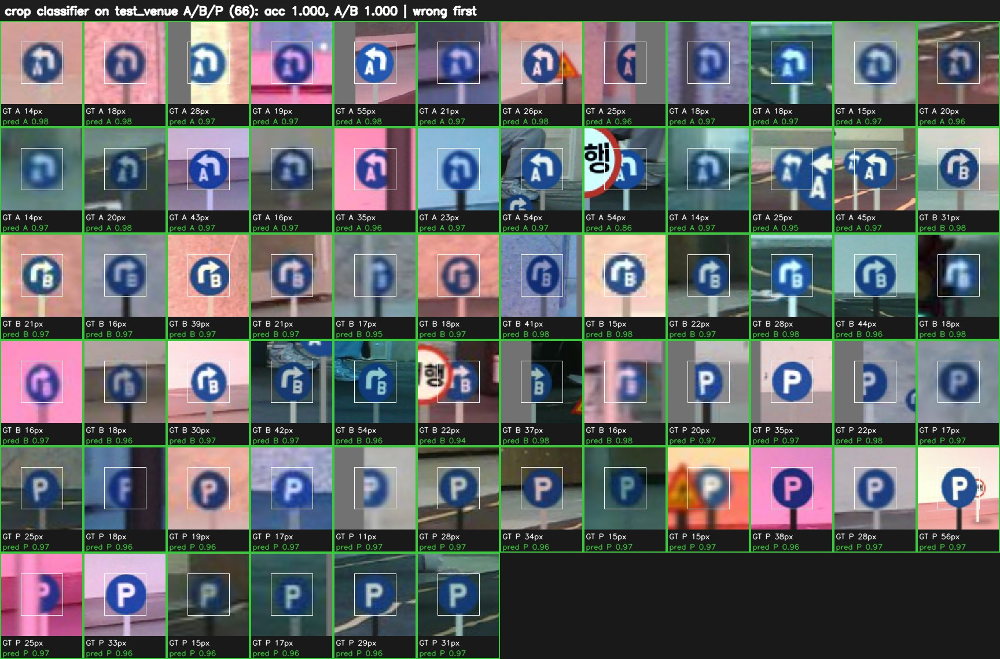

# 다중 작업 1차: 검출 점수 분석 (2026-11-10)

`multitask-v1`(HybridNets, 검출 12종)의 검출 점수가 클래스마다 크게 다릅니다. 신호등과 켜진 불은 0.93~1.00인데, 표지판 대부분은 0.35~0.6입니다. 이 문서는 그 이유를 확인한 기록입니다.
결과 수치와 그림은 [`outputs/train_mt_v1/README.md`](../outputs/train_mt_v1/README.md)에 있습니다.

## 처음 의심한 것

1. 신호등이 1.0 근처라 오버피팅이고, 나머지는 0.5 근처라 언더피팅인가?
2. HybridNets 검출부가 클래스 1개용으로 만들어져서, 여러 클래스를 다루니 점수가 낮아진 건가?

## 결론

| 의심 | 확인 결과 |
|---|---|
| HybridNets 검출이 1클래스 전용이다 | **아닙니다.** 다중 클래스 구조이고, 클래스 무시 AP50이 0.96입니다 |
| 신호등 1.0은 오버피팅이다 | **쉬운 클래스라 높은 것입니다.** 색(빨강·노랑·초록)만 보면 되고 크기도 큽니다. 다만 test가 합성이라 모든 점수가 실제보다 높게 나왔을 수 있습니다 |
| 나머지는 언더피팅이다 | **맞습니다(표지판 안쪽 그림으로만 구분되는 클래스).** A/B는 train 사진에서도 2택 정답률이 59%입니다 |

**모델은 표지판의 바깥 모양과 색(빨간 삼각형, 파란 사각형, 빨간 원)까지만 배웠고, 안쪽 그림(사람과 방지턱, A 화살표와 B 화살표와 P)은 배우지 못했습니다.**

- 같은 사진에서 잘라 낸 표지판으로 작은 CNN을 학습하면 A/B/P를 거의 100% 구분합니다(5절). 정보는 사진에 있습니다.
- HybridNets 백본 특징도 A/B를 약 95% 구분합니다. 그런데 BiFPN을 지나며 86%로 줄고, 검출 머리는 58%만 씁니다(6절).
- 그래서 HybridNets 하나로 고치는 실험(검출 머리·BiFPN 학습 강화, 백본 지름길)을 돌리고 있습니다(8절).

## 1. HybridNets 검출부는 다중 클래스 구조

- 분류 머리 출력은 `앵커 수 × 클래스 수`입니다. `train_multitask.py`에서 `HybridNetsBackbone(num_classes=12)`로 만듭니다.
- 손실(`hybridnets/loss.py` FocalLoss)은 정답 라벨을 `targets[앵커, 클래스번호] = 1`로 클래스마다 따로 만들고, 클래스마다 sigmoid로 계산합니다.
- 검출부는 COCO 80종을 학습하던 EfficientDet 구조입니다. 공개 가중치가 BDD100K `car` 한 종으로 학습돼 있어서 1클래스 전용처럼 보였던 것입니다.

## 2. 위치는 찾고, 종류를 헷갈림

`scripts/eval_mt_det_diag.py` 결과(`outputs/train_mt_v1/diag_det.txt`)입니다.

**클래스를 무시하고 "물체가 있다"만 채점하면 AP50이 0.958(기존 test) / 0.966(대회장) / 0.960(bag)입니다.** 표지판이 있는 자리는 거의 다 찾습니다.

정답별로 모델이 낸 답(기존 test, 점수 0.3 이상, IoU 0.5 이상인 예측 중 점수 최고)입니다.

| 정답 | AP50 | 모델이 낸 답 |
|---|---:|---|
| pedestrian | 0.48 | **bump 48**, pedestrian 30, 놓침 9 |
| bump | 0.62 | bump 72, pedestrian 15, 놓침 4 |
| sign_A | 0.34 | sign_A 31, **parking 28**, sign_B 15, 놓침 9 |
| sign_B | 0.37 | **parking 31**, sign_A 24, sign_B 21, 놓침 9 |
| parking | 0.36 | parking 32, sign_A 25, sign_B 14, 놓침 12 |
| slow | 0.98 | slow 77, 놓침 5 |
| traffic_light | 0.99 | traffic_light 256, 놓침 4 |

혼동은 두 묶음 안에서만 일어납니다.

- **빨간 삼각형**: pedestrian ↔ bump
- **파란 사각형**: sign_A ↔ sign_B ↔ parking

혼자 빨간 원 모양인 slow는 0.98입니다. 대회장 test와 test_bag도 같은 양상입니다.

## 3. 앵커 크기 때문은 아님

| 클래스 | 크기 중앙값 (640×360 기준, √면적) | 하위 10% | 학습 때 정답 앵커를 받을 수 있는 비율 |
|---|---:|---:|---:|
| 표지판 6종 | 21~24px | 14~16px | 94~97% |
| traffic_light | 41px | 27px | 98% |
| 켜진 불 3종 | 12~13px | 9px | 81~93% |

- 가장 작은 앵커가 약 10px이고, HybridNets 손실은 100px² 이하 박스를 IoU 0.15부터 정답으로 칩니다. 표지판의 94% 이상은 정답 앵커를 받습니다.
- 켜진 불은 표지판보다 작은데도 0.95 이상입니다. **문제는 크기가 아니라 색 말고 그림으로 구분해야 한다는 점입니다.**

## 4. A/B 집중 확인: 언더피팅

`scripts/eval_mt_ab.py` 결과(`outputs/train_mt_v1/ab_stats.json`)입니다. 정답 A/B 표지판마다, 그 자리 앵커에서 **A 점수와 B 점수만 비교**했습니다(A/B 2택). 50%가 찍기 수준입니다.

| | A/B 2택 정답률 | 최종 예측 정답률 |
|---|---:|---:|
| **train** (600장, 증강 없음) | **59%** | 38% |
| 기존 test | 58% | 30% |
| 대회장 test | 57% | 34% |
| test_bag | 54% | 23% |

- **train과 test 정답률이 같습니다.** 학습한 사진도 못 맞히니 오버피팅이 아니라 언더피팅입니다.
- **크기와 상관이 없습니다.** 기존 test에서 18px 미만 53%, 26px 이상 59%입니다. 54px짜리 또렷한 A 표지판도 A/B/P 점수가 0.34~0.38로 비슷합니다.
- 점수를 보면 A·B·P가 모두 0.33~0.40입니다. "파란 사각형이면 셋에 1/3씩"이 손실을 가장 줄이는 답이라, 모델이 그 상태에 머물러 있습니다.

### 학습 라벨은 정상

train의 A / B / P 표지판을 Klein으로 다듬은 것과 원본으로 나눠 잘라 봤습니다(`scripts/eval_mt_train_crops.py`).

- A는 왼쪽 화살표, B는 오른쪽 화살표, P는 P이고, 라벨이 바뀐 사진은 보이지 않습니다.
- Klein이 그림을 지우거나 바꾼 흔적도 보이지 않습니다.
- 사람 눈으로는 15px짜리도 대부분 구분됩니다.

A/B가 있는 사진은 좌우 반전을 하지 않습니다. 화살표 방향이 바뀌어 라벨이 틀어지기 때문이고, 코드에서 제대로 꺼져 있는 것을 확인했습니다.

## 5. 확인 실험 1: 잘라 낸 표지판으로 작은 분류기 학습

같은 사진에서 정답 박스 주변을 잘라 A/B/P 3종 분류기(작은 CNN, 약 117만 파라미터)를 처음부터 학습했습니다(`scripts/eval_mt_ab_crop_cls.py`).

- 입력: 박스 주변 1.5배를 64×64로 잘라 씀. 사진은 640×360 그대로
- 증강: 박스 위치·크기 흔들기(검출 박스 오차 흉내), 해상도 낮췄다 올리기, 색 조명, 흐림. 좌우 반전 없음
- train 4,526개, 30 epoch, 약 15초

| | 표지판 수 | 3종 정답 | A/B 정답 | 박스 ±10% 흔듦 A/B | 검출 모델 A/B (비교) |
|---|---:|---:|---:|---:|---:|
| train | 4,526 | 99.8% | 99.9% | 99.8% | 59% |
| val | 153 | 100% | 100% | 100% | - |
| 기존 test | 260 | 100% | 100% | 100% | 58% |
| 대회장 test | 66 | 100% | 100% | 100% | 57% |
| test_bag | 20 | 100% | 100% | 100% | 54% |

- 18px 미만 표지판도 같습니다. val은 3번째 epoch에 95%를 넘었습니다.
- **같은 사진, 같은 해상도로 작은 CNN은 바로 배웁니다. 정보는 사진에 충분히 있습니다.**
- 100%는 그대로 믿기 어렵습니다. 합성 기록(`meta.csv`)에 표지판 그림 종류가 없고 잘라 본 사진도 클래스마다 같은 디자인이라, train과 test가 같은 그림으로 합성된 쉬운 시험으로 보입니다. 실제 표지판 사진으로 확인해야 합니다.

## 6. 확인 실험 2: HybridNets 내부 특징에 A/B 정보가 있는가 (linear probe)

학습된 가중치를 고정하고, 층마다 정답 표지판 자리의 특징(roi_align 3×3)만으로 선형 분류기를 학습했습니다(`scripts/eval_mt_feature_probe.py`).
특징에 정보가 있으면 높게, 없으면 낮게 나옵니다.

| 특징을 뽑은 곳 | 해상도 | 1차 A/B (기존 test / 대회장 test) | 4차 차선 모델 A/B |
|---|---|---:|---:|
| 백본(EfficientNet-B3) p2 | 1/4 | **97% / 93%** | 97% / 91% |
| 백본 p3 | 1/8 | **97% / 93%** | 91% / 93% |
| BiFPN P3 (**검출 머리가 받는 층**) | 1/8 | 86% / 80% | 78% / 64% |
| BiFPN P4 | 1/16 | 64% / 64% | 65% / 57% |
| 실제 검출 머리 출력 (비교) | | 58% / 57% | - |

1. **백본은 A/B를 이미 구분합니다(약 95%).** 차선만 배운 4차 가중치도 같아서, HybridNets 구조나 입력 해상도가 원인은 아닙니다.
2. **BiFPN을 지나며 줄어듭니다(97% → 86%).** BiFPN이 고운 층에 거친 층(P4~P7)을 섞어서 작은 표지판 세부가 흐려집니다.
3. **검출 머리는 받은 정보도 다 못 씁니다(86% → 58%).** 학습 부족입니다. 다만 BiFPN P3는 4차 78%에서 1차 86%로 올랐으니, 맞는 방향으로 배우던 중에 lr이 0이 된 것으로 보입니다.

## 7. 원인 정리

데이터에 정보가 있고 라벨도 맞고, 백본 특징에도 정보가 있습니다. 원인은 학습과 BiFPN 쪽입니다.

1. **분류 머리가 새로 시작했고 학습량이 적습니다(실험 2의 3번).** 분류 머리는 12클래스로 새로 초기화했고, lr 1e-4가 40 epoch에 0이 되도록 줄었습니다. 색으로 구분되는 클래스로 손실이 먼저 크게 줄고, 그림으로만 구분되는 클래스는 1/3 지점에 머문 채 lr이 바닥났을 수 있습니다. val mAP50은 마지막 epoch까지 0.68 → 0.69로 조금씩 오르고 있었습니다.
2. **검출 손실 비중이 작습니다.** 분할 손실(da + 2×ll + 2×흰 가로선)이 검출 손실(×1.0)보다 무거워서 BiFPN과 검출 머리가 천천히 배웁니다. 백본에는 이미 정보가 있으니(실험 2의 1번), 백본이 차선 쪽에만 맞춰진 것은 아닙니다.
3. **BiFPN이 고운 특징을 흐립니다(실험 2의 2번).** 22px 표지판은 stride 8에서 3×3 칸이고, BiFPN이 여기에 거친 층을 섞습니다.

## 8. HybridNets 개선 실험 (진행 중)

HybridNets 하나로 고치는 실험 두 개를 1차 best.pt에서 이어서 15 epoch씩 돌리고 있습니다(`scripts/run_mt_exp_ab.sh`). 결과가 나오면 이 절에 채웁니다.

| | 바꾸는 것 | Jetson 속도 영향 |
|---|---|---|
| **A. 학습만** | 검출 머리(regressor, classifier)와 BiFPN의 lr 10배(1e-3), 검출 손실 비중 1 → 2, 처음 500 step warmup | 없음 |
| **B. A + 지름길** | 백본 p3 특징을 1×1 conv로 BiFPN P3에 더해 검출 머리에만 넣음(`det_skip`). 0으로 시작해서 처음엔 1차와 출력이 같음. 분할에는 원래 BiFPN 특징을 씀 | 1×1 conv(48 → 160ch) 하나 |

`train_multitask.py`에 `--head-lr-mult`, `--enc-skip`, `--warmup-steps` 옵션을 추가했습니다. 기본값이면 1차와 같습니다.
B 가중치는 `det_skip`이 있어서, 추론·ONNX 변환에는 `train_multitask.forward_mt`처럼 P3에 지름길을 더해야 합니다.

## 9. 대응 방안

1. **미션 순서를 이용합니다.** 방지턱은 1번째, 보행자는 3번째 미션이고, 주차는 마지막 구간에만 나옵니다. 미션 매니저가 지금 어느 구간인지 알기 때문에 "빨간 삼각형", "파란 사각형"까지만 알면 됩니다.
2. **A/B는 따로 분류합니다.** 갈림길의 A/B만은 그 자리에서 구분해야 합니다. 검출기가 파란 사각형을 찾으면 그 부분을 잘라 작은 분류기로 A/B를 판단합니다. 차 카메라는 1280×720이라 모델 입력(640×360)보다 2배 큰 표지판을 쓸 수 있습니다. 이 데이터셋의 사진은 640×360으로만 저장돼 있어서, 여기서 학습한다면 640×360에서 잘라야 합니다.
   - 확인 실험 1에서 이 방식은 합성 test 100%였습니다.
3. HybridNets만으로 고치려면 8절의 실험 A·B입니다.
   - 클래스를 모양 묶음(빨간 삼각형, 파란 사각형, slow, 신호등, 불빛, limo, cone)으로 합칩니다. 점수는 크게 오르겠지만 A/B 판단은 여전히 2번이 필요합니다.

## 10. 주의

- test의 표지판·신호등도 실제 프레임에 합성한 것이라, 실제 표지판 사진에서의 성능은 아직 모릅니다.
- 위 수치는 시드 1개, 가중치 1개(best.pt, epoch 33) 기준입니다.
- 데이터를 늘리는 것은 지금 문제의 답이 아닙니다. A/B/P가 train에 1,500개씩 있고 train에서도 못 맞히는 언더피팅이라, 같은 종류의 합성 데이터를 더 넣어도 나아질 근거가 없습니다. 실제 표지판 사진은 실제 성능을 위해 따로 필요합니다.

## 재현

[`outputs/train_mt_v1/README.md`](../outputs/train_mt_v1/README.md)의 "다시 만들기"를 보세요.
