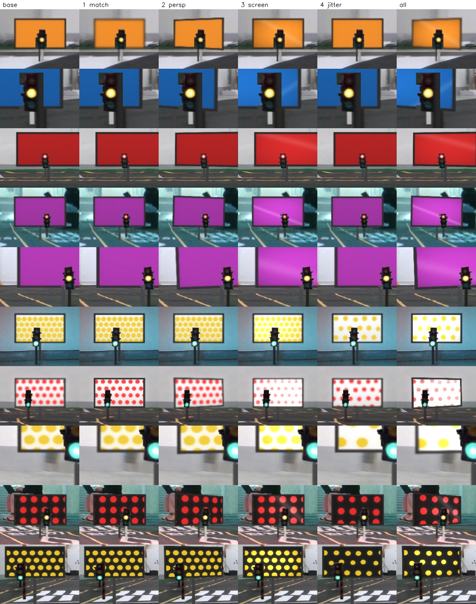
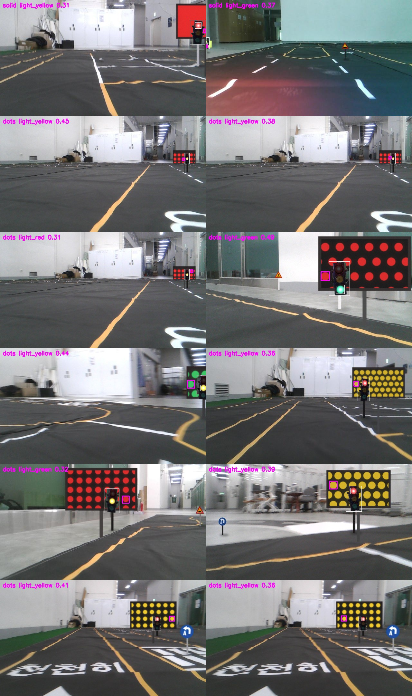

# multitask-v3 학습 준비 (2026-11-11)

multitask-v2 best에서 이어서 학습하는 v3의 설정, 근거, 서버 실행 방법을 정리합니다.

> **결과 (2026-11-12):** H100에서 학습해 epoch 11 가중치를 [`multitask-v3`](https://github.com/mastic-choi/LimoPro_FOSCAR_Vision/releases/tag/multitask-v3)로 릴리즈했습니다. 차선 보호에 val loss 최저 epoch이 모두 걸려 `best.pt`는 v2 그대로였고, 후보 중 epoch 11(`best_score.pt`)을 골랐습니다. 결과와 고른 이유는 [`outputs/train_mt_v3/README.md`](../outputs/train_mt_v3/README.md)에 있습니다. 아래는 학습 전에 쓴 계획입니다.

## 요약

- **이미지는 새로 만들지 않습니다.** 서버에 남아 있는 v2 데이터(합성 train 9,304장, 이 중 6,986장 Klein 다듬기)를 그대로 쓰고, 묶음 zip(50.7MB)에는 코드와 시작 가중치만 넣습니다.
- **신호등 뒤 방해 모니터를 학습 중에 바로 그려 넣습니다.** 절반은 단색 화면, 절반은 땡땡이 화면입니다. 땡땡이 원은 신호등에 켜진 불과 다른 색입니다(초록불이면 빨강·노랑 원). 라벨이 없는 음성 샘플입니다.
- **v2는 땡땡이 모니터에 약합니다.** 진짜 불빛 색을 틀린 경우는 0건이지만, 모니터 원을 불빛으로 61개(36장), 신호등으로 45개 잡았습니다(점수 0.3 이상, 193장).
- **학습 중 보정 손실은 뺐습니다.** 보정은 학습 후 val로 클래스별 temperature를 맞춰서 합니다(Guo et al. 2017).
- **조기 종료는 val loss로 합니다.** 최대 120 epoch이고, val loss 최저 뒤 5 epoch 동안 더 낮아지지 않으면 멈춥니다. 차선 IoU가 v2보다 나빠진 epoch은 best로 고르지 않습니다.

## 1. 데이터: 서버의 v2 데이터 재사용

서버에서 받은 `LimoPro_dataset_mt_v1.zip`(5,118,641,426 바이트, SHA256 `89d63edd…86ae`)을 풀지 않고 이 PC의 데이터와 비교했습니다(`scripts/check_h100_dataset.py`, 결과 `outputs/h100_dataset_check/check.json`).

| 항목 | 결과 |
|---|---|
| 장수 | train 9,304 / val 326 / test 542 / test_venue 143 / test_bag 42. 이 PC와 같음 |
| 라벨·마스크 | `labels`, `da_masks`, `ll_masks`, `sl_masks`, `sl_valid` 5개 split 전부 내용이 같음 (다른 파일 0개) |
| Klein | train 6,986장 다듬음, 207장 되돌림. val·test는 Klein 없음 |
| FSOCO 콘 | 학습 입력(640×360)으로 줄이면 박스의 80%가 √넓이 14px 미만 → `--ignore-small 14`로 무시됨. 차에서 보는 콘은 0.4~2m라 크게 찍혀서 그대로 둠 |

라벨이 같으므로 서버에서는 코드만 바꿔 덮어 풀면 됩니다.

## 2. 신호등 뒤 방해 모니터 증강

`scripts/mt_online_aug.py`의 `add_monitor`. 학습할 때 신호등이 있는 이미지에 확률 0.4로 그립니다(좌우 반전·회전 같은 기하 증강 전, 640×360 원본 좌표).

- 신호등 몸체 박스 기준으로 3.5~6배 넓은 16:9 화면을 신호등 뒤에 그리고 받침대를 붙입니다.
- 원본의 신호등 몸체(어두운 픽셀 + 켜진 불)와 기둥, **불빛 라벨 박스 안의 타원**을 다시 위에 덮어 신호등이 모니터 앞에 있게 합니다.
- 달리는 차로(da) 위로 5% 넘게 걸치거나, 표지판·콘 같은 다른 라벨 물체를 가리거나, 화면 위로 잘리면 그리지 않습니다. 신호등이 있는 Klein 사진 400장 중 59%에 그려집니다.
- 모니터가 덮은 곳은 da/ll/흰 가로선 정답에서 지웁니다. 박스 라벨은 바뀌지 않습니다.
- **땡땡이 화면(그린 모니터의 50%)**: 어두운 바탕이나 흰 바탕에, 신호등 불빛 크기의 0.7~1.4배인 원을 깝니다. 원 색은 켜진 불과 다른 색입니다. 모델이 "신호등 몸체 안에서 빛나는 것만 불빛"을 배우게 하려는 것입니다.

### 실제 카메라처럼 보이게 하는 효과 (전부 켬)

같은 사진·같은 모니터에 효과만 바꿔 그린 비교입니다(`scripts/preview_monitor_real.py`). 칸은 순서대로 기존 / 1 match / 2 persp / 3 screen / 4 jitter / 전부입니다.



| 효과 | 하는 일 |
|---|---|
| match | 신호등 주변 사진의 선명도(센 경계에서 한 번 더 흐렸을 때 남는 기울기 비율)와 노이즈(Immerkær 추정)를 재서, 모니터도 같은 정도로 흐리게 하고 노이즈를 넣음 |
| persp | 좌우 ±25° 비스듬히 본 사다리꼴, ±2° 기울기. 화면을 2배 캔버스에 그린 뒤 원근 변환 |
| screen | 비네팅, 좌우 밝기 차이, 비스듬한 반사 줄, 밝은 색이 하얗게 날아감. 땡땡이는 원이 연해지지 않게 날아감을 약하게(노출 1.0~1.15배, 단색은 1.0~1.5배) |
| jitter | 땡땡이 원의 위치(이웃과 겹치지 않는 범위)·크기(±10%)·밝기를 흔들고, 원 간격을 반지름의 2.6~5배로 넓힘 |

데이터 로딩은 이미지당 약 33ms에서 42ms로 늘어납니다(CPU 1코어). 서버는 워커 16개라 학습 속도에는 영향이 없을 것으로 봅니다.

### 고친 버그: 불빛 가운데가 뚫림

하얗게 날아간 불빛 가운데는 어둡지도 색이 진하지도 않아 몸체에서 빠집니다. 사진 끝에 걸려 잘린 신호등은 그 구멍이 바깥과 이어져 메워지지 않았고, 그 자리에 모니터가 그려져 불빛이 도넛 모양이 됐습니다. 잘린 쪽 테두리를 몸체로 치고 구멍을 메우도록 고쳤고, 불빛 라벨 박스 안의 타원은 항상 원본으로 남깁니다.

| 불빛 라벨이 있는 Klein 사진 (모니터 그려진 279장) | 불빛이 10% 넘게 덮인 사진 | 덮인 불빛 픽셀 |
|---|---:|---:|
| 고치기 전 | 15장 | 1.54% |
| 고친 후 | 0장 | 0.03% |

### 주의

규정집의 미션 1 모니터에 무엇이 나오는지 확인하지 못했습니다. [v2 확인 문서](MULTITASK_V2_CONF_STOPLINE.md)의 다음 할 일에 "빨강·초록 원 등"이라고 적혀 있어 땡땡이 비율을 50%로 정했습니다. 규정집을 보고 맞춰야 합니다.

## 3. v2의 모니터 앞 신호등 성능 (v3와 비교할 기준)

`scripts/eval_mt_monitor.py`. test·test_venue 중 신호등이 있고 모니터를 그릴 수 있는 193장(정답 불빛 203개)에, 같은 seed로 원본 / 단색 / 땡땡이 모니터를 같은 자리에 그려 v2 best로 추론했습니다. 효과 4개를 끈 기본 모니터 기준입니다.

| 점수 0.3 이상 | 원본 | 단색 모니터 | 땡땡이 모니터 |
|---|---:|---:|---:|
| 불빛 색 맞음 | 86.2% | 85.7% | 86.2% |
| 불빛 색 틀림 | 0% | 0% | 0% |
| 불빛 놓침 | 13.8% | 14.3% | 13.8% |
| 모니터 위 가짜 불빛 | 0 | 2개 (2장) | **61개 (36장)** |
| 모니터 위 가짜 신호등 | 0 | 0 | **45개** |
| AP50 신호등 / 빨강 / 노랑 / 초록 | 1.00 / 0.98 / 0.97 / 0.98 | 1.00 / 0.96 / 0.96 / 0.98 | 0.98 / 0.90 / 0.89 / 0.92 |

점수 0.5 이상으로 올려도 땡땡이 모니터에서 가짜 불빛 8개(8장), 가짜 신호등 20개가 남습니다. 효과 4개를 켠 모니터에서는 가짜 불빛 76개(39장, 0.3 이상)로 조금 더 많습니다(`outputs/eval_monitor/v2_match-persp-screen-jitter.json`).



*가짜 불빛(자홍 박스)은 거의 다 신호등 바로 옆 원입니다. 예: 노란불 신호등 옆 빨간 원을 light_red 0.58로 잡음.*

**차 쪽 판단**: 불빛을 "신호등 박스 안에서만" 보면 이 오탐은 대부분 걸러집니다. 화면 전체에서 가장 높은 불빛을 보면 초록불에서 빨간 원 때문에 멈출 수 있습니다.

이 시험 세트의 모니터는 학습 증강과 같은 코드로 그리므로, v3가 여기서 좋아져도 실제 모니터에서 그만큼 좋아진다는 보장은 없습니다. 실제 모니터 앞에서 찍은 bag으로 확인해야 합니다.

## 4. 점수 보정: 학습 중 보정 손실 끄기

Guo et al. 2017 *On Calibration of Modern Neural Networks*의 결론은 "학습이 끝난 뒤 검증 세트로 temperature 하나를 맞추면 정확도는 그대로 두고 보정이 된다"입니다. v3에 적용한 내용은 다음과 같습니다.

- 학습 후 val 예측으로 클래스별 temperature를 맞춰 `calib.json`에 저장합니다. 차에서는 `p' = sigmoid(logit(p) / T_cls[class])`로 씁니다. 예측이 30개보다 적은 클래스는 전체 T를 쓰고, T는 0.2~5 안에서만 고릅니다(예측이 적은 클래스에서 0.05처럼 튀던 문제를 고침).
- 학습 중 보정 손실(미분 가능한 ECE)은 끕니다(`CALIB_WEIGHT=0`). 이 논문에서 나온 방법이 아니고, 정확도(특히 A/B 구분)를 깎을 수 있습니다.
- v2에서 temperature로 해결되는 것은 "전체적으로 점수가 낮게 나옴"입니다. 클래스별 T가 0.34~0.64이고, 신호등 ECE가 0.133에서 0.036으로 줄었습니다. A·B·주차가 점수를 나눠 가지는 것은 해결되지 않습니다(sign_A T 0.992, ECE 0.193 그대로).

## 5. 조기 종료와 차선 보호

- 최대 120 epoch. lr은 이 epoch 수에 맞춰 `(1 - epoch/120)^1.5`로 줄어듭니다.
- 매 epoch val에서 학습과 같은 손실을 잽니다. 가중치가 같고, √넓이 14px 미만 박스 무시도 같고, 증강은 없습니다.
- val loss 최저 epoch 뒤로 5 epoch 동안 더 낮아지지 않으면(올라가기 시작하면) 멈춥니다. `best.pt`는 val loss가 가장 낮았던 epoch입니다.
- 점수(da+ll IoU+mAP50)가 가장 높았던 epoch은 참고용으로 `best_score.pt`에 따로 저장합니다. 논문에서 말하는 "NLL은 나빠지는데 정확도는 오르는" 경우가 있는지 둘을 비교해 보면 알 수 있습니다.
- **차선 보호**: 차선 가중치는 4차 차선 모델 → multitask v1 → v2 → v3로 계속 이어서 학습합니다. 지금까지는 나빠지지 않았지만, 검출 손실이 줄어 전체 val loss가 내려가는 동안 차선이 나빠질 수 있습니다.
  - 학습 전에 시작 가중치(v2)를 val로 재 둡니다.
  - val da+ll IoU가 그보다 0.01 넘게 낮은 epoch은 val loss가 최저여도 `best.pt`로 고르지 않습니다.
  - 끝까지 그러면 시작 가중치가 `best.pt`로 남습니다.
  - 그래도 그 epoch은 버리지 않습니다. val loss 최저 가중치는 차선 보호와 상관없이 항상 `best_val_loss.pt`에 저장합니다. 학습이 끝나면 `best.pt`와 epoch이 다른 후보(`best_val_loss.pt`, `best_score.pt`)도 같은 test 3종으로 채점해 `test.json`의 `candidates`에 넣습니다. 검출은 좋아졌는데 차선이 나빠진 경우, 이 표를 보고 어느 쪽을 쓸지 정합니다. 다른 후보를 고르면 temperature는 `scripts/eval_mt_calib.py`로 그 가중치에 맞춰 다시 구해야 합니다.
  - 어느 쪽이 나빠졌는지 보이게 `log.csv`에 val loss를 차선(`val_seg`), 흰 가로선(`val_sl`), 검출(`val_det`)로 나눠 기록합니다.

**4차 차선(ego-lane-v4)에서 시작하는 안**: `INIT=weights/hybridnets_v4_best_da.pt bash run_v3.sh`로 할 수 있습니다(v2 서버 폴더에 있음). 기본으로 하지 않은 이유는 다음과 같습니다.

- 아래 표처럼 v2의 차선은 4차와 거의 같아서(대회장 ll −0.009, test_bag ll +0.010), 이어서 학습한 탓에 차선이 나빠졌다는 근거가 없습니다.
- 4차 가중치에는 검출 머리와 흰 가로선 채널이 없어서 처음부터 다시 배워야 합니다. multitask v1은 4차에서 시작해 40 epoch 동안 val mAP50 0.69까지 갔고, v2(검출 머리 lr ×10)가 그 위에서 15 epoch을 더 해 0.91이 됐습니다.

지금까지 차선 IoU (같은 test 세트):

| | 4차 차선 | multitask v1 | multitask v2 |
|---|---|---|---|
| test da / ll | 0.951 / 0.819 | 0.952 / 0.819 | 0.955 / 0.816 |
| 대회장 test da / ll | 0.931 / 0.495 | 0.934 / 0.493 | 0.935 / 0.486 |
| test_bag da / ll | 0.982 / 0.816 | 0.981 / 0.820 | 0.981 / 0.826 |

## 6. v2와 바뀐 설정 전체

| 항목 | v2 | v3 |
|---|---|---|
| 시작 가중치 | multitask v1 best | multitask-v2 best (`hybridnets_mt_v2_best.pt`) |
| 데이터 | synth_signs_v2 + cones_v1 | 같음 |
| 방해 모니터 | 없음 | 확률 0.4, 그중 땡땡이 50%, 효과 4개 |
| 흰 케이블 | 없음 | 끔 (대회장에 전선 없음, `CABLE_P`로 켤 수 있음) |
| 작은 박스 | 전부 학습 | √넓이 14px 미만 무시. 불빛(중앙값 13px)은 제외 |
| A/B/주차 | 그대로 | 들어간 이미지 2배 자주 뽑음 (4,017장) |
| 보정 | 없음 | 학습 후 클래스별 temperature (`calib.json`) |
| 조기 종료 | val 점수 8 epoch | val loss 5 epoch, 최대 120 epoch, 차선 보호 0.01 |
| 학습 후 시험 | test / test_venue / test_bag | + 모니터 시험 (`eval_monitor/`) |

## 7. 서버 실행

v2 때 서버에 풀어 둔 `LimoPro_mt` 폴더 위에 덮어 풉니다. 자세한 내용은 [tools/h100_mt_v3/README_V3.md](../tools/h100_mt_v3/README_V3.md)에 있습니다.

```bash
unzip -o LimoPro_mt_v3_h100.zip     # scripts/ 일부 덮어씀, v2 run.sh는 그대로
cd LimoPro_mt
bash run_v3.sh check                # v2 데이터·가중치·SHA256 확인
bash run_v3.sh                      # 학습 -> 모니터 시험 -> results_v3_<서버이름>.zip
```

- 묶음은 `python scripts/make_h100_mt_v3_bundle.py`로 만듭니다(`outputs/share/LimoPro_mt_v3_h100.zip`, 저장소에는 올리지 않음).
- 이 PC에서 짧게 돌려 학습, val loss 조기 종료, 차선 보호, temperature 저장, test 채점까지 오류 없이 도는 것을 확인했습니다. H100에서는 아직 돌려 보지 않았습니다.

## 8. 결과가 오면 볼 것

1. `log.csv`의 train loss / val loss 곡선(차선·가로선·검출로 나눈 val loss 포함), 멈춘 이유(`test.json`의 `best.stop_reason`), 차선 보호로 빠진 epoch(`best.lane_guard_skipped`)
2. `test.json`의 `candidates`: `best.pt` / `best_val_loss.pt` / `best_score.pt`의 test 3종 차선·검출 점수
2. 차선: test / 대회장 test / test_bag의 da·ll IoU가 v2(위 표)보다 나빠지지 않았는지
3. 검출: A/B/주차 AP, 작은 박스를 무시한 효과
4. 모니터 시험: `eval_monitor/v3.json`과 v2(3절 표)의 땡땡이 가짜 불빛·가짜 신호등 수
5. `calib.json`의 클래스별 T

## 파일

| 파일 | 내용 |
|---|---|
| `scripts/train_multitask.py` | v3 옵션 전부 (`--aug-monitor-*`, `--ignore-small`, `--oversample-ab`, `--es-val-loss`, `--best-by`, `--lane-guard`) |
| `scripts/mt_online_aug.py` | 모니터·케이블 증강 |
| `scripts/mt_calib.py`, `scripts/eval_mt_calib.py` | 보정 지표, temperature, v2 보정 측정 (`outputs/train_mt_v2/calib/`) |
| `scripts/mt_det_loss.py` | 검출 손실 (보정 손실 선택 가능, v3에서는 끔) |
| `scripts/eval_mt_monitor.py` | 모니터 앞 신호등 시험 |
| `scripts/preview_monitor_real.py` | 모니터 효과 비교 그림 |
| `scripts/check_h100_dataset.py` | 서버 데이터셋 zip 검사 |
| `scripts/make_h100_mt_v3_bundle.py` | 서버용 묶음 만들기 |
| `tools/h100_mt_v3/` | `run.sh`(zip 안에서는 `run_v3.sh`), `README_V3.md`, `requirements.txt` |
