# 다중 작업 1차 결과 (`multitask-v1`, 2026-11-10)

`ego-lane-v4` HybridNets에서 이어서, 차선 분할(da / ll / 흰 가로선)과 검출 12종(표지판·신호등·켜진 불·limo·라바콘)을 모델 하나로 같이 학습한 결과입니다.
가중치와 데이터셋은 릴리즈 [`multitask-v1`](https://github.com/mastic-choi/LimoPro_FOSCAR_Vision/releases/tag/multitask-v1)에 있습니다.

검출이 왜 약한지 분석한 내용은 [`docs/MULTITASK_DETECTION_ANALYSIS.md`](../../docs/MULTITASK_DETECTION_ANALYSIS.md)에 있습니다.

## 한 줄 요약

- **차선은 4차와 같은 수준**이고, 신호등과 서행(slow)은 잘 잡습니다.
- **표지판은 "있다"는 잘 찾지만(클래스 무시 AP50 0.96) 종류를 헷갈립니다.** 빨간 삼각형(보행자·방지턱), 파란 사각형(A·B·주차)끼리 섞입니다.
- **A/B는 사실상 구분하지 못합니다.** A와 B 점수만 비교해도 정답률이 57%로 동전 던지기 수준이고, **train 사진에서도 59%**입니다. 외운 것(오버피팅)이 아니라 배우지 못한 것(언더피팅)입니다.

## 파일

| 파일 | 내용 |
|---|---|
| `hybridnets_mt_v1_test.json` | best.pt(epoch 33)의 test / test_venue / test_bag 채점 결과 |
| `hybridnets_mt_v1_log.csv` | epoch별 손실과 val 점수 |
| `diag_det.txt` | 클래스별 크기, 앵커 매칭, 혼동, 클래스 무시 AP (`scripts/eval_mt_det_diag.py`) |
| `ab_stats.json` | A/B 표지판 하나하나의 예측과 점수 (`scripts/eval_mt_ab.py`) |
| `montages/` | 아래 그림들 |

## 차선 (da / ll IoU)

| | 4차 | **다중 작업 1차** |
|---|---|---|
| 기존 test 542장 | 0.951 / 0.819 | 0.952 / 0.819 |
| 대회장 test 143장 | 0.931 / 0.495 | 0.934 / 0.493 |
| 실차 코너 test_bag 42장 | 0.982 / 0.816 | 0.981 / 0.820 |

대회장 test 흰 가로선 IoU: 0.578

## 검출 (AP50)

| 클래스 | 기존 test | 대회장 test | test_bag |
|---|---|---|---|
| traffic_light | 0.99 | 0.99 | 1.00 |
| light_red / yellow / green | 0.97 / 0.95 / 0.98 | 0.93 / 1.00 / 0.98 | 1.00 / 1.00 / 1.00 |
| slow | 0.95 | 0.94 | 0.94 |
| bump | 0.61 | 0.53 | 0.90 |
| pedestrian | 0.42 | 0.59 | 0.50 |
| parking | 0.35 | 0.57 | 0.46 |
| sign_A | 0.34 | 0.48 | 0.48 |
| sign_B | 0.37 | 0.40 | 0.47 |
| cone | 0.55 (TraCon test 40장) | - | - |
| **mAP50** | **0.651** | **0.714** | **0.751** |
| 클래스 무시 AP50 (표지판·신호등 전체를 한 클래스로) | 0.958 | 0.966 | 0.960 |

test의 표지판·신호등도 실제 프레임에 합성한 것입니다. 실제 표지판 성능은 아직 재지 않았습니다.

## 검출 몽타주

색 박스가 모델 예측(점수 0.4 이상), 흰 얇은 박스가 정답입니다. 박스가 있는 사진 중에서 고르게 뽑았습니다.

**대회장 test**: 신호등은 0.6~0.9로 잘 잡습니다. 표지판은 맞혀도 0.40~0.52이고, A/B 표지판(아래에서 두 번째 줄 오른쪽)은 놓칩니다.

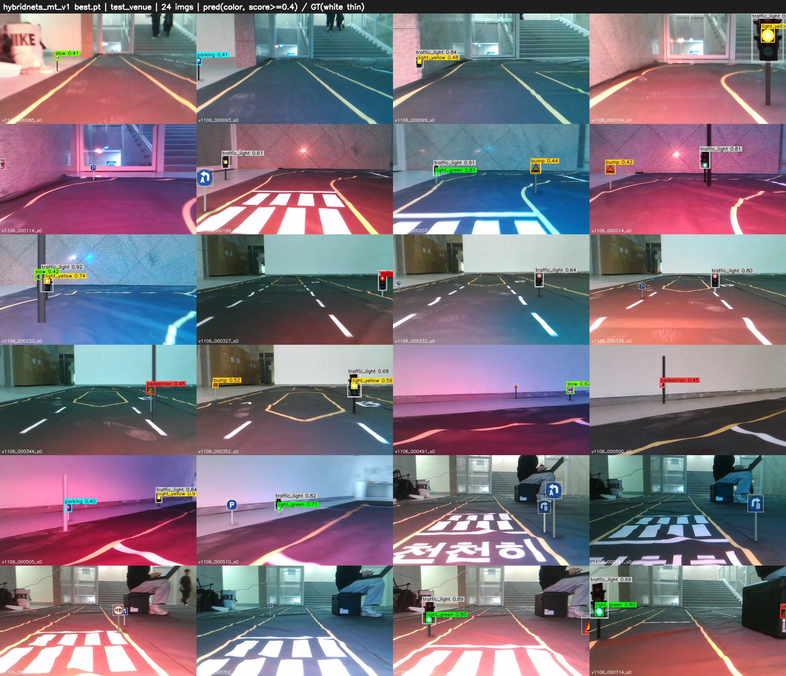

**기존 test**

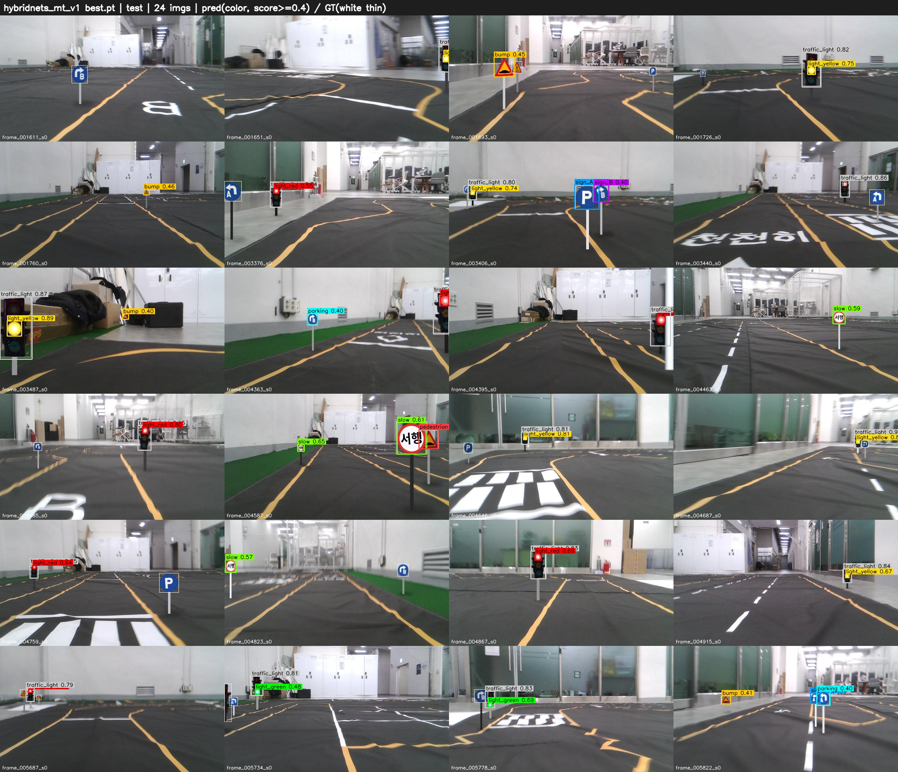

**실차 코너 test_bag**

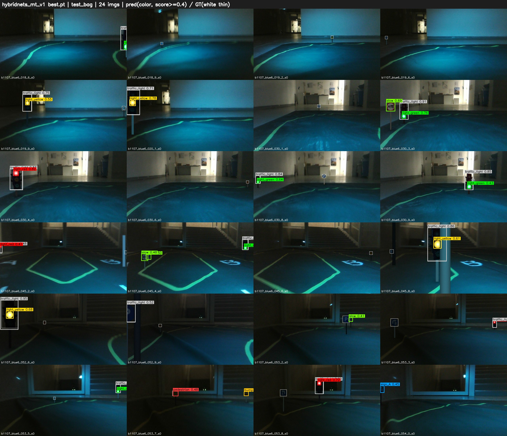

**라바콘 test (TraCon)**: 가까운 콘은 0.6~0.8로 잘 잡고, 겹친 콘과 먼 콘을 일부 놓칩니다. 공사 표지판을 콘이나 slow로 잡은 오탐이 조금 있습니다.

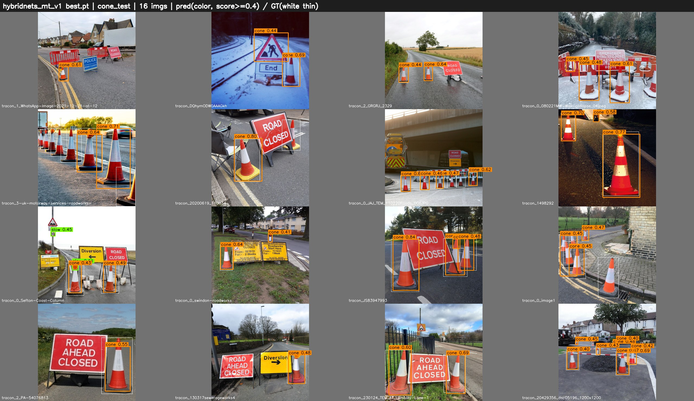

## A/B 구분 확인

정답이 sign_A 또는 sign_B인 표지판마다 두 가지를 쟀습니다.

- **최종 예측**: 정답 박스와 IoU 0.5 이상, 점수 0.3 이상인 예측 중 점수가 가장 높은 것의 클래스
- **A/B 2택**: 그 자리 앵커에서 A 점수와 B 점수만 비교했을 때 맞는지. "파란 사각형인 건 알려 주고 A/B 중에서만 고르라고 하면 맞히는가"입니다. 50%가 찍기 수준입니다.

| | 표지판 수 | 최종 예측 정답 | **A/B 2택 정답** | 정답 A일 때 예측 | 정답 B일 때 예측 |
|---|---:|---:|---:|---|---|
| train (600장 표본, 증강 없음) | 646 | 38% | **59%** | A 149, P 90, B 58, 놓침 37 | B 97, A 93, P 79, 놓침 27 |
| 기존 test | 175 | 30% | **58%** | A 31, P 28, B 15, 놓침 9 | P 31, A 24, B 21, 놓침 9 |
| 대회장 test | 44 | 34% | **57%** | P 9, A 8, B 3, 놓침 2 | P 9, B 7, A 4 |
| test_bag | 13 | 23% | **54%** | P 2, 놓침 2, A 1, B 1 | A 3, B 2, P 1, 놓침 1 |

크기별 A/B 2택 정답률(기존 test): 18px 미만 53%, 18~26px 62%, 26px 이상 59%. **커도 나아지지 않습니다.**

### 잘라 낸 표지판

정답 A/B 표지판을 잘라 확대했습니다(픽셀 그대로 확대). 테두리 초록 = 맞음, 빨강 = 틀림, 주황 = 놓침.
아래 첫 줄은 `GT 정답 크기`, 둘째 줄은 최종 예측, 셋째 줄은 A/B 2택 결과와 `(A 점수/B 점수)`입니다.

**대회장 test (44개 전부)**: 54px짜리 또렷한 A 표지판도 A/B/P 점수가 0.34~0.38로 거의 같습니다. 모델이 "파란 표지판이면 A·B·P에 1/3씩"으로 배운 상태입니다.

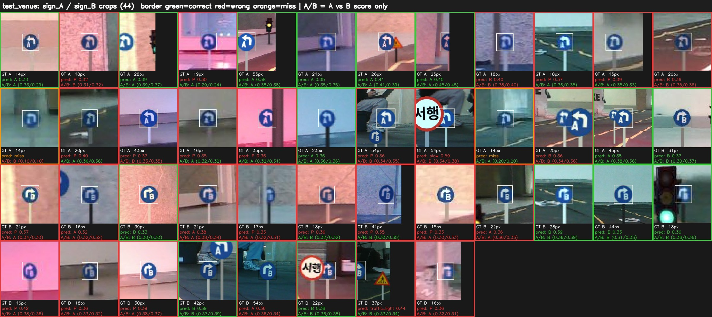

**기존 test (A 24개, B 24개)**

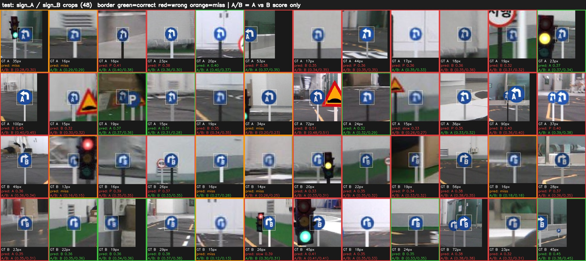

**test_bag (13개 전부)**

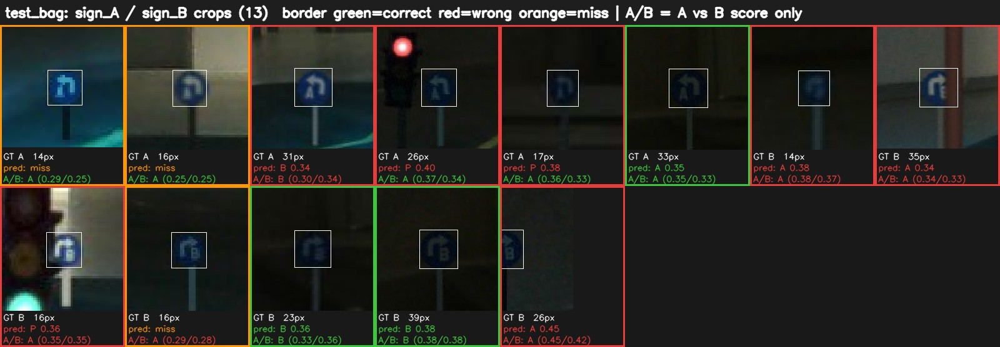

**train (A 24개, B 24개)**: 학습한 사진에서도 똑같이 틀립니다.

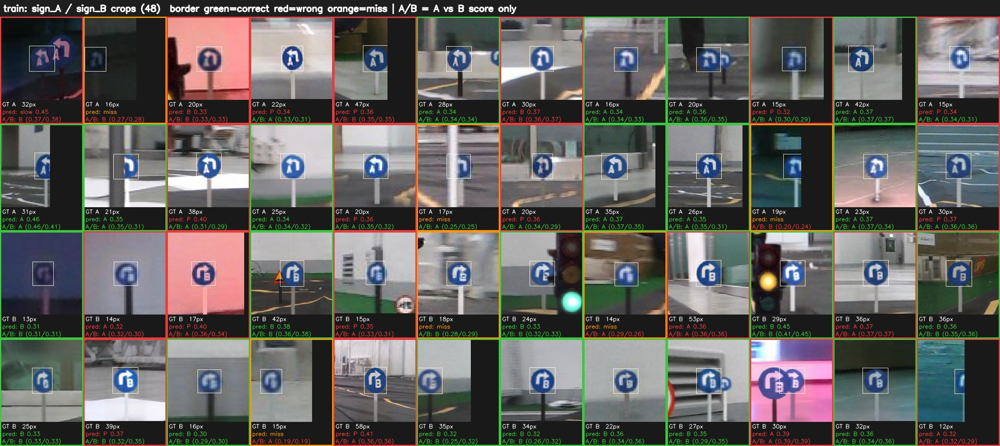

### 전체 프레임

대회장 test 중 A/B가 있는 프레임입니다. 예측 A는 파랑, B는 자홍, P는 하늘색입니다(점수 0.3 이상). 큰 P 표지판도 B 0.33으로 나옵니다(3번째 줄 오른쪽).

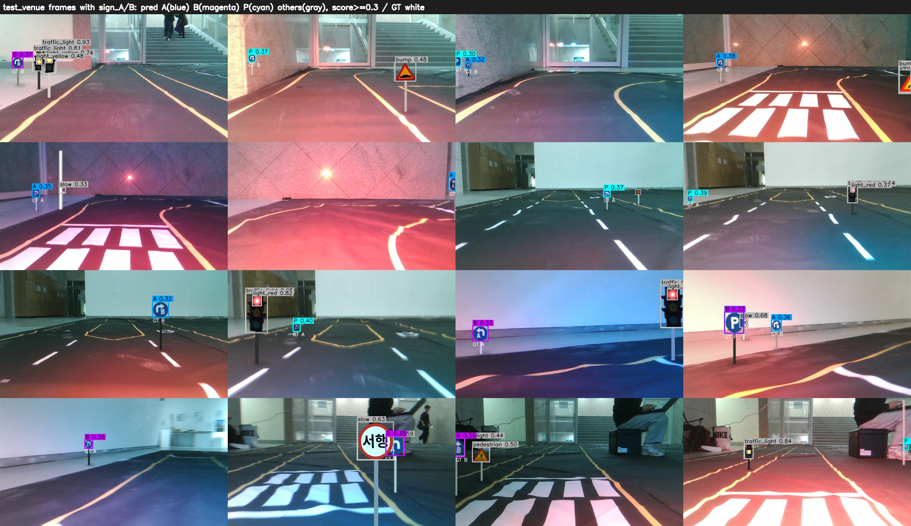

### 학습 라벨은 정상

train의 A / B / P 표지판을 줄별로 잘라 봤습니다. A는 왼쪽 화살표, B는 오른쪽 화살표, P는 P이고, 라벨이 바뀐 것은 보이지 않습니다. Klein으로 다듬은 사진도 그림이 유지됩니다.

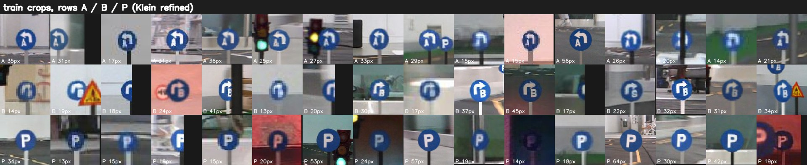

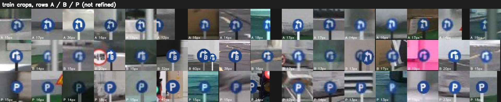

## 추가 확인 실험

자세한 내용은 [`docs/MULTITASK_DETECTION_ANALYSIS.md`](../../docs/MULTITASK_DETECTION_ANALYSIS.md) 5~8절에 있습니다.

- **잘라 낸 표지판으로 작은 CNN 분류기 학습** (`ab_crop_cls.json`): 같은 사진·해상도에서 A/B/P를 train 99.8%, test 세트 전부 100% 구분합니다. 정보는 사진에 있습니다. 다만 train과 test가 같은 표지판 그림으로 합성돼 쉬운 시험입니다.
- **HybridNets 특징 linear probe** (`probe.txt`): 백본 p2·p3 특징은 A/B를 약 95% 구분하는데, 검출 머리가 받는 BiFPN P3에서는 약 85%로 줄고, 검출 머리 출력은 58%입니다.
- **HybridNets 개선 실험 A·B** (`scripts/run_mt_exp_ab.sh`): 검출 머리·BiFPN 학습 강화(A), A + 백본 p3 지름길(B). 진행 중입니다.

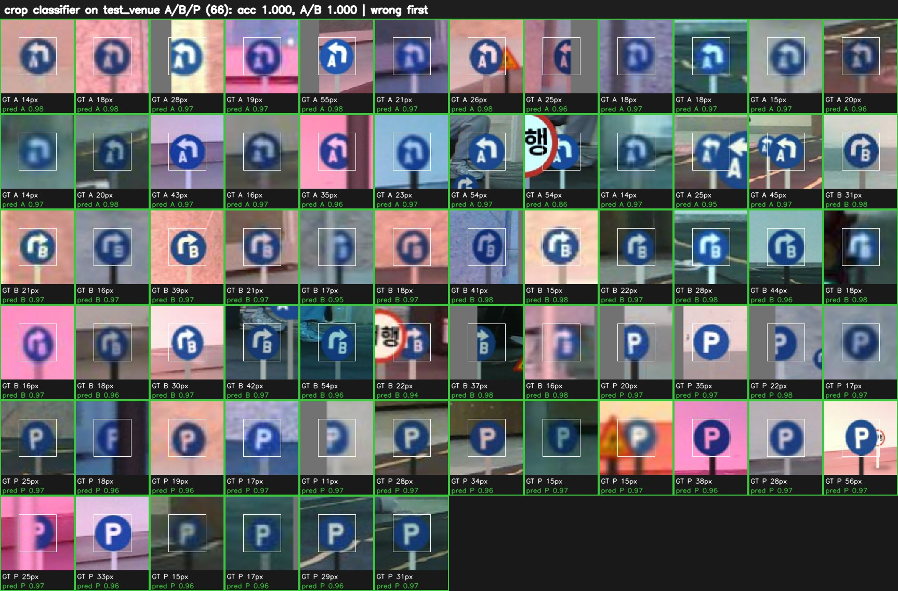

## 다시 만들기

학습 번들 폴더(데이터셋과 `models/HybridNets`가 있는 곳)에서:

```bash
python scripts/eval_mt_montage.py . hybridnets_mt_v1_best.pt outputs/train_mt_v1/montages
python scripts/eval_mt_det_diag.py . hybridnets_mt_v1_best.pt > outputs/train_mt_v1/diag_det.txt
python scripts/eval_mt_ab.py . hybridnets_mt_v1_best.pt outputs/train_mt_v1/montages
python -I scripts/eval_mt_train_crops.py . outputs/train_mt_v1/montages
python -I scripts/eval_mt_ab_crop_cls.py . outputs/train/ab_crop_cls_v1
python scripts/eval_mt_feature_probe.py . hybridnets_mt_v1_best.pt > outputs/train_mt_v1/probe.txt
```

`eval_mt_ab.py`는 `ab_stats.json`을 출력 폴더에 씁니다.
