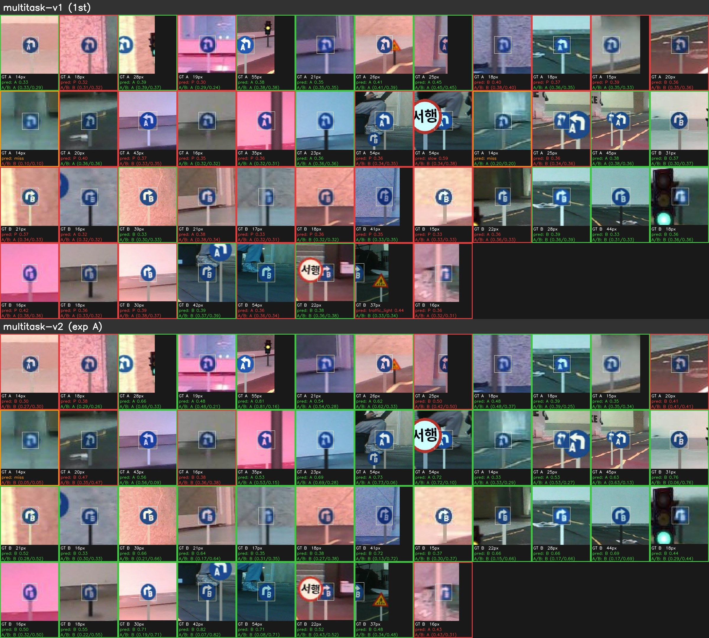
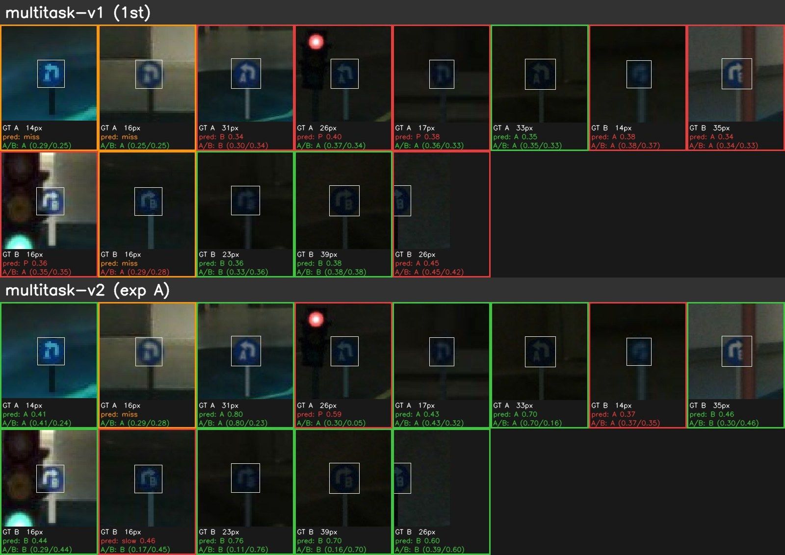
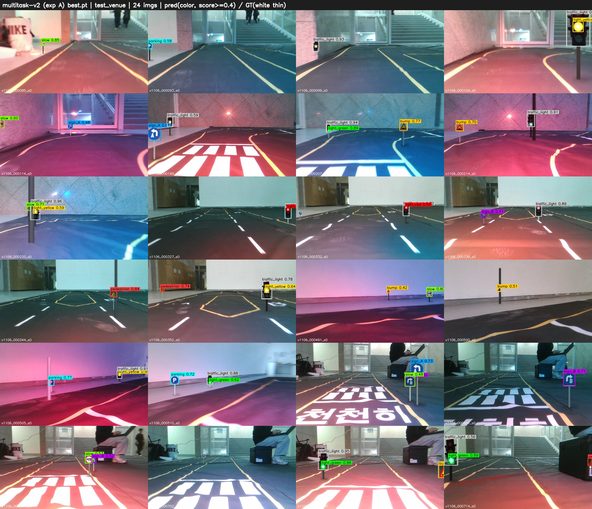
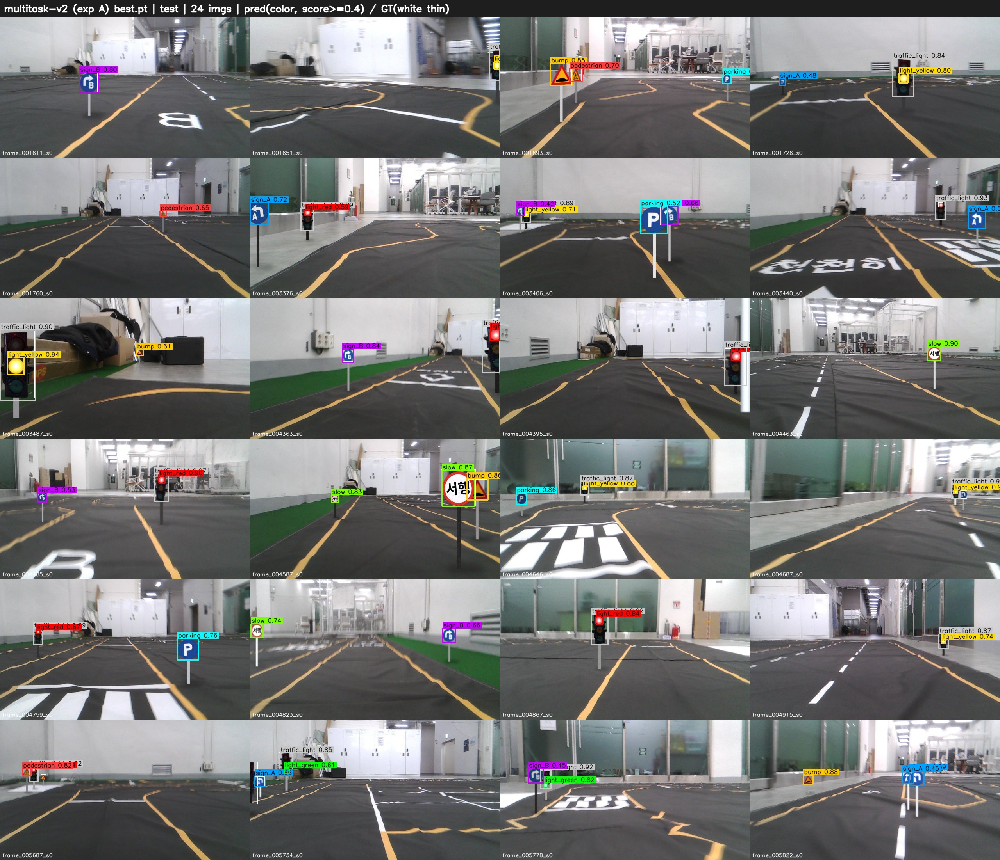
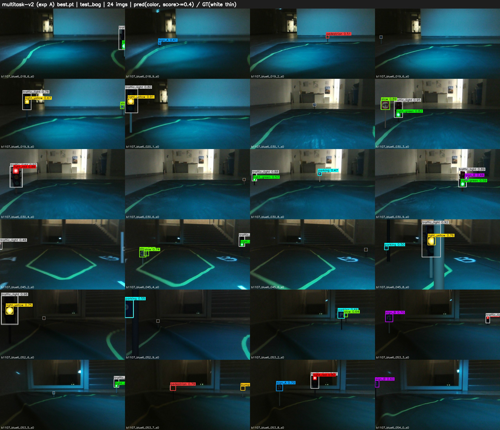
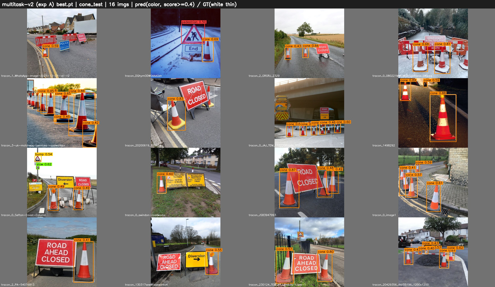

# 다중 작업 2차 결과 (`multitask-v2`, 2026-11-10)

1차(`multitask-v1`)가 표지판 종류, 특히 A/B를 구분하지 못한 원인은 **검출 머리와 BiFPN의 학습 부족**이었습니다([분석](../../docs/MULTITASK_DETECTION_ANALYSIS.md)).
2차는 데이터와 구조는 그대로 두고, 1차 best.pt에서 이어서 **학습 설정만 바꿔** 15 epoch 더 학습했습니다(분석 문서의 "실험 A").
가중치는 릴리즈 [`multitask-v2`](https://github.com/mastic-choi/LimoPro_FOSCAR_Vision/releases/tag/multitask-v2)에 있습니다.

## 한 줄 요약

- **검출 mAP50이 0.65~0.75에서 0.90~0.95로 올랐습니다.** 보행자·방지턱 혼동은 거의 사라졌고, A/B·주차 AP는 0.35~0.57에서 0.81~0.96이 됐습니다.
- **A/B 2택 정답률은 54~59%에서 84~92%가 됐습니다.** 26px 이상 표지판은 96~100%이고, 18px 미만(멀리 있는 표지판)은 61~83%입니다.
- 차선은 1차와 같은 수준이고(차이 ±0.007), 흰 가로선 IoU는 0.578에서 0.604로 올랐습니다.
- 모델 구조는 1차와 같아서, 추론 코드와 ONNX 변환을 그대로 쓸 수 있습니다.

## 바꾼 것 (1차 대비)

| | 1차 | 2차 |
|---|---|---|
| 시작 가중치 | 4차 차선 HybridNets | 1차 best.pt (epoch 33) |
| epoch | 40 | 15 (best epoch 14) |
| lr | 1e-4, 40 epoch에 0이 되도록 감소 | 검출 머리(regressor, classifier)·BiFPN 1e-3, 나머지 1e-4, 15 epoch에 0이 되도록 감소. 처음 500 step warmup |
| 검출 손실 비중 | 1.0 | 2.0 |
| 데이터, 증강, 구조 | | 1차와 같음 |

명령: `scripts/run_mt_exp_ab.sh`의 실험 A (`train_multitask.py --head-lr-mult 10 --det-weight 2 --warmup-steps 500 --epochs 15 --init <1차 best.pt>`). H100 1장, epoch당 약 187초.

## 1차와 비교

| | 1차 | **2차** |
|---|---:|---:|
| 기존 test 542장 da / ll | 0.952 / 0.819 | 0.955 / 0.816 |
| 대회장 test 143장 da / ll | 0.934 / 0.493 | 0.935 / 0.486 |
| 실차 코너 test_bag 42장 da / ll | 0.981 / 0.820 | 0.981 / 0.826 |
| 대회장 test 흰 가로선 IoU | 0.578 | **0.604** |
| 검출 mAP50 (기존 / 대회장 / bag) | 0.651 / 0.714 / 0.751 | **0.895 / 0.937 / 0.952** |
| 클래스 무시 AP50 (기존 / 대회장 / bag) | 0.958 / 0.966 / 0.960 | 0.985 / 0.985 / 0.994 |

### 검출 AP50

| 클래스 | 기존 test 1차 → 2차 | 대회장 test 1차 → 2차 | test_bag 1차 → 2차 |
|---|---|---|---|
| pedestrian | 0.42 → **0.96** | 0.59 → **0.99** | 0.50 → 0.83 |
| bump | 0.61 → **0.97** | 0.53 → **0.90** | 0.90 → 1.00 |
| sign_A | 0.34 → **0.81** | 0.48 → **0.84** | 0.48 → **0.96** |
| sign_B | 0.37 → **0.89** | 0.40 → **0.88** | 0.47 → **0.88** |
| parking | 0.35 → **0.85** | 0.57 → **0.91** | 0.46 → **0.93** |
| slow | 0.95 → 0.99 | 0.94 → 1.00 | 0.94 → 0.96 |
| traffic_light | 0.99 → 0.99 | 0.99 → 0.99 | 1.00 → 1.00 |
| light_red / yellow / green | 0.97 / 0.95 / 0.98 → 0.98 / 0.95 / 0.98 | 0.93 / 1.00 / 0.98 → 0.95 / 1.00 / 0.97 | 모두 1.00 |
| cone (TraCon test) | 0.55 → 0.57 | - | - |

test_bag은 클래스마다 표지판이 6~7개뿐이라 한 개 차이로 0.1 넘게 바뀝니다.

### A/B 구분

정답 A/B 표지판마다 잰 값입니다(`scripts/eval_mt_ab.py`). "2택"은 그 자리에서 A 점수와 B 점수만 비교한 것이라, 50%가 찍기 수준입니다.

| | 표지판 수 | 2택 1차 → **2차** | 최종 예측 1차 → **2차** |
|---|---:|---|---|
| train (600장 표본) | 646 | 59% → **86%** | 38% → **81%** |
| 기존 test | 175 | 58% → **84%** | 30% → **77%** |
| 대회장 test | 44 | 57% → **84%** | 34% → **82%** |
| test_bag | 13 | 54% → **92%** | 23% → **69%** |

크기별 2택 정답률(2차)

| | 18px 미만 | 18~26px | 26px 이상 |
|---|---:|---:|---:|
| train | 71% | 90% | 96% |
| 기존 test | 61% | 94% | 96% |
| 대회장 test | 67% | 81% | 100% |

- **가까운 표지판은 거의 다 맞히고, 먼 표지판이 남은 문제입니다.** 차가 갈림길에 다가가면 표지판이 커지니, 가까워지는 몇 프레임의 결과로 다수결하면 됩니다.
- 남은 오답은 대부분 A ↔ B 사이입니다(기존 test: 정답 A인데 B 18개, 정답 B인데 A 6개). 보행자 ↔ 방지턱 혼동은 거의 없어졌습니다.

### 내부 특징 (linear probe)

층마다 표지판 자리의 특징만으로 선형 분류기를 학습했을 때의 A/B 정답률(기존 test)입니다(`probe.txt`).

| 층 | 1차 | 2차 |
|---|---:|---:|
| 백본 p3 | 96% | 97% |
| BiFPN P3 (검출 머리 입력) | 86% | 90% |
| BiFPN P4 | 65% | 82% |
| 실제 검출 머리 출력 | 58% | 84% |

검출 머리가 받은 정보(90%)를 거의 다 쓰게 됐습니다(84%). BiFPN에서 줄어드는 몫(97% → 90%)은 아직 남아 있고, 이것을 고치는 것이 실험 B(백본 지름길)입니다.

## 그림

### A/B 표지판: 1차와 2차

대회장 test의 정답 A/B 표지판 44개입니다. 위가 1차, 아래가 2차입니다. 초록 테두리 = 맞음, 빨강 = 틀림, 주황 = 놓침. 셋째 줄은 `A/B 2택 결과 (A 점수/B 점수)`입니다.
1차는 A·B 점수가 0.3대로 거의 같았고, 2차는 정답 쪽 점수가 0.5~0.8로 벌어집니다.



**test_bag**



### 검출 몽타주 (2차)

색 박스가 예측(점수 0.4 이상), 흰 얇은 박스가 정답입니다. 1차 그림과 같은 사진입니다([1차](../train_mt_v1/README.md#검출-몽타주)).

**대회장 test**: 1차에서 놓치던 A/B 표지판(아래에서 두 번째 줄 오른쪽)을 sign_A 0.73, sign_B 0.71로 잡습니다. 같은 칸에서 B 표지판을 slow 0.48로도 잡은 오탐이 하나 있습니다.



**기존 test**



**실차 코너 test_bag**



**라바콘 test (TraCon)**



### A/B 잘라 낸 사진 (2차만)

- [기존 test](montages/ab_crops_test.jpg), [train](montages/ab_crops_train.jpg), [test_bag](montages/ab_crops_test_bag.jpg)
- [대회장 test 전체 프레임](montages/ab_frames_test_venue.jpg)

## 파일

| 파일 | 내용 |
|---|---|
| `hybridnets_mt_v2_test.json` | best.pt(epoch 14)의 test / test_venue / test_bag 채점 |
| `hybridnets_mt_v2_log.csv` | epoch별 손실과 val 점수 |
| `compare_v1_v2.md` | 1차와 2차 비교표 전체 (`scripts/summarize_mt_exp.py`) |
| `diag_det.txt`, `ab_stats.json`, `probe.txt` | 혼동·크기 진단, A/B 표지판별 예측, 층별 linear probe |
| `montages/` | 위 그림들 |

## 주의

- test의 표지판·신호등도 실제 프레임에 합성한 것이고, train과 같은 표지판 그림을 씁니다. 실제 표지판에서의 성능은 아직 모릅니다.
- 시드 1개, 가중치 1개 기준입니다.
- 대회장 ll은 0.493 → 0.486으로 조금 내렸습니다. 1·2차 모두 대회장 차선은 약한 편입니다.

## 다시 만들기

학습 번들 폴더에서:

```bash
bash scripts/run_mt_exp_ab.sh   # 실험 A(이 결과)와 B를 차례로 학습·채점, outputs/train/mt_exp_summary.md
python scripts/eval_mt_montage.py . outputs/train/hybridnets_mt_expA/best.pt <출력 폴더> "multitask-v2 (exp A) best.pt"
python scripts/eval_mt_det_diag.py . outputs/train/hybridnets_mt_expA/best.pt
```
