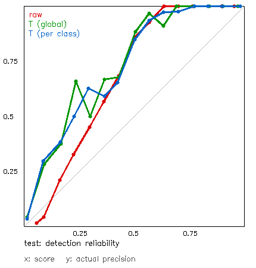
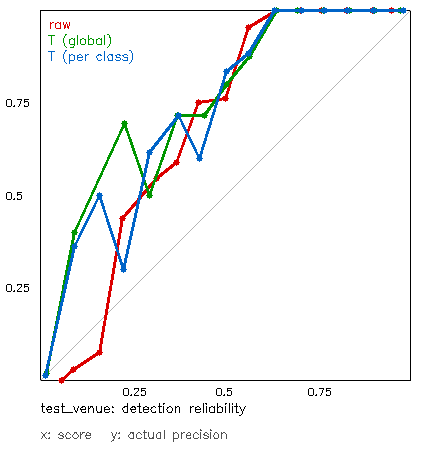
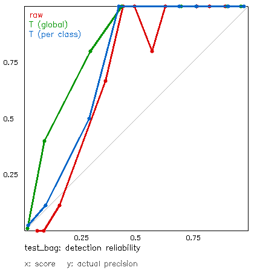

# 점수 보정(calibration) 측정

가중치 `outputs/train/hybridnets_mt_v2/hybridnets_mt_v2_best.pt`. 검출: NMS 뒤 점수 >= 0.05 예측마다 같은 클래스 정답과 IoU >= 0.5로 맞았는지(1/0)와 점수를 비교 (15개 구간). 놓친 정답은 점수가 없어 여기 들어가지 않습니다.

temperature(val에서 맞춤): 전체 T = **0.572**, 클래스별 {"pedestrian": 0.487, "sign_A": 0.992, "sign_B": 0.641, "bump": 0.563, "slow": 0.487, "parking": 0.886, "traffic_light": 0.336, "light_red": 0.641, "light_yellow": 0.495, "light_green": 0.519}  
(T > 1이면 점수가 실제보다 높게 나오는 과신, T < 1이면 실제보다 낮게 나오는 과소)

## test

| 검출 점수 | 예측 수 | 실제 정답률 | 평균 점수 | ECE | MCE | NLL | Brier |
|---|---:|---:|---:|---:|---:|---:|---:|
| 원래 점수 | 2218 | 0.456 | 0.377 | 0.122 | 0.363 | 0.270 | 0.075 |
| 보정(전체 T) | 2218 | 0.456 | 0.367 | 0.089 | 0.421 | 0.241 | 0.069 |
| 보정(클래스별 T) | 2218 | 0.456 | 0.373 | 0.083 | 0.364 | 0.229 | 0.068 |
| 원래, 20px 이상 | 988 | 0.634 | 0.542 | 0.137 | 0.360 | 0.216 | 0.052 |
| 클래스별 T, 20px 이상 | 988 | 0.634 | 0.576 | 0.058 | 0.312 | 0.141 | 0.038 |

| 클래스 | 예측 수 | 정답률 | 평균 점수 | ECE 원래 → 보정 | NLL 원래 → 보정 |
|---|---:|---:|---:|---|---|
| pedestrian | 150 | 0.57 | 0.44 | 0.160 → 0.119 | 0.327 → 0.320 |
| sign_A | 142 | 0.54 | 0.36 | 0.193 → 0.193 | 0.562 → 0.563 |
| sign_B | 164 | 0.52 | 0.39 | 0.146 → 0.167 | 0.508 → 0.513 |
| bump | 142 | 0.63 | 0.47 | 0.177 → 0.140 | 0.322 → 0.290 |
| slow | 155 | 0.53 | 0.46 | 0.135 → 0.063 | 0.206 → 0.128 |
| parking | 134 | 0.59 | 0.42 | 0.171 → 0.167 | 0.511 → 0.519 |
| traffic_light | 320 | 0.80 | 0.70 | 0.133 → 0.036 | 0.170 → 0.079 |
| light_red | 306 | 0.28 | 0.24 | 0.114 → 0.066 | 0.218 → 0.187 |
| light_yellow | 328 | 0.25 | 0.24 | 0.109 → 0.056 | 0.183 → 0.150 |
| light_green | 370 | 0.24 | 0.23 | 0.120 → 0.045 | 0.160 → 0.092 |

| 분할 (픽셀) | 픽셀 수 | ECE | MCE | NLL |
|---|---:|---:|---:|---:|
| da | 124,876,800 | 0.0096 | 0.1722 | 0.0606 |
| ll | 124,876,800 | 0.0037 | 0.2302 | 0.0253 |

## test_venue

| 검출 점수 | 예측 수 | 실제 정답률 | 평균 점수 | ECE | MCE | NLL | Brier |
|---|---:|---:|---:|---:|---:|---:|---:|
| 원래 점수 | 560 | 0.473 | 0.389 | 0.144 | 0.388 | 0.270 | 0.075 |
| 보정(전체 T) | 560 | 0.473 | 0.381 | 0.093 | 0.464 | 0.228 | 0.068 |
| 보정(클래스별 T) | 560 | 0.473 | 0.386 | 0.090 | 0.340 | 0.219 | 0.068 |
| 원래, 20px 이상 | 242 | 0.665 | 0.565 | 0.160 | 0.358 | 0.224 | 0.053 |
| 클래스별 T, 20px 이상 | 242 | 0.665 | 0.602 | 0.086 | 0.291 | 0.134 | 0.035 |

| 클래스 | 예측 수 | 정답률 | 평균 점수 | ECE 원래 → 보정 | NLL 원래 → 보정 |
|---|---:|---:|---:|---|---|
| pedestrian | 42 | 0.57 | 0.46 | 0.189 → 0.107 | 0.295 → 0.203 |
| sign_A | 34 | 0.62 | 0.38 | 0.312 → 0.312 | 0.650 → 0.650 |
| sign_B | 42 | 0.48 | 0.41 | 0.154 → 0.135 | 0.451 → 0.408 |
| bump | 29 | 0.69 | 0.50 | 0.275 → 0.211 | 0.364 → 0.312 |
| slow | 34 | 0.71 | 0.53 | 0.207 → 0.156 | 0.320 → 0.242 |
| parking | 30 | 0.67 | 0.47 | 0.265 → 0.241 | 0.381 → 0.369 |
| traffic_light | 74 | 0.92 | 0.79 | 0.139 → 0.039 | 0.162 → 0.054 |
| light_red | 83 | 0.24 | 0.21 | 0.159 → 0.105 | 0.205 → 0.160 |
| light_yellow | 87 | 0.28 | 0.25 | 0.147 → 0.065 | 0.192 → 0.157 |
| light_green | 101 | 0.24 | 0.23 | 0.096 → 0.046 | 0.191 → 0.152 |

| 분할 (픽셀) | 픽셀 수 | ECE | MCE | NLL |
|---|---:|---:|---:|---:|
| da | 32,947,200 | 0.0186 | 0.2633 | 0.1479 |
| ll | 32,947,200 | 0.0157 | 0.4927 | 0.1425 |
| sl | 16,535,723 | 0.0037 | 0.2979 | 0.0266 |

## test_bag

| 검출 점수 | 예측 수 | 실제 정답률 | 평균 점수 | ECE | MCE | NLL | Brier |
|---|---:|---:|---:|---:|---:|---:|---:|
| 원래 점수 | 181 | 0.431 | 0.349 | 0.158 | 0.229 | 0.257 | 0.072 |
| 보정(전체 T) | 181 | 0.431 | 0.334 | 0.102 | 0.093 | 0.213 | 0.067 |
| 보정(클래스별 T) | 181 | 0.431 | 0.343 | 0.090 | 0.088 | 0.212 | 0.067 |
| 원래, 20px 이상 | 83 | 0.506 | 0.446 | 0.139 | 0.169 | 0.175 | 0.037 |
| 클래스별 T, 20px 이상 | 83 | 0.506 | 0.466 | 0.067 | 0.014 | 0.098 | 0.026 |

| 클래스 | 예측 수 | 정답률 | 평균 점수 | ECE 원래 → 보정 | NLL 원래 → 보정 |
|---|---:|---:|---:|---|---|
| sign_A | 14 | 0.43 | 0.31 | 0.251 → 0.250 | 0.404 → 0.404 |
| sign_B | 16 | 0.44 | 0.30 | 0.290 → 0.236 | 0.430 → 0.441 |
| bump | 11 | 0.55 | 0.38 | 0.241 → 0.187 | 0.328 → 0.303 |
| slow | 17 | 0.41 | 0.32 | 0.206 → 0.137 | 0.270 → 0.225 |
| parking | 22 | 0.32 | 0.27 | 0.180 → 0.166 | 0.286 → 0.271 |
| traffic_light | 25 | 0.80 | 0.68 | 0.150 → 0.053 | 0.178 → 0.079 |
| light_red | 16 | 0.38 | 0.30 | 0.171 → 0.126 | 0.244 → 0.232 |
| light_yellow | 30 | 0.20 | 0.22 | 0.103 → 0.021 | 0.111 → 0.022 |
| light_green | 22 | 0.36 | 0.30 | 0.164 → 0.082 | 0.193 → 0.095 |

| 분할 (픽셀) | 픽셀 수 | ECE | MCE | NLL |
|---|---:|---:|---:|---:|
| da | 9,676,800 | 0.0019 | 0.0753 | 0.0216 |
| ll | 9,676,800 | 0.0025 | 0.2938 | 0.0138 |

