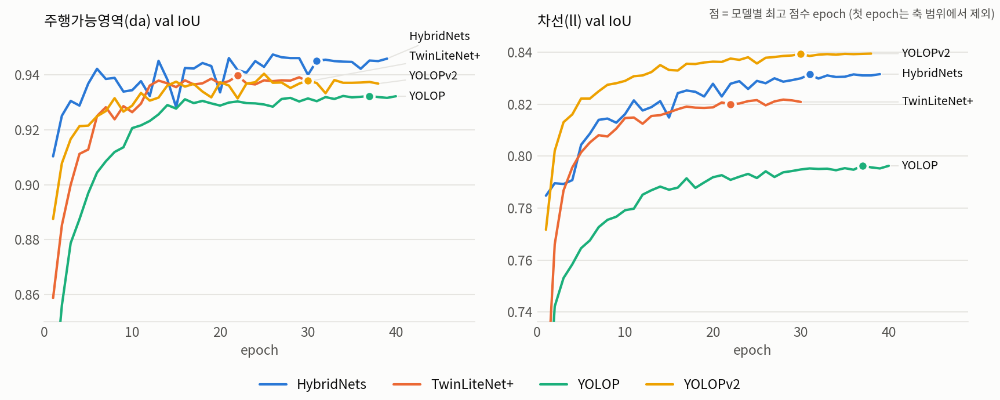
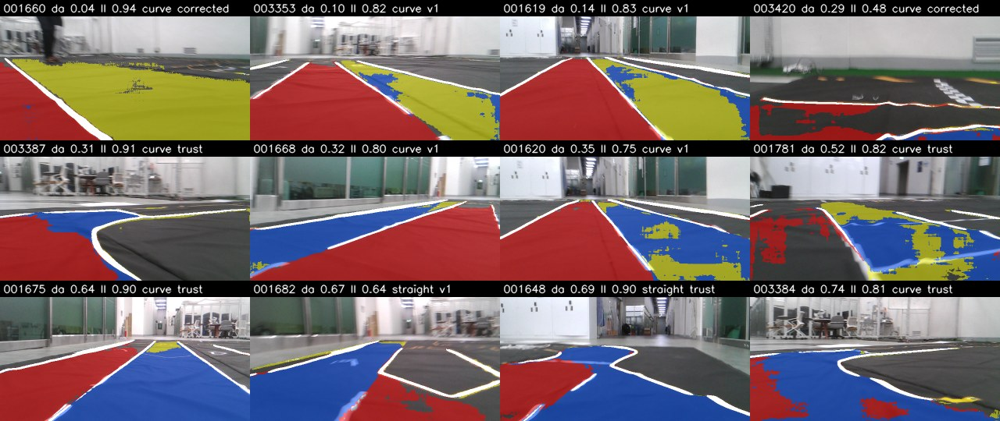
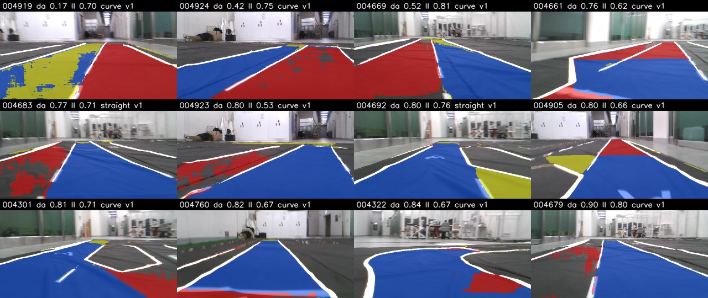
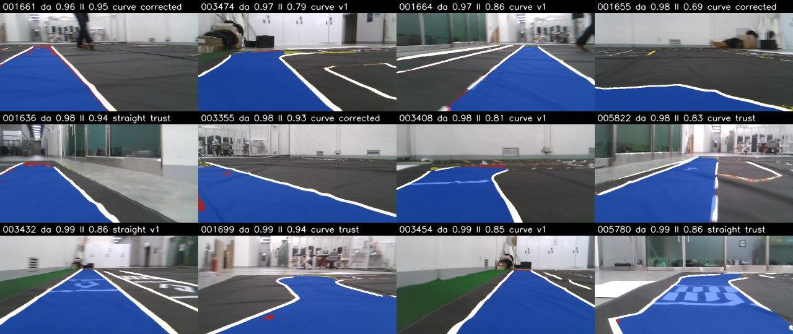
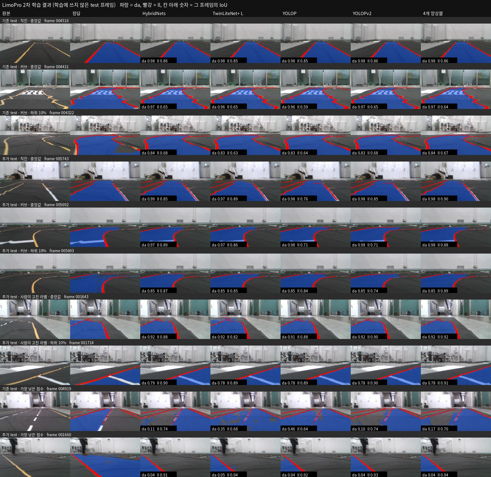

# LimoPro ego lane 2차 학습 결과

2026-10-31, FOSCAR PC(RTX 3070 Ti 8GB). 점수는 모두 IoU이고, da는 주행가능영역(내 차로), ll은 차선이다.

## 1. 결론

- **학습은 정상 완료됐다.** 4개 모델을 4시간 37분 동안 오류와 메모리 부족 없이 학습했다.
- **1차보다 낫다고 말할 수 없다.** 1차와 같은 test 268장에서 앙상블은 da 0.971 → 0.961, ll 0.809 → 0.801로 조금 떨어졌고, 커브 da는 0.947 → 0.924로 가장 많이 떨어졌다. YOLOP만 뚜렷하게 올랐다.
- **2차의 목표인 어려운 장면 개선은 아직 확인하지 못했다.** 기존 test에는 어려운 장면이 없고, 1차 가중치가 없어서 추가 test에서 1차와 직접 비교할 수 없다.
- **추가 test에서 앙상블은 da 0.935, ll 0.868이다.** 사람이 직접 고친 라벨 53장만 보면 da 0.872, ll 0.844이고, 이 값이 가장 믿을 만하다.
- **가장 눈에 띄는 약점은 차로 선택이다.** 차선은 잘 찾는데 내 차로를 정답과 반대쪽으로 고르는 프레임이 있다. 평균 점수보다 주행에 더 위험할 수 있다.
- **단일 모델은 YOLOPv2와 HybridNets가 사실상 동률로 가장 높다.** test 542장 전체에서는 앙상블이 da와 ll 모두 단일 모델보다 높다. 다만 기존 test 268장에서는 ll과 커브 da에서 YOLOPv2가 앙상블보다 조금 높다.

## 2. 데이터

16분 주행 세션 1개에서 나온 데이터다. `dataset/ego_v2`에 최윤성 검수 803장을 더한 뒤 val/test를 재분배했다.

| split | 장수 | 비율 | 커브 | 어려운 장면 | 구성 |
|---|---:|---:|---:|---:|---|
| train | 3,709 | 81.0% | 2,339 | 2,423 | 1차 라벨 + 2차 검수 |
| val | 327 | 7.1% | 169 | 149 | 기존 97 + 추가 230 |
| test | 542 | 11.8% | 264 | 180 | 기존 268(`v1`) + 추가 274(`new`) |

- 연속 프레임은 서로 거의 같아서 시간 구간 단위로 나눴다. 추가 test는 프레임 1610~1781, 3352~3496, 5671~5823이고, 추가 val은 10~121, 3786~3929, 7863~8059이다.
- 새 구간 앞뒤 30프레임의 188장은 정답 유출을 막으려고 학습에서 뺐다.
- 옆 차로까지 칠했을 수 있는 da 40% 이상 27장은 새 val/test 구간에서 뺐다. train에는 이런 라벨이 164장(4.4%) 남아 있다.
- 추가 test 274장의 라벨은 사람이 승인만 한 것 150장, 사람이 직접 고친 것 53장, 1차 라벨 71장이다.

## 3. 학습 설정과 경과

LR, 손실, 증강은 번들 설정 그대로다. AdamW, BCE + Dice(ll 가중치 2.0), 최대 40 epoch, 조기 종료 8 epoch, GPU 사용률 제한 90%다.

| 모델 | LR | batch | epoch (best) | epoch당 | 학습 시간 | 1차 시간 |
|---|---:|---:|---|---:|---:|---:|
| HybridNets | 1e-4 | **4** | 39 조기 종료 (31) | 156초 | 101분 | 35분 |
| TwinLiteNet+ Large | 5e-5 | 8 | 30 조기 종료 (22) | 114초 | 57분 | 73분 |
| YOLOP (채널별 BCE) | 1e-4 | 8 | 40 끝까지 (37) | 72초 | 48분 | 49분 |
| YOLOPv2 | 1e-5 | 8 | 38 조기 종료 (30) | 111초 | 70분 | 87분 |
| 합계 | | | | | **4시간 37분** | 약 4.1시간 |

1차는 전 모델 batch 8, train 950장, RX 9070 XT + ZLUDA였다. train이 3.9배인데 시간은 1.13배다. HybridNets만 이 PC의 메모리 때문에 batch 4로 학습해 시간이 늘었다.



val에 어려운 장면이 들어가서 1차 val 점수와 직접 비교할 수 없다. YOLOP는 40 epoch까지 점수가 조금씩 올라 아직 포화되지 않았을 수 있다.

## 4. 1차와 비교 (같은 test 268장)

`test.json`의 `v1`, `v1_curve` 그룹이다. 칸마다 1차 → 2차 순서이고, 커브는 84장, 직진은 184장이다.

| 모델 | 전체 da | 전체 ll | 커브 da | 커브 ll | 직진 da | 직진 ll |
|---|---:|---:|---:|---:|---:|---:|
| HybridNets | 0.967 → 0.958 | 0.809 → 0.802 | 0.937 → 0.916 | 0.760 → 0.750 | 0.980 → 0.978 | 0.830 → 0.824 |
| TwinLiteNet+ Large | 0.954 → 0.956 | 0.784 → 0.783 | 0.918 → 0.922 | 0.731 → 0.724 | 0.970 → 0.972 | 0.806 → 0.808 |
| YOLOP (채널별 BCE) | 0.940 → 0.946 | 0.749 → 0.769 | 0.906 → 0.907 | 0.692 → 0.715 | 0.956 → 0.965 | 0.774 → 0.791 |
| YOLOPv2 | 0.962 → 0.959 | 0.810 → 0.806 | 0.938 → 0.927 | 0.761 → 0.752 | 0.973 → 0.974 | 0.830 → 0.829 |
| **4개 앙상블** | **0.971 → 0.961** | **0.809 → 0.801** | **0.947 → 0.924** | **0.754 → 0.743** | **0.981 → 0.979** | **0.833 → 0.826** |

앙상블은 멤버 best_da 가중치로 1차와 같은 규칙을 썼다(da 확률 평균 ≥ 0.5, ll 과반 투표, 최종 da = da ∪ ll).

**점수가 떨어진 이유는 이번 학습만으로 가릴 수 없다.** 가능한 원인은 다음과 같다.

- **라벨 기준 차이:** 2차 train에는 옆 차로까지 칠한 라벨이 있고, 이 test의 정답은 내 차로만 칠해져 있다.
- **HybridNets의 batch 차이:** 1차 batch 8 → 2차 batch 4이고 LR은 같다.
- **test와 라벨 출처:** 이 test는 1차 train과 같은 방식으로 만든 쉬운 라벨이라, 1차 모델에 유리할 수 있다.

과하게 칠하는 경향은 확인됐다. 앙상블의 커브 da는 precision 0.944, recall 0.977로, 놓치는 것보다 정답 밖까지 칠하는 경우가 더 많다.

## 5. 추가 test (어려운 장면 포함)

칸마다 da / ll이다.

| 모델 | 전체 542장 | 추가 274장 | 추가 중 커브 180장 | 사람이 고친 53장 | 승인만 한 150장 |
|---|---:|---:|---:|---:|---:|
| HybridNets | 0.945 / 0.824 | 0.932 / 0.850 | 0.912 / 0.844 | 0.871 / 0.822 | 0.961 / 0.880 |
| TwinLiteNet+ Large | 0.940 / 0.810 | 0.925 / 0.842 | 0.903 / 0.837 | 0.855 / 0.811 | 0.958 / 0.876 |
| YOLOP (채널별 BCE) | 0.932 / 0.789 | 0.918 / 0.812 | 0.895 / 0.802 | 0.853 / 0.787 | 0.953 / 0.836 |
| YOLOPv2 | 0.945 / 0.828 | 0.931 / 0.854 | 0.913 / 0.847 | 0.864 / 0.823 | 0.959 / 0.891 |
| **4개 앙상블** | **0.948 / 0.832** | **0.935 / 0.868** | **0.915 / 0.864** | **0.872 / 0.844** | **0.968 / 0.909** |

**승인만 한 라벨의 점수는 부풀려져 있다.** 이 라벨은 1차 모델이 만든 것을 사람이 승인한 것이라 모델 출력과 비슷할 수밖에 없다. 같은 구간인데 앙상블 da가 승인 라벨 0.968, 고친 라벨 0.872로 0.096 차이 난다. 어려운 장면(`new_hard`, 0.941)이 쉬운 장면(`new_easy`, 0.923)보다 높게 나온 것도 이 영향으로 보인다. 어려운 장면 성능은 고친 라벨 53장 기준으로 봐야 하지만, 장수가 적어 대략적인 값이다.

## 6. 어떻게 틀리는가

평균 점수와 달리 대부분의 프레임은 잘 맞고, 소수의 프레임이 크게 틀린다.

| 앙상블 da (프레임별) | 기존 268장 | 추가 274장 |
|---|---:|---:|
| 중앙값 | 0.981 | 0.982 |
| 하위 10% | 0.951 | 0.883 |
| 0.8 미만 | 6장 | 17장 |
| 0.5 미만 | 2장 | 7장 |

아래 그림은 앙상블 결과다. 파랑은 맞게 칠한 곳, 빨강은 정답 밖까지 칠한 곳, 노랑은 놓친 곳, 흰색은 예측 차선이다. 칸 위에 프레임 번호와 점수를 적었다.

**추가 test에서 가장 나쁜 12장**



**기존 test에서 가장 나쁜 12장**



아래는 이 그림을 눈으로 보고 판단한 내용이다. 수치로 분류한 것은 아니다.

1. **차로를 반대로 고른다.** 점수가 가장 낮은 프레임 대부분이 여기에 해당한다(001660, 003353, 001619, 001668, 001620, 004919, 004924). ll 점수는 0.70~0.94로 높아서, 차선은 찾았는데 어느 쪽이 내 차로인지가 갈린 경우다. 번호가 이어지는 구간에 몰려 있어 주행 중에는 판단이 잠깐 뒤집히는 형태로 나타날 수 있다.
2. **일부는 정답 라벨이 의심스럽다.** 예를 들어 001619는 차 정면이 빨간 쪽 차로에 있어 보이는데 정답은 오른쪽 차로다. 반대로 001660은 차가 오른쪽 차로에 있어 보이는데 모델이 왼쪽을 칠했으므로 모델 쪽 오류로 보인다. 차가 차선 가까이 있거나 비스듬할 때 사람과 모델 모두 판단이 갈린다.
3. **옆 차로로 얼룩이 샌다.** 004683, 004923, 001781처럼 내 차로는 맞는데 옆 매트에 얼룩이 생긴다.
4. **옆 차로까지 넓게 칠한다.** test 정답에는 da 40% 이상이 없는데 모델은 542장 중 HybridNets 9장, TwinLiteNet+ 5장, YOLOP 10장, YOLOPv2 3장, 앙상블 7장에서 그렇게 칠했다. 면적 기준이라 급커브의 정상 예측도 일부 섞여 있을 수 있다.

5. **정답 라벨의 구멍 때문에 점수가 낮은 프레임도 있다.** 아래 몽타주의 004322, 005693은 정답 da에 구멍이나 얼룩이 있고 모델 출력이 오히려 깔끔하다. 이런 프레임에서는 모델이 맞아도 점수가 내려간다.

**보통 수준의 장면** (추가 test, 점수 30~70% 구간)



**모델별 비교 몽타주.** 행은 프레임, 열은 원본, 정답, 모델 4개, 앙상블이다. 파랑은 da, 빨강은 ll이고, 칸 아래 숫자는 그 프레임의 IoU다. 프레임은 앙상블 da 점수의 분위수로 골랐다. 주행 형태로 보려면 `images/result_driving.gif`를 연다(test 프레임 182장, 5fps, 36초).



## 7. 모델 선택

- **자동 라벨 생성에는 4개 앙상블이 맞다.** 전체 da와 ll이 단일 모델보다 모두 높다.
- **단일 모델의 점수는 YOLOPv2(0.945 / 0.828)와 HybridNets(0.945 / 0.824)가 가장 높다.**
- **차량 탑재 모델은 Jetson 속도를 재고 정해야 한다.** 지금 있는 속도 기록은 개발 PC 값이다(RX 9070 XT + ZLUDA, 640×480, forward 기준). 이 값으로 Jetson 속도를 짐작할 수는 없다.

| 모델 | 파라미터 | 개발 PC 속도 | 2차 전체 da / ll |
|---|---:|---:|---:|
| YOLOPv2 | 38.9M | 14.9 FPS | 0.945 / 0.828 |
| HybridNets | 12.8M | 25.8 FPS (640×512) | 0.945 / 0.824 |
| TwinLiteNet+ Large | 1.94M | 38.5 FPS | 0.940 / 0.810 |
| YOLOP | 7.9M | 61.2 FPS | 0.932 / 0.789 |

## 8. 한계

- **대회장 성능은 측정되지 않았다.** 데이터 전체가 같은 트랙, 같은 조명의 주행 한 번에서 나왔다.
- **급커브 평가가 부족하다.** 사람이 직접 고친 라벨이 53장뿐이다.
- **시드 1개 결과다.** ±0.01 안팎의 차이는 우연일 수 있다.
- **새 증강의 효과는 따로 재지 않았다.** `lane_gap`, `track_wrinkle`의 효과를 볼 끊긴 차선 test는 만들지 않았다.
- **val/test에 옆 차로 라벨이 조금 남아 있을 수 있다.** 면적 기준으로만 걸렀다.

## 9. 다음 할 일

1. **차로 선택 오류를 실제 주행에서 확인한다.** 주행 영상에 돌려 판단이 뒤집히는 빈도를 본다. 자주 뒤집히면 이전 프레임을 쓰는 안정화나 라벨 기준 정리를 검토한다.
2. **1차 가중치로 추가 test를 평가한다.** 2차가 어려운 장면에서 나아졌는지 직접 비교할 유일한 방법이다. 1차 가중치는 개발 PC에 있을 것으로 보이며 USB에는 없다.
3. **차량 후보 모델의 Jetson 속도를 잰다.** `scripts/benchmark_models.py`를 쓸 수 있다.
4. **의심 라벨을 다시 확인한다.** 6장의 차로 선택 프레임부터 본다.
5. **원인 분리 실험을 한다.** 옆 차로 라벨 164장을 뺀 학습, HybridNets batch 8 학습(메모리 16GB급 GPU 필요)을 각각 돌려 점수 하락의 원인을 가린다.
6. **평가 데이터를 보강한다.** 사람이 직접 라벨링한 급커브 test와 끊긴 차선 test를 만든다.
7. **최윤성 검수의 남은 477장을 합쳐 재학습한다.**

## 10. 파일과 재현 방법

| 파일 | 내용 |
|---|---|
| `results_foscar.zip` | 모델별 `best_da.pt`, `best_ll.pt`, `log.csv`, `test.json`, `train.log` |
| `eval.json` | 모델과 앙상블의 그룹별 IoU, precision, recall, 프레임별 점수 |
| `manifest_ego_v2_ys_split.csv` | 프레임별 split, 커브, 어려운 장면, 판정, 검수자, 제외 사유 |
| `코드_수정본.zip` | 이 PC에 맞게 고친 스크립트와 `CLAUDE.md` |
| `logs/` | 전체 학습 로그, 감시 로그 |
| `images/` | 이 보고서의 그림 |

작업 폴더는 `/home/foscar/2026AutoRace/LimoPro_train`이다. USB의 `LimoPro_train_bundle/LimoPro_train.zip`은 수정 전 원본이다.

```bash
# 데이터 (최윤성 zip을 풀어 둔 폴더 기준)
.venv/bin/python scripts/merge_review.py dataset/ego_v2 <review 폴더> dataset/ego_v2_ys --reviewer 최윤성
.venv/bin/python scripts/resplit_dataset.py dataset/ego_v2_ys dataset/ego_v2_ys_split \
    --test-blocks 1610 1781 3352 3496 5671 5823 --val-blocks 10 121 3786 3929 7863 8059

# 학습 (기본 데이터가 ego_v2_ys_split)
bash run_train.sh > outputs/train_all.log 2>&1

# 앙상블 평가와 그림
.venv/bin/python scripts/eval_ensemble.py
.venv/bin/python scripts/plot_val_curves.py
.venv/bin/python scripts/make_result_montage.py
```
